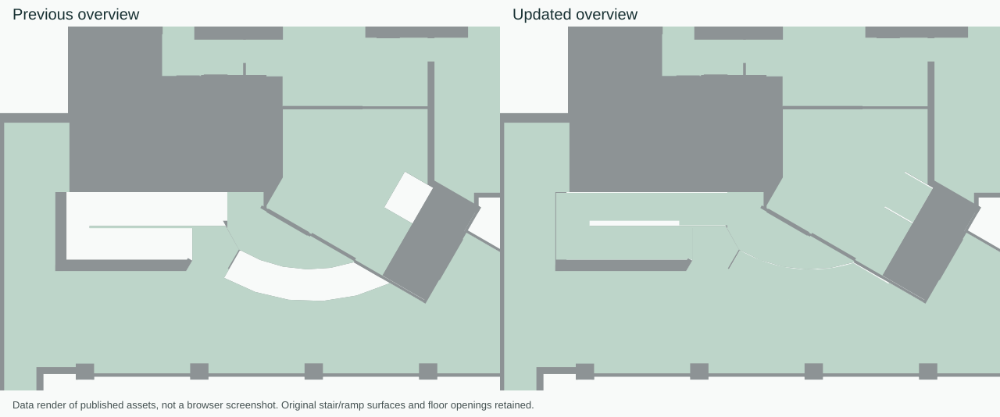
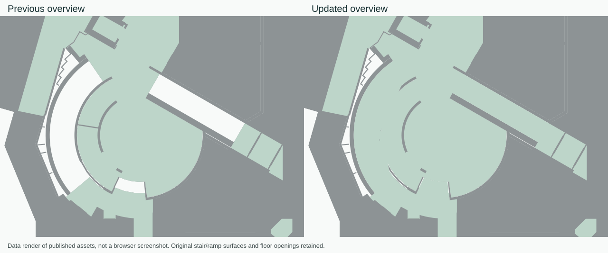

# UNBC pathway coverage and overview connector surfaces

User date: 2026-10-15 (America/Vancouver). Execution host: 2026-10-16 UTC.

Source-repair follow-up: [PATHWAY-SOURCE-REPAIR.md](PATHWAY-SOURCE-REPAIR.md). It corrects the preliminary Tea Lab / Agora causal diagnoses below and records the separate candidate rebuild. The baseline counts and published overview evidence in this report remain historical measurements.

The white crescent beside 08-S101 was a missing **curved stair display** in the progressive overview. The neighbouring U-shaped ramp is a different physical surface. The overview also omitted the original ramp display triangles near 04-124. A hallway/landing recolour cannot paint surfaces absent from the overview.

## Display changes

The seven small overview scopes now append the same original visible, ground-occluded stair polygons used by the detailed 2D floor, plus original ramp display triangles. Overhead stairs remain excluded. The full viewer already has zoom-independent native stair styling; it is preserved. Original ramps have an unlit 2D plan overlay at every zoom. No room outline, bounding rectangle, hull or inferred landing is used. All original floor/ground rings and holes, labels, native prepared chunks and physical source data stay unchanged. Connector paint authorizes no route.

The exporter includes the same connector surfaces for future packages. The 2D overlay is scoped to the selected native floors/building and is absent in 3D/source-review modes. Room reveal remains a setting and uses its existing zoom interpolation.

The main overview adds 75,516 gzip bytes (2,083,381 → 2,158,897); Brotli is 1,803,249 bytes. The overview is a separate early download; this change does not fetch every prepared floor. Superseded overview representations were removed rather than retained alongside new copies.

| Scope | Original visible stair polygons | Original ramp triangles | Gzip overview bytes |
| --- | ---: | ---: | ---: |
| Floor 1 · Main floor | 1,385 | 1,164 | 2,158,897 |
| Floor 3 | 2,558 | 0 | 1,419,844 |
| Basement | 7 | 0 | 17,305 |
| Floor 1 | 1,501 | 1,164 | 2,221,708 |
| Floor 1 · Floor 1.5 | 3,606 | 0 | 175,787 |
| Floor 2 | 3,881 | 0 | 2,004,743 |
| Floor 4 | 602 | 0 | 1,160,120 |

The images below render the actual new overview polygons and low-zoom palette. They are **data renders, not browser screenshots**. Original unsupported openings remain empty; filling all remaining white shapes would invent floor support.




## Exhaustive graph coverage

All 1,855 eligible destination identities were audited as both origin and destination, including the optional pass-through/circulation choices. The default visitor subset has 1,622 places. Both public walking and step-free profiles were checked. Each of the 1,855 origins under each profile was compared with the original runtime `reachableProjectDestinations` function; every result matched. There are also 1,855 same-place cases handled directly by the UI.

| Profile | Directed, nonself pairs | Reachable | Unavailable |
| --- | ---: | ---: | ---: |
| Walking | 3,439,170 | 2,332,104 | 1,107,066 |
| Step-free | 3,439,170 | 8 | 3,439,162 |
| Total | 6,878,340 | 2,332,112 | 4,546,228 |

This is exhaustive **graph reachability**, not 6.88 million individually centered routes, instruction sets, rendered lines or browser interactions. Unavailable results include disconnected source components, missing approaches and legitimate restrictions. They are not all software failures. There are also 40 destinations with declared arrivals but no public path to another eligible destination; these are listed separately in `isolated-with-arrival.csv`. They are additional to the 115 missing entrances. The very limited step-free coverage reflects missing/negative original accessibility evidence, not a decision to silently treat unknown edges as accessible.

The compressed bitsets store one row per endpoint in `endpoint-inventory.json.gz` order, 232 bytes per row. Destination `j` uses byte `j >> 3`, bit `j & 7`; the diagonal is omitted. The complete original-oracle audit, per-origin counts and policy blockers are in `all-pairs-full-oracle-audit.json.gz`.

## Actual navigation calculations

The production `published-route-calculation.worker.ts` and `RouteWorkerClient` exercised all 48 enabled vertical connections: 43 lift links, four ramp links and one local-steps link. Every link was requested upward/downward under both profiles: **192 cases**, none skipped or unmapped.

- 96 walking requests returned routes.
- Four step-free requests returned routes; 92 correctly returned unavailable under the current policies.
- All 100 returned routes used the intended connector. Arrival identities, finite path coordinates, instruction generation, enabled-edge use and step-free restrictions passed.
- No test assertion failed. One worker allocation served the run; maximum sampled worker heap was about 644 MiB under an actual 960 MiB V8 heap limit (768 MiB old-generation cap).

This Node-worker test uses the production calculator and filesystem transport. It does not reproduce WebGL, browser memory limits, mobile devices or network latency. It does not hold a full decoded display floor resident. The separate earlier resident-floor test remains separate evidence. It is not proof that every phone/browser crash is resolved.

## Blocker investigation and safe fixes

Fresh original physical validation rechecked **5,226 walking edges and 1,561 door edges**. It confirmed the same six unsupported walking links and one doorway crossing a native floor opening; the routing dataset hash was unchanged after validation. Their exact edge IDs, path points and source bounds are saved in the physical evidence files.

| Family | Finding | Disposition / required repair |
| --- | --- | --- |
| 115 missing entrances | Old canonical arrival seed nodes exist, but no enabled native walking approach reaches them. The compiler intentionally withholds `arrivalNodeId`. 68 have related native door records; a door record alone does not establish a usable approach. | UI now refuses these complete endpoint selections immediately with a visitor-facing unavailable-entrance message. Recover physical doors/cells/approaches in the compiler; regenerate and revalidate before restoring arrivals. Full identity list: `missing-entrances.csv`; original source detail: `missing-arrival-triage.json.gz`. |
| Four walking links at Agora / 08-159 | Recovered virtual seam points lie outside native cell `native-cell:3.280840:415`. | Fix the evidenced source seam/approach and regenerate. A path straightener cannot repair an unsupported fixed endpoint. |
| Two walking links near 05-S304 | Door 1920744 points lie outside native cell `native-cell:24.278215:938`. | Recover the real measured doorway/floor approach. Keep exact floor checks active. |
| One doorway at 08 Tea Lab | Its prepared path intersects a real native floor opening. | Resolve the physical approach/source door ownership; do not fill the opening for routing. |
| 28 held stair links | All remain disabled and unqualified under the original source-body/terminal/clearance checks. Source-proof and disabled counts describe the same 28 links. | Complete the source-bound stair review and regenerate. Displayed treads are not clearance evidence; see the separate stair follow-up. |
| 12 staff policy blockers; one off-limits blocker | Access rules, not geometry paint defects. | Retain the original restrictions. |
| 7,059 step-free policy blockers | Those edges are not confirmed accessible under the current original metadata; some are explicitly disallowed. | Gather slope/width/threshold/lift evidence and retain explicit negative restrictions. Unknown is not automatically yes. |

No missing link was invented, no access flag was loosened, no held stair was enabled and no native aperture was filled to obtain a passing result. The remaining blockers require source evidence/compiler repairs; this work does **not** claim that every pathway now works.

## Reproduction and verification

The reusable read-only CLI is `scripts/indoor/audit-all-pairs-published.ts`. It accepts an immutable visitor ZIP and the exactly publisher-pinned routing cache, refuses an unrecognized snapshot, checks every origin against the original reachability oracle, writes the matrices/reports and verifies the source projection hash is unchanged. Use the ordinary source audit for non-pinned projects.

```sh
node --max-old-space-size=4096 --expose-gc --import tsx   scripts/indoor/audit-all-pairs-published.ts INPUT.campus-viewer.zip   --routing-cache CHECKED.json.gz --out NEW_AUDIT_DIRECTORY
```

The saved CLI was then freshly run to completion in 267,248 ms: both matrices and the endpoint inventory were byte-identical to the first complete oracle audit, and every per-origin/profile result and blocker matched. The source projection remained unchanged.

Verification: 50 focused unit tests passed; the scoped application/exporter/audit typecheck passed; the hospital-inclusive production build passed. The actual core/progressive client integration imported the pinned visitor ZIP, loaded only the selected Main-floor assets, installed 2,128 native regions and fetched no routing data or other floor details. Its default in-process conservative decoder run is an integration check, not a browser or fast-worker timing benchmark. A separate final pinned decoder check loaded Main-floor details in 5,017 ms locally, then independently rehashed the complete 349,125,903-byte logical payload to the unchanged original digest. All 228 current transport files were also checked against their manifest hashes/lengths, with zero unreferenced overview files. These local timings are not browser timing promises. All seven overview replacements preserve every preexisting geometry feature and the original floor/ground/labels/binding. Both transport encodings were round-tripped and verified; all non-overview asset descriptors were compared unchanged. The source model/master and prepared physical/navigation geometry are not edited by these changes.

The required desktop/mobile browser proof could not be obtained because this session has no supported browser-control capability. The included images are explicitly labelled data renders. Browser crash/reflow/interaction verification remains outstanding.

## Publication binding

- Visitor package: `6cb0ff0f40efd478d3058da29fa2a1bcd3cb16419042f3d5b8567c9c7f7cee22`.
- Source dataset: `f4761c369fd010e48b95e18a467b3adae76723220523b4cf54821f10bc2cafd8`.
- Routing projection: `a7f91256cb2bbd8c6951d7fdab154d7f104c5e0c4bd0100b7e2abb1202cd3ddd`.
- Prepared engine unchanged: `681e71a5b49b7ac79d914f79624be41cea860778d5732289cd2a445e7c2a0d8d`.
- Previous progressive revision: `ce04f9a8f556d5383968d68b25b52a3ba1bd72d8877d09f1275756aefa5057c3`.
- New overview-bearing revision: `c2a275a008cf4c578da9f9f7ec547afa82241ed0a2f0d9220a95697c18c5a3d1`.

Both compiled publication and paint-review receipts now bind the new manifest revision; exact prepared-floor and routing cache hashes are unchanged. Embedded original floor-projection provenance still identifies the unchanged native floor mask; the additional connector features carry their original stair/ramp element IDs and source model digest. Reload the full viewer after publication so the client and manifest use the same checked revision.
