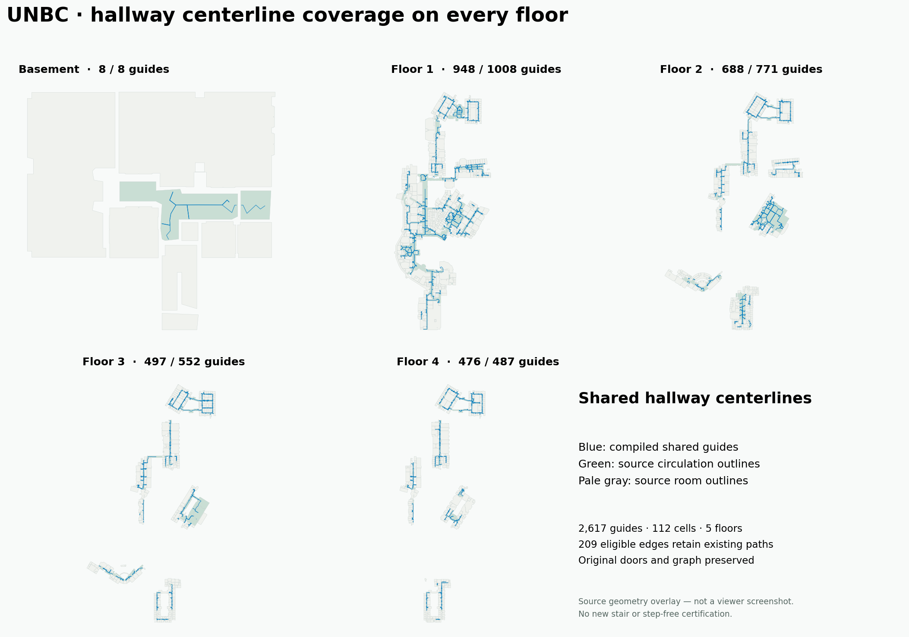
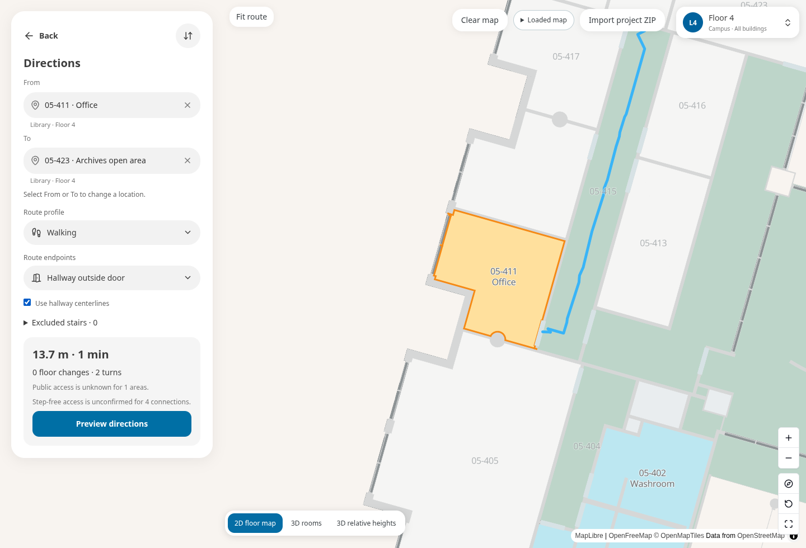

# Shared hallway centerlines on every UNBC floor

The implementation now generates one shared auxiliary corridor network per independently supported physical component, with branches to the original doorway/arrival coordinates. Route queries reuse the same shared chains. Islands retain alternatives; junctions retain their branches. The original source graph, nodes, ownership, door thresholds, source geometry and enabled/disabled connections remain unchanged.

This supersedes the limited 05-415 proposal in REPORT.md. It does not supersede the October 16 source rebuild hold or resolve missing entrances, held stairs, outdoor-stair evidence or step-free coverage.

## Package and provenance

Input: the existing published visitor ZIP, 45,290,239 bytes, SHA-256 `6cb0ff0f40efd478d3058da29fa2a1bcd3cb16419042f3d5b8567c9c7f7cee22`.

Model: `8c294549ee667ed7aba38f1f4f3a53514dae7544af97f0157ee8187dd8702178`.

Candidate: `UNBC.shared-corridors.campus-viewer.zip`, 45,513,613 bytes (45.51 MB decimal; 43.41 MiB), SHA-256 `e2f8c31879a47c56663724b4d869c8702c7592a807c8e952a346d472bb8d632b`.

Candidate indoor JSON SHA-256: `9ef19fd31808958dc45420459ae469b94ac38af45afd2fb1bf518aaa249c1d00`.

The candidate adds 223,374 compressed bytes (0.49%). It is a derived visitor package with unchanged source geometry, not a regenerated authoring master. No geometry or display simplification is inferred from the smaller shared network. Guides are currently stored per original edge; deduplicating their shared chains into a future transport format is a separate optimization.

## Coverage

| Campus floor | Shared guides | Eligible planar hallway walking edges | Existing-path fallbacks |
| --- | ---: | ---: | ---: |
| Basement | 8 | 8 | 0 |
| Floor 1 | 948 | 1,008 | 60 |
| Floor 2 | 688 | 771 | 83 |
| Floor 3 | 497 | 552 | 55 |
| Floor 4 | 476 | 487 | 11 |
| Total | 2,617 | 2,826 | 209 |

All 112 eligible cells were enumerated across eight physical elevations; no sampling budget was exceeded. They contain 118 exact physical components. Eligible means enabled native-cell walking edges between walkable circulation owners, on exactly the same native level and elevation, with no staff endpoint. The other 2,400 enabled walking edges retain the original solver by design. Vertical connectors, rooms and accessibility confirmations are unchanged.

155 eligible edges had no supported shared route; 54 failed the final distance/planar-width gate. These counts describe centerline refusals, not newly broken destinations. None is a coincident-endpoint alias. Uncertain cases retain the original route solver. The full per-cell report retains their original edge IDs for targeted follow-up.



This figure is an analytical overlay of source outlines and generated guides, not a viewer screenshot or proof of complete raised rooms.

## Physical and policy checks

Boundary sampling and Delaunay/Voronoi construction only propose an auxiliary network. Every used shared chain and terminal branch must pass continuous exact rational two-foot planar strip support against independently checked native floor/material geometry. Positive holes, thin obstacles and access exclusions remain. Terminal branches may use only that original terminal's checked finite doorway half; the opposite half does not authorize a crossing.

Shared chain fitting stays within 0.15 ft of its proposal and rechecks the entire strip. It preserves original terminal coordinates exactly. A runtime consumer binds guides to the complete source geometry/access snapshot, rechecks support and actual original doorway/opening crossings, and falls back when the guide fails. The two-foot planar check is not a headroom or wheelchair certificate.

The public directions panel adds **Use hallway centerlines**, on by default when the package has these guides, with a reversible per-model preference. Switching this preference reuses the worker graph. Confirmed step-free routes continue to use their original geometry. An older app that does not support resolver version 2 ignores these guides and retains existing routing.

## Efficient iteration

Run a targeted candidate after changing an approach or cell algorithm:

```sh
node --max-old-space-size=6144 --import tsx scripts/indoor/compile-corridor-candidates.ts INPUT.campus-viewer.zip NEW_OUTPUT_DIRECTORY --cell ORIGINAL_CELL_ID
```

This checks package hashes and current physical dependencies, emits candidate diagnostics, and does not grant publication/cache authority. It never restores per-cell authority under a different producer binding. Full-map compilation ran once, in 588.4 seconds; the previously problematic 05-415 cell compiled all 11 walking edges and attached all seven original door ends plus its arrival.

After stable candidates, perform the complete source import once, export, independently check the ZIP and exact data/source-asset parity, then replay actual navigation using a resident graph:

```sh
node --max-old-space-size=6144 --import tsx scripts/indoor/prepare-routing.ts INPUT.campus-viewer.zip OUTPUT.campus-viewer.zip --guides-from CANDIDATES/prepared-routing.json --verify-navigation
```

The accepted source import took 287.2 seconds. Export/independent transport checks took 27.9 seconds. This avoids repeating the entire importer for unchanged exported geometry. Do not re-label old published validation or display receipts: the consumer engine binding changed, so old publication caches remain stale.

## Acceptance status

- 24 focused compiler, guide binding, thin-obstacle/island/T-junction, exact endpoint, own-door-half, preference/cache and publication-binding tests passed.
- 29 existing hallway-routing/prepared-guide/viewer-centering regressions passed; 27 native-circulation tests passed. Full TypeScript checking, touched-file lint and the Pages build passed.
- **51 actual calculator comparisons passed**, using the same resident graph with the setting both on and off. All 50 public-review requests returned routes; the step-free request stayed blocked in both settings. These are geometry/policy comparisons, not new public-access certifications or an exhaustive all-destination acceptance.
- The 42 ordered pairs among 05-411/412/413/414/416/417/423 all retained availability. 32 used shared guides. Ten involving 05-414 initially fell back during the full composite runtime check. A subsequent targeted repair, described below, retains checked guides when that journey splits at its fixed doorway.
- A real shared-guide route succeeded on each floor: 10-B500 → 10-B510, 09-218 → 09-260, 06-214 → 06-244, 10-3564 → 10-3588 and 04-402 → 04-423.
- 05-136 → 05-173 succeeded, and 05-143 ↔ 05-242 succeeded through the existing Library lift in both directions. All 28 held stair edges remained disabled. Original nodes, edges and records stayed identical.
- Cold graph preparation and the first route took 283.3 seconds. Subsequent public-review queries had a 0.164-second median and 9.02-second maximum in this sample. The long same-floor query took 9.02 seconds with shared guides versus 19.89 seconds with existing refinement; this is one local run, not a general speed guarantee. The short cold CPU sample was dominated by exact rational overlay arithmetic within graph preparation.
- The actual route geometry and comparisons are recorded in [all-floors-navigation.json](all-floors-navigation.json). The desktop/mobile browser check passed after correcting the cache assertion described below. The live publication remains unchanged.

## Targeted repair after the first acceptance

The fixed-door fallback previously refined each walking side without passing its prepared guide. It now composes each side through the same source-bound guide and original graph orientation checks. A qualified shared path also bypasses later generic join/junction adjustments, preserving the shared chain, its original anchors and its stated width check. The doorway itself stays fixed.

[Ten actual 05-414 route chains were replayed](split-fallback-navigation.json) over the complete accepted ZIP and current physical/passage checks. All ten now retain two shared walking paths; all original graph endpoints and original directed door segments remain exact. This uses graph identities, because the legacy centering could slide an arrival inside a circulation area. It does not move a source node to match that older rendering.

The replay took approximately 70 seconds, with no full-floor compilation, source edits or policy graph rebuild. It does not grant publication/cache authority. Sixty-five centering/guide/engine-binding tests then passed. The candidate ZIP and all 2,617 guide proposals remain unchanged. Current consumer engine: `c84533ab1a73ca6b141b1917fb5a3ee6f6288337af18a8774aa88d141f2f1daf`. The earlier complete 51-pair record is explicitly bound to engine `eb046d3386d6bf5aa78890a7f4f25153c5b8c183114440ff20379e448b07fd18`; do not relabel that record or its preparation assets under the new engine.

```sh
node --max-old-space-size=6144 --import tsx scripts/indoor/audit-corridor-refinement.ts ACCEPTED.zip ACCEPTED.zip.routing-report.json PRIOR-NAVIGATION.json REPLAY.json
```

The first desktop browser run drew the real UNBC shared route and reused the same worker when switching off. Its test then incorrectly waited for a new worker message when switching back on, although the client correctly restored its completed result. The test now checks the restored UI result instead. The corrected desktop/mobile run passed in approximately 12.4 minutes, with no page errors, the same worker on/off, cached shared-route restoration and an in-viewport mobile setting. This cold functional run is not a loading-time target or speed improvement. Browser examples cover the unchanged 05-411 → 05-423 route; the later doorway-split behavior has the separate current-engine replay above.



[Browser proof and image checksums](browser-proof.json) and [actual worker replies](browser-routes.json) are retained. [Desktop directions](viewer-desktop-directions.png), [mobile directions](viewer-mobile-directions.png) and [mobile setting](viewer-mobile-setting.png) show the real viewer, not an overlay.

## Continuing in another workspace

For this routing-style work, use the repository implementation and the 45.51 MB visitor candidate above. The RVT/evidence development archive is not needed to replay these unchanged source routes. The local candidate is `/workspace/scratch/unbc-centerline-all-floors/UNBC.shared-corridors.campus-viewer.zip`. Keep its SHA-256 when copying it.

Native stair/enclosure/source repairs still require the original authoring evidence and the October 16 handoff; this visitor package cannot replace those inputs. The old native source rebuild remains failed. No Site deployment or main-branch promotion occurred in this work.

## Follow-up

1. Inspect each refused cell using its original floor/material/access context; test the affected terminal pair and physical dependencies only. Do not widen the strip, move endpoints or remove genuine obstacles to improve a percentage.
2. Deduplicate shared-chain storage with original edge-to-chain references, preserving source graph identities and exact terminal branches. Measure before replacing the current portable guide representation.
3. Profile the cold graph preparation independently of route shape. Shared guides do not remove cold source validation or prove faster first navigation.
4. Continue the October 16 source repair queue separately. All 28 held stair links stay disabled; the failed source rebuild has not been promoted.
