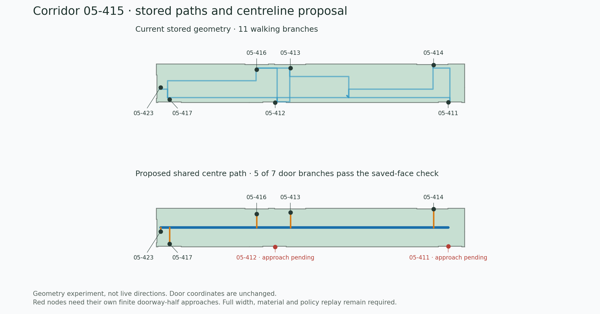

# Package audit and shared corridor paths — October 17

The published visitor ZIP was freshly recovered through the existing private
Site and verified against every part and the complete publication descriptor.
It is still the October 15 geometry export. No Site, source geometry, routing
graph, access review, preparation receipt or package was changed by this work.
The earlier 629 MB development/evidence handoff is a different artifact; it is
not the visitor download and was not present or re-audited in this workspace.

## What was inspected

- Visitor ZIP: **45,290,239 bytes**, SHA-256
  `6cb0ff0f40efd478d3058da29fa2a1bcd3cb16419042f3d5b8567c9c7f7cee22`.
- Indoor JSON: **229,156,273 bytes**, SHA-256
  `f4761c369fd010e48b95e18a467b3adae76723220523b4cf54821f10bc2cafd8`.
- 1,864 records, 5,476 nodes and 7,063 edges, including 5,226 enabled walking
  edges. All 28 held stair edges are still disabled.
- The supplied [Drive references](https://drive.google.com/drive/folders/1HDD6R_6g5BAwEF0F6zKct4NkUON1d_q9):
  listed all five files, downloaded `Indoor Map.zip` and the Pointr HAR, inspected
  their inventories and recorded route responses. No captured request or
  credential was replayed. The checked-in hospital and Harrods datasets were
  also measured. This was not a fresh interactive visit to each reference site.

The package and saved exact-topology descriptor hashes were checked. This was
**a structural audit and one-cell geometry experiment**, not a full import,
current physical/policy validation, every-room route test or new acceptance.

## Further size opportunities

Sizes below use `JSON.stringify` on parsed field values. Each field is compressed
independently with gzip level 6; the compressed sizes **cannot be added to obtain
the original ZIP size or promised export savings**. MB means 1,000,000 bytes.
Exact numbers are in [package-audit.json](package-audit.json).

| Section                                         | Reserialized JSON | Independent gzip |
| ----------------------------------------------- | ----------------: | ---------------: |
| Native selection mapping, nine saved levels     |          56.64 MB |         12.09 MB |
| Native material sections, 24 saved cuts         |          41.01 MB |          8.24 MB |
| Circulation geometry and exact/display topology |          40.57 MB |          8.97 MB |
| Corner seals and associated evidence            |          30.10 MB |          4.72 MB |
| Window display                                  |          22.65 MB |          1.55 MB |
| Entire edge table, including evidence/metadata  |           7.30 MB |          0.71 MB |
| Walking-edge coordinates alone                  |           1.41 MB |          0.28 MB |

Two additional hypothetical pooling codecs were measured and reversed:

- `nativeProvisionalCornerSeals.rows[].sourceFloorBindings`: **3,200 uses,
  56 distinct values**, 12,665,220 repeated serialized value bytes. The complete
  seal section changes from 30.10 to **17.47 MB JSON**, and from 4.72 to
  **3.73 MB independent gzip**, including the experimental pool/references.
- `nativeMaterialSections.levels[].sourceElementIds`: 24 uses, 20 distinct
  values; 1.11 MB repeated serialized values. The complete material section
  changes from 41.01 to **39.91 MB JSON**, and from 8.24 to **7.89 MB gzip**.

Both experiments restore identical reserialized parent JSON, including property
order and parsed IEEE values. They do not prove preservation of original raw
JSON number spelling or a production decoder. No native evidence was deleted.
A real codec must restore the original binding representation, keep validation
unchanged and pass package/worker round trips. Shared decoded objects must be
immutable in workers; authoring edits must not accidentally mutate aliases.

The current source's `routeWorkerDataset` projection still serializes to
**116.50 MB JSON / 22.71 MB independent gzip** on this map, despite already
omitting selection mapping, windows and major render data. See
[route-worker-projection.json](route-worker-projection.json). This measures the
current source function, not startup latency or the older deployed engine.

Therefore centerlines chiefly target route consistency and computation. They
will not remove most of the 45 MB download. The larger delivery opportunity is
floor-scoped display/picking data, immutable pooled physical evidence and
preparation bound to the accepted dataset/engine. The full viewer ZIP currently
contains all saved levels; this does not mean they are all rendered at once.

The current package has **no `preparedRouting` walking guides**. That optional
compiler already exists; see [prepared walking guides](../../../prepared-walking-guides.md).
Its old October 3 performance measurements are historical, not new measurements
on this package. Do not relabel historical guides or preparation authority.

## Reference comparison and desired routing

The hospital reproduction contains 4,968 authored corridor line features. The
Harrods reproduction contains 81,772 corridor lines marked `inferred`; its dense
grid is not a compact corridor backbone to copy. The Pointr HAR contains two
successful recorded route responses: 137.21 m with 103 node features/eight
direction features, and 116.21 m with 64 node features/five direction features.
A smooth-looking route therefore need not have only two coordinates. Counts,
source hashes and the two empty HTTP 204 responses are retained in
[reference-audit.json](reference-audit.json).

The UNBC compiler's `buildIndoorGrid` uses a 0.6-foot, wall-aligned grid and
multi-source wavefronts between neighboring terminals. The saved branches keep
their original door/arrival endpoints; runtime centering refines selected
journeys. This is not a single precomputed shared corridor network.

The proposed behavior is:

1. Derive one reusable center path for each continuous corridor branch from the
   exact floor/free-space domain. Preserve branches at junctions and both valid
   alternatives around islands, holes or obstructions. A large physical cell
   is not automatically one hallway or one public policy region.
2. Join original admitted hallway-side door nodes with short supported
   approaches, preferably perpendicular. A portal inside wall thickness needs
   **its own finite doorway-half support**. Never borrow another doorway,
   move a door node, cross an ordinary room or join equal coordinates by identity.
3. Select the destination's best eligible entrance by complete reachable route
   cost, including its door branch. Euclidean proximity alone cannot choose a
   door across a wall, restriction or floor. The existing hallway endpoint
   selection already handles multiple eligible entrances and direction.
4. Keep original stair/lift/ramp anchors, physical elevations, access, direction,
   unknown-access warnings and step-free qualification. A planar centerline
   grants no new stair, accessibility or clearance approval.

Use an **authoring/export option** for `existing guides` versus `shared corridor
guides`, with an immutable candidate and comparison report. Keep source
geometry and the existing graph recoverable. The current hallway/inside-room
endpoint preference is separate. This export option is a recommendation; no
new visitor setting has been added.

## Actual bounded prototype: corridor 05-415



The figure uses actual saved UNBC geometry, not a browser screenshot or an
invented floorplan. Source cell `native-cell:34.120735:1199` has 11 walking
branches, 58 coordinate uses and seven connected room-door nodes.

The prototype supplies one straight center-run candidate and retains every
original terminal/door ID. It checks continuous support using the saved exact
source face: **one run and five door branches pass**. Nodes for **05-411 and
05-412** lie outside that pure face, so their branches remain unattached by this
deliberately narrow check. This does not establish that those existing doors or
routes are broken: their own finite doorway-half approaches were not included.
The full-width walking strip, original material/clearance and route policy were
not replayed. No new route was calculated or enabled.

[corridor-proposal.json](corridor-proposal.json) retains the fixed endpoints,
candidate run, refusals, original paths, exact-topology identity and explicit
limits. `proposeCorridorBackbone` requires a support callback, filters original
owner/level/elevation, and returns `proposal-only` with `graphChanged: false`.
It is not called by the production viewer or compiler. Automatic medial-axis
extraction, junction graph assembly and production guide serialization are not
implemented by this prototype; the command tests a narrow straight-run proposal.

## Targeted checks and next step

**17 tests pass**, including five new proposal tests and the existing hallway
endpoint/lane families. Cases include shared perpendicular branches, a real
hole with supported endpoints, a thin wall, an obstructed nearer projection,
foreign ownership, floor/split-height mismatch, fixed source identities,
door direction, accessibility and ordinary-room fallback. The scoped TypeScript
check passes. No app UI changed, so this figure is analysis output rather than
desktop/mobile viewer acceptance. No full campus rebuild was started.

For the next implementation iteration, stay on this corridor:

1. Adapt the existing source-bound own-door-half query for the two original
   portal nodes; keep complete support and foreign material context on their
   physical elevation. Do not extend the corridor polygon or relax support.
2. Validate every proposed branch's full-width strip, native material, original
   ownership and policy. Retain the original arrival node and its connection.
3. After all seven approaches qualify, calculate the **42 ordered door pairs**,
   applicable route profiles and adjoining connector approaches. Compare
   availability, door IDs, restrictions and continuity with the original graph.
4. Then cover a T junction, a loop/island and curved/wide circulation. Compile
   shared guides once per supported scope. Reuse existing IDs/edge checks where
   possible; a topology/weight change needs a regenerated coherent candidate.
5. Batch stable work before one required full preservation/navigation/export
   acceptance. The failed source rebuild's two lost arrivals and all held-stair
   evidence gates remain separate outstanding work in the October 16 handoff.

## Reproduce

From OpenIndoorMaps with its lockfile dependencies installed:

```sh
node --import tsx --test --test-concurrency=1 \
  tests/unit/corridor-backbone-proposal.test.ts \
  tests/unit/hallway-routing.test.ts tests/unit/viewer-route-lanes.test.ts
node --max-old-space-size=4096 --import tsx \
  scripts/indoor/audit-corridor-package.ts /absolute/UNBC.campus-viewer.zip \
  /absolute/new-diagnostic-folder --cell native-cell:34.120735:1199
python3 scripts/indoor/audit-reference-networks.py \
  /absolute/reference-audit.json /absolute/v9.pointr.express.har
python3 scripts/indoor/render-corridor-proposal.py \
  /absolute/new-diagnostic-folder/corridor-proposal.json /absolute/corridor.png
```

The two Python tools need no network; plotting requires Matplotlib. The package
audit does not overwrite its input or produce an importable map. Outputs are
diagnostics, not validation receipts. Large original ZIP/JSON/HAR files remain
outside Git under `/workspace/scratch`.
