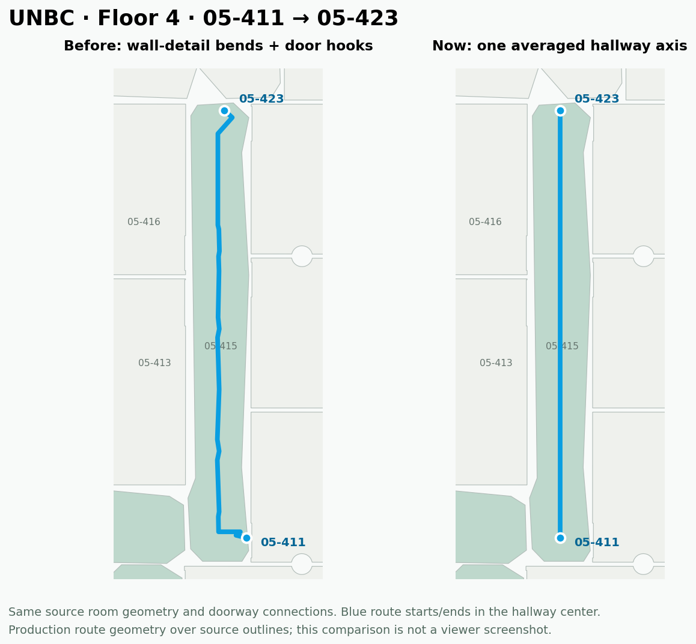

# Averaged hallway axes and centerline endpoints

The earlier shared network followed small wall recesses and retained the full
door approaches in the displayed route. That produced small changes of heading
along the otherwise straight 05-415 hall, plus hooks at both ends of
05-411 → 05-423. The new compiler proposes one averaged axis for a straight,
elongated physical component. Hallway directions use its checked center joins
as their displayed start and finish. Original source nodes, edges, doorways,
directions, ownership, source geometry and access states remain unchanged.



This is an analytical overlay of production route geometry on source outlines,
not a browser screenshot. The old route has 21 vertices; the new displayed
route has two. Its walking distance is approximately 12.49 m, measured between
the hallway-center stops. The separately preserved door approaches account for
the removed portion of the displayed walk.

## Fitting and physical checks

`corridor-straight-axis.ts` uses polygon area moments to propose a dominant
orientation, then fits a line to regularly spaced cross-section midpoints.
This avoids weighting a finely tessellated/recessed wall more heavily than the
opposite wall. Both diagonal and axis-aligned hallways use their actual native
orientation. This does not move or simplify a room boundary.

The straight proposal is limited to elongated components with one continuous
interval at every sampled cross-section and no more than 0.75 ft deviation of
section midpoints from the fitted axis. Junctions, strong curves, holes and
genuine bends retain the general shared network. Sampling is only proposal
generation: every used axis segment, original doorway approach and complete
per-edge guide must pass the current exact continuous two-foot planar strip
check. Each terminal may use only its original finite doorway half.

Small floating-point differences between projections on the same axis are
removed before runtime physical and crossing checks. This numeric cleanup has
no authority to cut an obstacle or skip a real doorway. Source graph identities
and both original outer anchors stay in every stored guide.

Prepared resolver `native-walking-guides-3` adds `hallwayJoins` indices to each
full guide. Older resolver versions fall back to ordinary routing. The viewer
trims only a route's two outer approaches, only when those joins actually occur
in its currently checked shared path. It retains each chosen door point and
approach in `departure.hallwayCenter` / `arrival.hallwayCenter`; internal
doorways and all floor transitions remain in the route. Distance, start/finish
markers and instructions use the same displayed endpoints. Missing or
coincident usable stops conservatively retain the original outside-door walk.

The existing **Use hallway centerlines** option remains reversible and scoped
to the model. **Inside room** and **At doorway** keep their original endpoint
semantics. Turning centerlines off restores the ordinary hallway-side walk.
Step-free routes retain their separately approved geometry. None of the 28
held stairs is enabled by this change.

## Targeted verification

All 21 eligible walking edges in 05-415 and the adjoining fixed-door cell
compiled in the first scoped candidate. All eight original terminals in
05-415 attach to the averaged axis. Forty-two saved actual route chains were
then replayed against the complete source physical and policy context: all
passed. Thirty are now one straight displayed segment; the twelve involving
05-414 retain their genuine adjoining-cell turns. Both directions of
05-411 ↔ 05-423 have exactly two displayed vertices and centerline stops. The
fixed native doorway and original full-route anchors remain exact before the
two display endpoints are shortened.

[Targeted replay](targeted-replay.json) is explicitly a refinement diagnostic,
not a fresh policy-graph approval or publication cache. It records consumer
engine `50ae4a3aeca0060c1ac8e483fb1d01f4e1102324eb324a3c0b3a70ccdff7663a`;
subsequent lint-only zero-length-condition spelling changed the final engine
binding without changing the algorithm. Preserve the recorded binding.

```sh
node --import tsx scripts/indoor/compile-corridor-candidates.ts \
  INPUT.campus-viewer.zip EMPTY_CANDIDATE_DIR \
  --cell native-cell:34.120735:1199 --cell native-cell:34.120735:1204

node --import tsx scripts/indoor/audit-corridor-endpoints.ts \
  INPUT.campus-viewer.zip EMPTY_CANDIDATE_DIR/prepared-routing.json \
  PRIOR_ACTUAL_NAVIGATION.json REPLAY.json
```

The 25 focused axis/shared-guide/hallway tests pass, including straight halls
with recesses, L/T/curved halls, island alternatives, a positive thin obstacle,
both route directions, preserved door branches and correct center-stop
instructions. The 65 related centering, guide binding and preparation-engine
tests also pass, alongside the full TypeScript check and production build.

## Complete candidate and preservation

The final compiler enumerated all 112 cells / 118 physical components on all
five campus floors and eight physical elevations. It compiled the same
2,617 / 2,826 eligible walking edges as the prior candidate; 209 keep existing
refinement. Four components proposed a single averaged axis, including 05-415.
The others retain their branched/bent shared networks. This does not claim
that every straight-looking sub-run in a large, connected campus component
has already been reduced to one axis.

[Compilation counts and refusals](all-floors-compilation.json) retain their
original cell/edge identities. The run took 755.2 seconds while source
validation ran concurrently. These are local functional timings, not a speed
comparison. The initial source validation took 425.9 seconds; the reported
package preparation interval includes waiting for the compiler, not just
calculation.

The complete source import, current guide binding, exact parsed ZIP round trip
and unchanged source-asset comparison passed. The [package receipt](package.json)
records:

- Candidate: `UNBC.straight-hallways.campus-viewer.zip`, **45,519,753 bytes**
  (45.52 MB decimal), SHA-256
  `09d35032a47d4cde544207c5a83f28c061750dfdaf2b32e07f042362c164658a`.
- Indoor JSON SHA-256:
  `87194bb96ce4564699f5fb431ef00917fae93181f5730fe3e5f7056c1ca6ca1b`.
- Unchanged source model SHA-256:
  `8c294549ee667ed7aba38f1f4f3a53514dae7544af97f0157ee8187dd8702178`.
- Final runtime preparation engine:
  `aaa335577ffdeb27b45b1b405d94c49a673dc7a36cbd46f3bbc463e202265bda`.

The ZIP adds 229,514 bytes (0.51%) to the original published visitor package.
It is 6,140 bytes larger than the first shared-guide candidate because it also
stores explicit center-join references. This is a route-style refinement, not
a transport-size optimization or a regenerated authoring master. Guides retain
exact Float64 coordinates and original full endpoint connections.

The local candidate is
`/workspace/scratch/unbc-straight-hallway/UNBC.straight-hallways.campus-viewer.zip`.
Use it with the updated app; an old app may ignore the new resolver. Stale guide
versions no longer advertise an available centerline setting in the new UI.
The visitor candidate is sufficient for this routing-style work; native
geometry/stair repairs still require the original model and authoring evidence.

[All 51 current normal-calculator comparisons](navigation.json) passed with
the setting on/off: all 42 ordered library room pairs, a shared-guide route on
each campus floor, 05-136 → 05-173 and the Library lift in both directions.
Route availability agrees between preferences. The step-free lift example
remains unavailable in both, and all 28 held stair edges remain disabled.
Original nodes, edges and records are unchanged. The full candidate uses the
final runtime engine recorded above; the earlier targeted diagnostic keeps its
own older engine binding.

The first graph request took several minutes. This feature improves displayed
path geometry and endpoint behavior; it does not solve cold graph preparation.

## Mappedin comparison requested by the user

An independent agent reviewed two actual public demo routes in an isolated
browser: the supplied hospital journey and Reebok → Rocky Mountain Chocolate
Factory at the outlet mall. Both show long straight corridor runs with
intentional corners and short endpoint branches into the selected spaces.
The hospital route uses an elevator from Level 2 to Level 1; this is not stair
verification. Rounded-looking joins in screenshots do not establish a spline
or any particular underlying algorithm. Our map already uses rounded stroke
caps/joins; the defect fixed here was in the proposed route geometry.

Borrow the clean shared trunk, preserve actual turns and make endpoint behavior
explicit. Retain the distinction between a verified hallway-center stop and an
inside-room/doorway stop. The demo's ordinary room branches support keeping
the original connections separately rather than deleting them.

[Full reference review](mappedin/REPORT.md) and [image hashes](mappedin/proof.json).
Actual screenshots: [hospital route](mappedin/desktop-instruction-2.png),
[reception approach](mappedin/desktop-arrival-zoom.png),
[mobile elevator step](mappedin/mobile-instruction-2.png), and
[outlet route](mappedin/outlet-route.png).

## Scope

This changes derived routing style and endpoint presentation. It does not
rebuild the original native source, resolve missing entrances, clear held
stairs, certify headroom or improve first-load preparation. The October 16
source rebuild hold remains authoritative. The live Site publication remains
unchanged.
