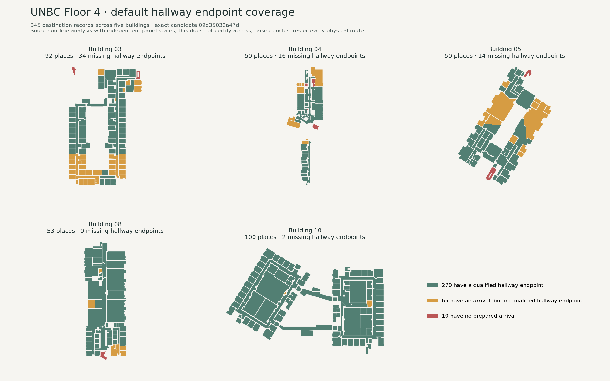
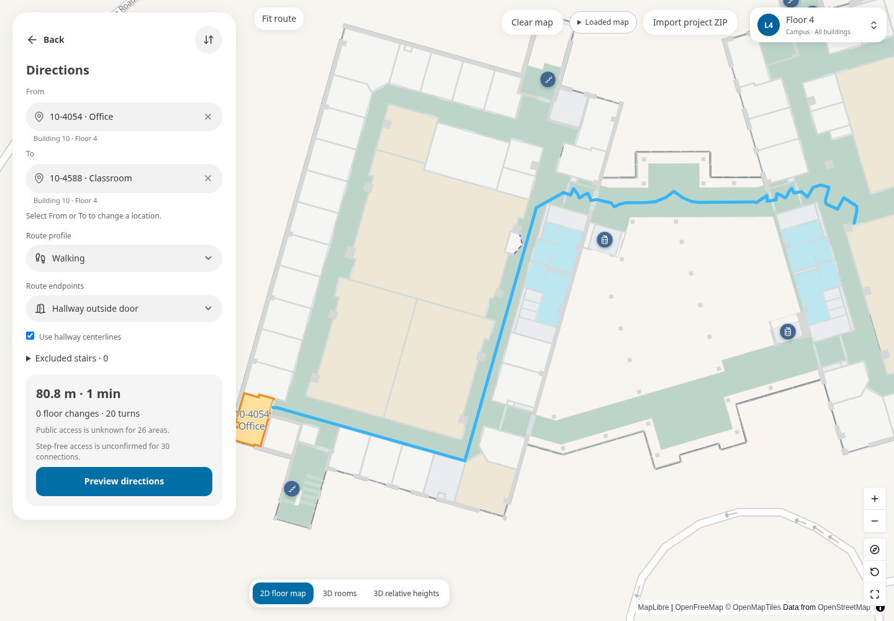
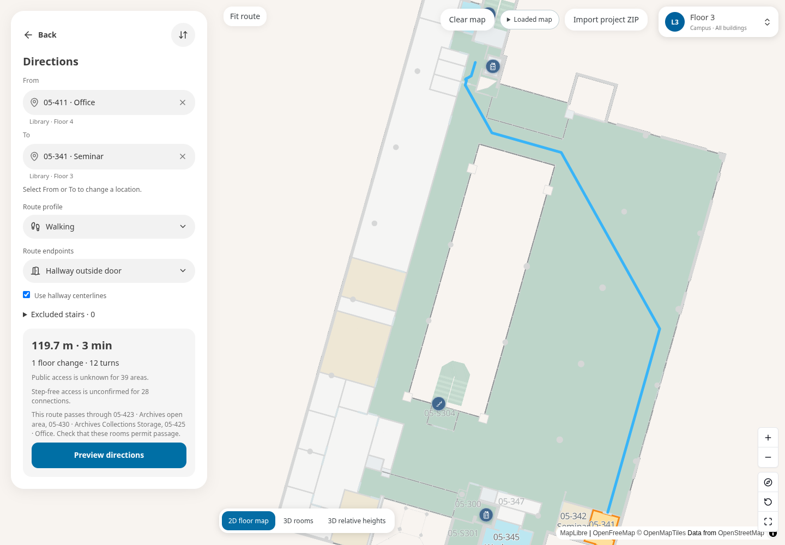
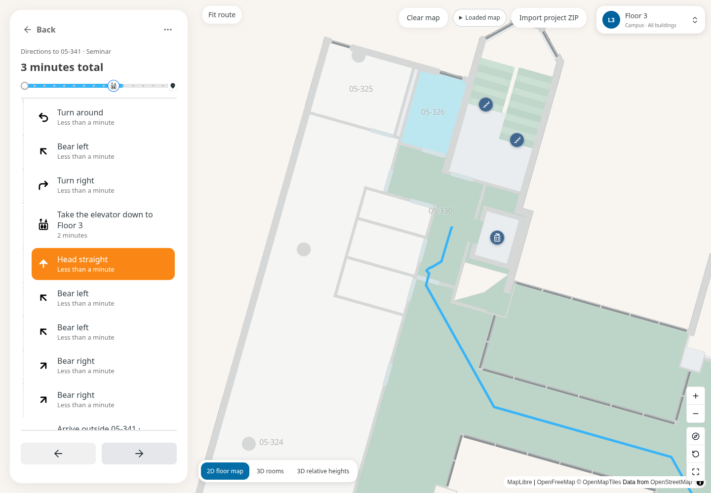

# Floor 4 and multifloor navigation acceptance

This follow-up tests the immutable 45,519,753-byte version 3 hallway candidate
with the current normal route calculator. It does not regenerate native
geometry, enable held stairs or publish the candidate. The exact archive
SHA-256 is `09d35032a47d4cde544207c5a83f28c061750dfdaf2b32e07f042362c164658a`;
its engine remains
`aaa335577ffdeb27b45b1b405d94c49a673dc7a36cbd46f3bbc463e202265bda`.
Source model, original room boundaries, nodes, edges, access and doors are
unchanged from the [candidate receipt](../corridor-backbone/straight-hallways/package.json).

## Completed calculator results

All **1,538 distinct normal-calculator requests** completed: **508 available**,
**1,030 unavailable**, no unresolved invariant failures. Walking has 504
available / 194 unavailable out of 698 requests; step-free has four available
/ 836 unavailable out of 840. Every unavailable request was also unavailable
with shared guides off. This is a checked availability comparison for failed
requests, not an assertion that every possible campus pair was refined.

The nearby Floor 4 cases cover all 345 places in both directions and profiles.
There are 532 distinct walking requests in that subset: 378 available, 154
unavailable. Successful cases cover 268 places as origins and destinations;
the other 77 have the endpoint/isolation blockers listed below. All successful
nearby Floor 4 cases stay on Floor 4. All 14 long section cases also succeeded
in both directions. No selected Floor 4 graph-positive pair returned an
unavailable physical calculation.

The raw batch took 994.7 seconds (16.6 minutes); the six-case assertion replay
took 362.4 seconds (6.0 minutes), including fresh policy preparation. These are
functional run timings under concurrent browser work, not production latency
benchmarks. The input and all physical/policy context remained unchanged.

Observed [request timings](timings.json) help separate cold preparation from
individual queries. Available nearby Floor 4 walks have a median of 0.21 s
and a 95th percentile of 1.41 s. Available journeys with vertical transitions
have a median of 1.00 s and a 95th percentile of 16.09 s. Some requests take
43–47 s, including cold binding/refinement work; fresh policy preparation
alone took about five minutes. These concurrent local functional timings are
not a browser or production benchmark.

[Final report](report.json), [coverage by category](coverage-summary.json),
[per-place repair queue](floor-repair-queue.json),
[all 1,538 actual outcomes](actual-results.jsonl.gz),
[full request plan](cases.json.gz) and [example routes/instructions](examples.json.gz).
The compressed outcomes are lossless UTF-8 JSON Lines. The initial six strict
assertion failures remain in [the initial batch outcome and six original failures](initial-batch-outcome.json),
with [their successful selected replay](numeric-replay-report.json.gz).



This is an analytical plot of source outlines, not a visitor screenshot or
3D enclosure certification. Every plotted native ring was compared exactly
against this candidate; [drawing input proof](coverage-geometry-proof.json.gz).
The 2D source outlines have not been simplified or repaired by this test.

## Coverage and method

Floor 4 has 345 destination records across Buildings 03, 04, 05, 08 and 10.
These include circulation and landing records, not just ordinary visitor
rooms. Each profile's 118,680 distinct directed pairs is enumerated for graph
connectivity. The floor-induced graph permits only Floor 4 nodes; the campus
graph can go down and across the campus before coming back up. Neither matrix
is a claim that every pair passed physical path refinement.

Actual normal-calculator cases cover every Floor 4 place as both origin and
destination in walking and step-free modes. Nearest reachable peers test the
entrances; the two directions of a long diameter through each connected
section test its backbone. Places without a reachable peer are tested against
a known destination and remain explicit unavailable outcomes. Normal requests
also cover enabled lift/ramp/local-step owners, selectable held-stair owners,
and seeded Library floor-to-floor journeys in both directions. Alternative
connectors are recorded separately from use of the requested connector.

All calculations keep the complete source physical context, foreign obstacles,
floor holes, original ownership and policy evidence. Successful routes are
checked for enabled original edges, finite points, no walking path through
native floor holes, consistent displayed endpoints and original directed
vertical geometry with matching instructions. Unavailable cases are repeated
with shared guides off: availability only with guides off is a regression.
All 28 held stairs are independently checked for absence from both directions
of both policy graphs.

The batch reuses only a previously completely imported, browser-accepted
**exact archive**. The script checks archive/member hashes, current preparation
engine and unchanged production routing dependencies against that receipt.
Fresh policy graphs are calculated; no serialized graph or relabelled trust
receipt is injected. The browser separately performs its normal full import.
The complete dataset hash is checked again after the batch.

## Floor-wide connectivity

| Profile | Distinct ordered pairs | Connect within Floor 4 | Connect using campus graph |
| --- | ---: | ---: | ---: |
| Walking | 118,680 | 16,118 | 61,954 |
| Step-free | 118,680 | 0 | 0 |

Only 82 walking pairs connect within the strictly hallway-only graph. The
normal **prefer hallways** mode allows other-room transit as a fallback; this
test does not certify that all successful journeys stay out of other rooms.
Walking is the app's ordinary profile and still displays unknown-access
warnings where source review is incomplete. Step-free zeroes describe absent
qualified routing evidence, not a determination that each building is
physically inaccessible.

| Building | Destination records | No qualified hallway endpoint | No prepared arrival |
| --- | ---: | ---: | ---: |
| 03 | 92 | 34 | 2 |
| 04 | 50 | 16 | 4 |
| 05 | 50 | 14 | 2 |
| 08 | 53 | 9 | 2 |
| 10 | 100 | 2 | 0 |
| Total | 345 | 75 | 10 |

The ten missing arrivals are included in the 75 missing hallway endpoints.
There are 77 places without a reachable distinct peer in either walking graph;
the additional two have an endpoint but remain disconnected. There are seven
mutually connected sections with at least two places: 98, 58, 44, 30, 19, 14
and 5 places. The other 77 records are singletons in that enumeration.

An internal diagnostic can say `connected` when an inside-room route exists
but the selected hallway endpoint is unavailable. Use the qualified endpoint
counts and actual selected-mode result rather than treating that diagnostic as
a successful hallway route.

## Reproduce

Use an empty output directory to avoid appending to prior evidence:

```sh
node --max-old-space-size=6144 --import tsx \
  scripts/indoor/audit-floor-and-multifloor.ts \
  /path/to/UNBC.straight-hallways.campus-viewer.zip \
  docs/continuation/unbc-20261017/corridor-backbone/straight-hallways/browser-proof.json \
  'Floor 4' /path/to/empty-audit-output
```

The exact previous receipt and matching production code are required for input
reuse. A changed input or runtime needs fresh complete import acceptance.
Do not start this full-floor batch after each local repair: replay the changed
cell/physical elevation and its policy dependencies first, then batch stable
changes for acceptance.

## Browser functional result and visual blocker

The targeted multifloor retry **passed its functional checks** in 23.2 minutes
(23.4 minutes including runner startup). The real worker's source-edge sequence
and 119.741898 m distance agree with the normal calculator. The elevator step
selects Floor 3, the next walking instruction stays on Floor 3, and mobile
previous/next controls retain the correct floor. No page errors were recorded.
The earlier complete-floor journey and both viewport captures were already
completed before the initial worker-lifetime assertion failed.

Manual image review found a **desktop lift-step rendering blocker**:
[that capture](desktop-lift-transition.png) has POI pins but a blank floor
canvas after the worker progress indicator cleared. The following desktop
walking step and mobile lift step show the correct native floor geometry.
The duration and cause are not established. Check MapLibre source/render
readiness as well as preparation readiness; this test currently asserts
controls and level state, not rendered floor features. Its functional pass
must not be used as complete visual or publication acceptance.

[Acceptance scope and hashes](acceptance.json),
[real worker/browser proof](browser-proof.json),
[initial browser outcome](first-run-outcome.json) and
[initial failure context](first-browser-error-context.md.gz).







[Upper floor](desktop-multifloor-upper.png),
[mobile same-floor journey](mobile-full-floor-route.png),
[mobile lift instruction](mobile-lift-transition.png),
and [mobile following step](mobile-multifloor-lower.png).
The blank desktop transition capture is retained as failure evidence.

## Findings from the actual viewer

The 10-4054 → 10-4588 walking route calculates on Floor 4 and matches the
normal calculator's exact source-edge sequence. Desktop and mobile captures
show the actual visitor viewer. The 80.8 m route still has small zigzags in a
larger branched Building 10 component. The four averaged-axis components do
not yet cover that straight sub-run; this acceptance does not declare all
campus hallways straightened.

05-411 → 05-341 calculates a 119.7 m walking route with one lift transition
from Floor 4 to Floor 3. Its default fallback passes through 05-423 (Archives
open area), 05-430 (Archives Collections Storage) and 05-425 (Office). The UI
warns about those rooms and unknown public access. This is a real calculated
journey, not certification of an unobstructed public hallway route. Repair
source circulation/entrances, or offer an explicit stricter hallway-only
policy, before describing this as the requested room-avoiding route.
The upper-floor section also produces two **Turn around** instructions in
each direction. These [quality observations](route-quality-observations.json)
need source/shared-chain review even though the route passes the checked
physical and policy invariants.

The initial browser run failed its worker-reuse assertion after both journeys
had calculated: the same-floor reply came from worker 5, the multifloor reply
from worker 7. Idle graph release for floor preparation and cancellation of a
pending endpoint request can rebuild the worker. Reusing the same worker is
not a routing correctness requirement. The corrected test records that
observation, keeps the route/level/transition assertions, and supports a
multifloor-only retry so the completed Floor 4 browser case need not run again.
Cold preparation and repeated native-floor work remain performance problems.

Six initial batch cases used an overly strict bitwise equality assertion for
displayed endpoints. Their differences were about 10^-13 feet. The corrected
check permits at most 10^-8 feet of displayed-coordinate roundoff, while
original source edges and directed vertical polylines still require exact
identity. Only those six cases are replayed. The initial failure evidence is
preserved rather than reclassifying the original run as a clean pass.

## Connector outcomes and remaining repairs

All four enabled ramps were used by successful normal walking calculations
in both directions. Two ramps also passed step-free calculations in both
directions; the other two refused that profile. The enabled local-step edge
was used in both walking directions and excluded from step-free requests.
The full stair population remains 28 held edges: none was used. Selectable
owner requests cover 26 held edges (52 directions/profile); the other two
remain covered by the explicit graph exclusion assertions. Eighteen walking
owner requests found alternatives, rather than traversing their held stairs.

Lift owner-to-owner requests used their exact target edge in 80 of 86 walking
queries. Six requests involving 04-124 and 04-237/04-302/04-423 returned no
hallway-mode route with either centerline preference. Those share the
`unbc-04-lift` Floor 1 endpoint; they do not independently establish three
broken physical lifts. The inside-route diagnostic says `connected`, so
inspect the selected hallway endpoints and surrounding source circulation
before changing lift geometry or access. All 86 step-free lift owner queries
remain unavailable under current clearance evidence.

The next local work should address a specific failure and its dependencies:

1. Inspect the 75 missing hallway endpoints, including the ten missing arrivals,
   and the isolated 04-425 / 05-497 records. Use the saved per-record queue;
   do not infer a new doorway from proximity or relabel access to force a path.
2. Investigate the 04-124 hallway-side lift approach, then replay those six
   lift-owner requests and relevant neighbouring room routes in both directions.
3. Trace the Building 10 zigzags and the Library route through the archives and
   office. Fit safe straight runs between actual junctions, and repair source
   circulation or provide an explicit hallway-only refusal when fallback room
   transit is unwanted.
4. Fix and test desktop lift-step render readiness, including actual rendered
   floor features after the preparation indicator clears. Then profile
   native-floor invalidation and idle worker release. A completed
   graph/result cache must bind to actual source/policy/engine dependencies;
   avoiding a needless rebuild must preserve memory limits and cancellation.
5. Continue source stair/landing/clearance and step-free reviews separately.
   These route-style tests do not resolve the failed native source rebuild.

## Saved evidence and reruns

[Floor matrix and per-origin counts](floor-matrix.json) retain the record order
for the two lossless gzip bitsets. For origin index `i` and destination `j`,
read bit `j & 7` at byte `i * 44 + (j >> 3)` after decompression. Diagonal bits
are zero. This encodes graph connectivity only. The 84 mutually connected
place groups are recorded in [components](components.json).

To replay only the six corrected endpoint assertions, append
`docs/continuation/unbc-20261017/floor-multifloor-tests/numeric-replay-ids.json`
after the empty output directory in the command above. The selected replay
still constructs fresh full policy graphs; it is not the quick physical-cell
repair loop. Current complete runs use the corrected tolerance directly.

The browser command uses the existing production Pages build of the unchanged
runtime:

```sh
INDOOR_PROJECT_ZIP=/path/to/UNBC.straight-hallways.campus-viewer.zip \
FLOOR_NAV_BROWSER_OUTPUT=/path/to/browser-evidence \
FLOOR_NAV_AUDIT=/path/to/audit/actual-results.jsonl \
npx playwright test --config playwright.floor-navigation.config.ts
```

For just the remaining multifloor checks, set `FLOOR_NAV_MULTIFLOOR_ONLY=1`;
the `FLOOR_NAV_AUDIT` input is then optional. This skips the completed Floor 4
browser journey and imports the complete ZIP normally for the lift steps.

This follow-up changes QA tools and evidence only. The app, map package,
Reviter source and live Site remain unchanged.

Browser layouts use headless Chromium at 1440 × 1000 and 390 × 844 on this
Linux workspace. The mobile result is a viewport check, not a physical-phone
memory or browser compatibility test. The normal ZIP import and real worker
requests are retained; route responses are observed, not substituted. The
original failed worker-lifetime assertion is preserved separately from the
remaining multifloor retry.

## Loading investigation from this run

The native floor worker receives the selected logical floor's native level
IDs; it does not request every campus floor for each zoom. The full ZIP still
contains the complete source dataset. Code inspection confirms that
[the floor worker](../../../../app/indoor-project/floor-presentation.worker.ts)
derives native faces and calls the common
[`prepareFloor`](../../../../app/indoor-project/prepared-floor.ts) pipeline.
That pipeline prepares room blocks and height-aware products alongside 2D
footprints. `omitNativeDisplay` changes the reply payload, not preparation.
This is a concrete opportunity to investigate, not a measured claim that a
particular substage dominates the worker.

Before splitting geometry pipelines, capture the existing opt-in stage
measurements for just Floor 3/4, and generate fresh verified prepared display
assets for this candidate/current engine. Consider a staged 2D reply that
reuses the same verified footprints and defers unused volume products. Keep
source enclosure checks, physical context, cache byte limits and input/engine
bindings; do not reuse older prepared assets by changing their version label.

The retry also [reproduced repeated native-floor preparation](browser-loading-observations.json):
Floor 3 completed before the route result, the preview prepared Floor 4, then
selecting the elevator step started Floor 3 preparation again. The same route
reply remained present. This establishes repeat work; cache-key changes,
byte-budget eviction and worker teardown still need stage profiling to locate
the cause. Do not assume that raising the in-memory cache limit is the remedy.
