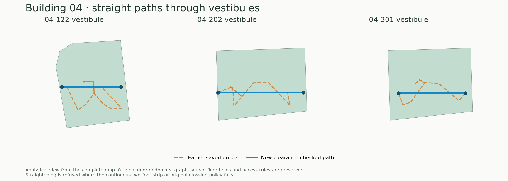
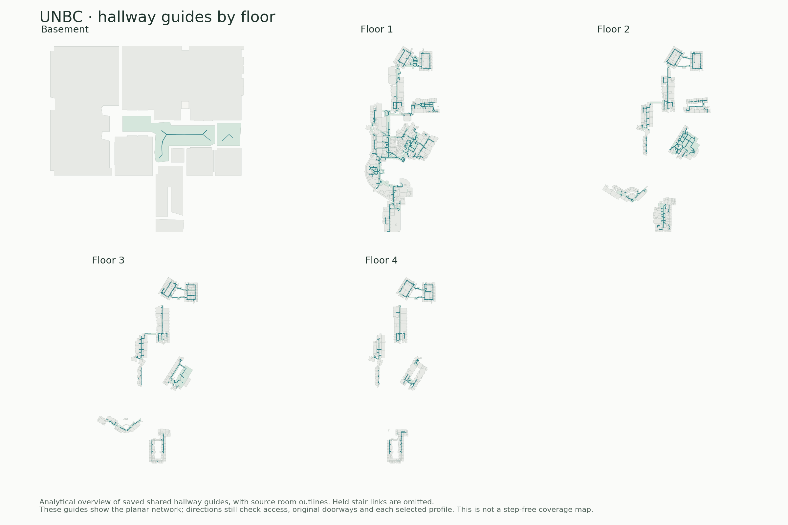
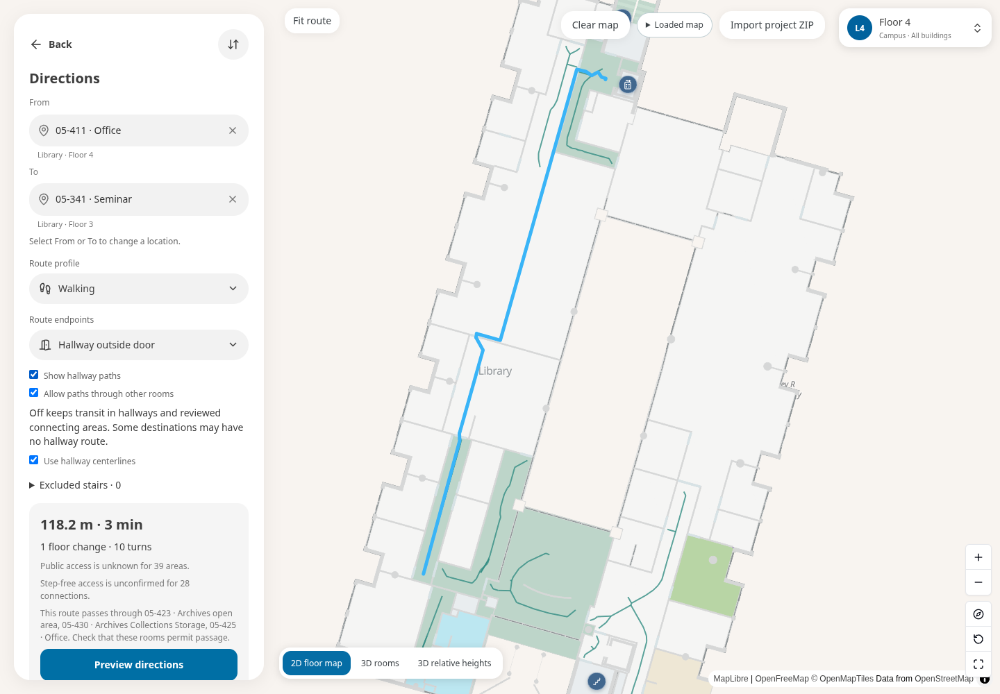
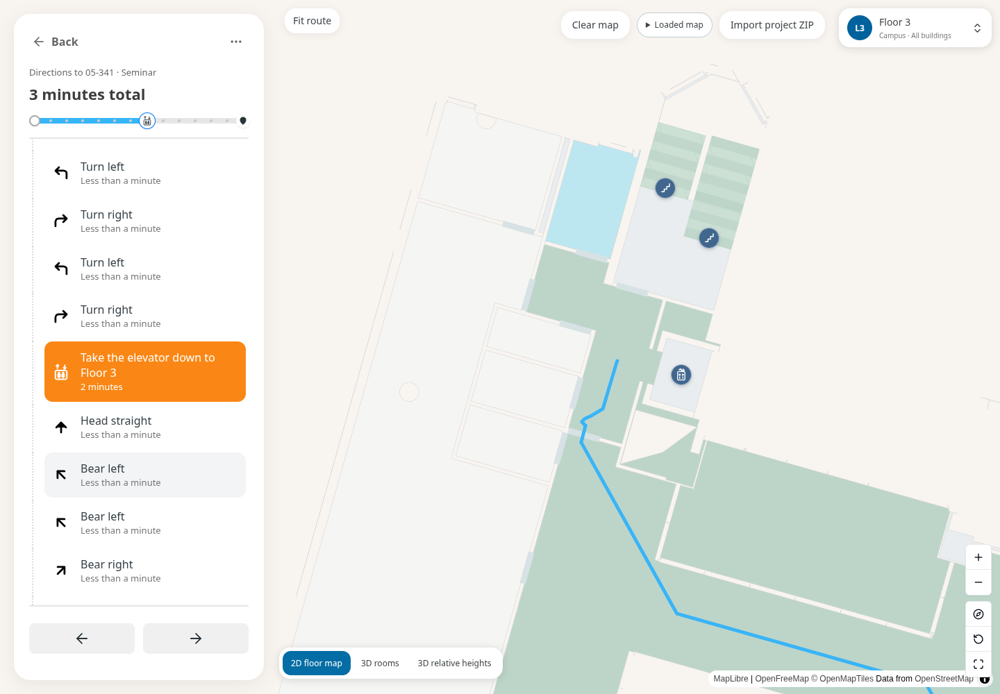
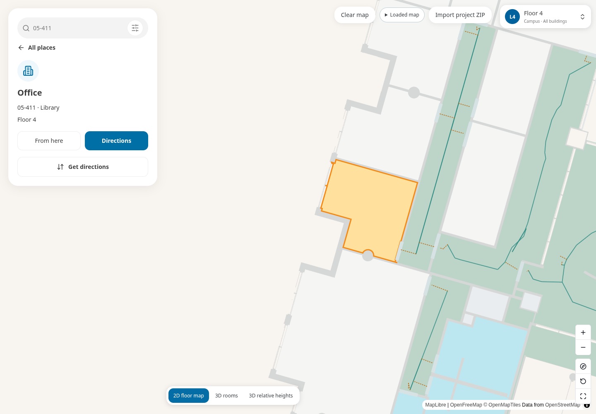

# UNBC pathway and loading repairs · October 17

The next paired publication adds [portable source downloads and connection
inspection](PORTABLE-DEVELOPMENT.md), with exact missing-native-input disclosure.
That report contains the all-floor source-topology audit and release procedure.
The version-12 receipt below remains the last previously published baseline.

This continuation repairs the viewer and checks affected original route chains.
The original map geometry, source nodes/edges, room classifications, access,
held stairs and accessible flags are unchanged. The viewer and existing shared-guide candidate are now live as private Site
version 12; the source geometry was not regenerated. The latest
[passage-door correction](PASSAGE-DOOR-FOLLOWUP.md) removes dotted internal
threshold branches while retaining room entrances.

Current work is on draft [OpenIndoorMaps PR #3](https://github.com/ahzs645/openindoormaps/pull/3),
branch `codex/unbc-corridor-analysis-20261017`. The related Reviter ownership
test/data-availability update is on [PR #17](https://github.com/ahzs645/reviter/pull/17),
branch `codex/unbc-stair-ownership-tests-20261017`. These changes have not been
merged into `main`. A new workspace needs these branches to inspect
this continuation; the old main-only instructions describe the earlier handoff.

The input is `UNBC.straight-hallways.campus-viewer.zip`, 45,519,753 bytes,
SHA-256 `09d35032a47d4cde544207c5a83f28c061750dfdaf2b32e07f042362c164658a`.
Its indoor JSON SHA-256 is
`87194bb96ce4564699f5fb431ef00917fae93181f5730fe3e5f7056c1ca6ca1b`;
the original model identity remains
`8c294549ee667ed7aba38f1f4f3a53514dae7544af97f0157ee8187dd8702178`.

## Changes

- Small circulation areas can use a straight through-path when the complete
  current two-foot strip and original doorway-crossing policy pass. Fixed doors
  remain separate and keep their original points. This also applies when the
  vestibule occurs inside a longer journey, rather than only in an isolated
  edge replay.
- Shared guide cleanup starts with the previous collinear simplification,
  then tests short reversing hooks individually. One real obstruction retains
  its own bend without vetoing every other cleanup. Opposite directions use a
  canonical geometric order while checking policy in the request direction.
  Both exact outer hallway-stop joins are protected until the original door
  approaches are separately retained and trimmed. The early prototype lost
  these stops and regressed a previously straight Library route; that failure
  prompted the protected-anchor regression test and focused replays.
- **Allow paths through other rooms** is an explicit visitor option, off by
  default. Hallways and geometry-bound reviewed through areas remain usable;
  ordinary-room transit needs opt-in. This intentionally makes some existing
  fallback journeys unavailable until the option is enabled. Inside-room and
  doorway endpoint choices still preserve their semantics. The route graph is
  reused when this preference changes, with separate result-cache identities.
- **Show hallway paths**, in map preferences and Directions, displays the
  prepared guide network in the selected floor scope. Calculated routes remain
  a separate bright-blue layer. The optional network is a planar guide view,
  not public-access or wheelchair certification; disabled stairs are omitted.
  Guide binding and deduplication run in the floor worker.
- Starting directions releases the idle floor worker's large dataset clone
  while retaining completed floors inside the existing 128 MiB/count budget.
  Edited/imported datasets invalidate those floors. Oversized completed native
  floors also get a private compressed copy in a separate 32 MiB LRU. Packing,
  source hashing and restoration run in the worker, using the existing bounded
  checksummed subtree codec. Restore checks actual dataset bytes, engine,
  levels, building, window mode and options. It preserves the complete prepared
  values and does not create import/physical/source validation authority. New
  sources, explicit retry and unmount discard both caches. A corrupt restore
  drops its entry so retry can prepare normally. Evicted/over-limit results
  can still require preparation; this is not an unlimited cache.
- Selecting From/To on a large native map highlights the place without first
  preparing the destination floor. Preview/follow instructions and explicit
  floor controls still select floors. This avoids To → From → To preparation
  while setting up one multifloor journey. Selected campus floors may contain
  multiple physical native planes; combined-floor display is preserved.
- A missing original arrival now stops the normal calculator before geometry,
  policy graphs or unused endpoint coverage are prepared. The UI already had
  this preflight; direct calculator requests now share it.
- Native floor masking now runs at the end of the same synchronization pass
  as base paint. Previously, a route/network/selection-only update reset the
  fallback fill opacity without rerunning the separate native mask effect.
  Actual Library Floor 4 screenshots reproduced white diagonal triangle seams
  after toggling paths. Restoring native opacity removed them. No native ring,
  wall or floor geometry was changed. The final browser test compares mint
  floor pixels across the toggle as well as checking rendered path features.

## Checks and limitations

The UI/cache browser build is `eb870bd9100bc779d3da885fa833995b4e43ecd5`.
The later inspection/doorway correction is `612e37c`. It adds the shareable
`paths=1` flag, solid teal hallway guides and dotted amber door approaches.
Map preferences and Directions both retain **Show hallway paths** with a legend.
Turning it off removes the flag without reloading the map. Only branches from
bound shared guides to enabled original door/opening endpoints are displayed;
arrival and vertical-connector spurs are not invented. Duplicate exact segments
are removed, with trunks taking precedence over approaches. This is an
inspection overlay, not proof that every displayed branch is currently routable.

The first endpoint fix `7215857` retained center stops but omitted an intermediate
jamb-approach vertex from its shortcut proposal. The fresh normal-calculator
batch caught two failed S201 straightness assertions despite zero U-turns.
Its 13 actual results and failures are preserved in `navigation-before-jamb-fix/`:
eight available, five expected refusals. The final proposal retains the **entire**
original door-to-center prefix/suffix and straightens only the through-run after
continuous strip and original policy checks. Four affected normal-calculator
source chains pass the new complete-context replay in both directions, with
two-point visible vestibules, preserved exact thresholds and zero U-turns.
The graph/policy implementation and source dataset are unchanged by this last
proposal correction; a new cold whole-map calculator run was not repeated.

The current routing implementation fingerprint is
`af5c3820ae212ad4a2a9bd705fd83ab8814f5bd0cbe7a82113080fbb0d1adeae`.
See `checked-jamb-approaches-final.json` and its assertions. The display engine
is separately bound (`6e918741d67cc3cc12ed3f58aac2af62d419e0817bc7bb1c310334f61b59474f`);
the display hash does not bind route refinement. The completed multifloor/cache
browser proof below belongs to `eb870bd` and its earlier display engine
`19c3b8bc610174a3da4d341045b4c2ac76f867e20eed9d03b4f66bb97f50dc16`.
The new dotted-approach display received its own real-UNBC browser check:
normal import, native Floor 4 and rendered approach features succeeded, and
`browser-door-approaches/desktop-rendered-paths.png` shows both line styles.
The **test probe**, not the viewer, then failed by reading a private MapLibre
source field as a FeatureCollection. Checkbox/legend, repeated-toggle request
counts and mobile assertions on this last display change did not complete.
The recorded probe now uses public `getData()` but has not been rerun. Do not
relabel this partial run as a full pass. Its scope/status and original error log
are preserved. The earlier complete desktop/mobile/cache proof remains valid
for its separately identified build. Later Browser skill availability requires
its connected browser tool; none is exposed in this session, so no further
standalone browser automation was used.

| Affected journey                                        |    Visible distance | Turn-around instructions |
| ------------------------------------------------------- | ------------------: | -----------------------: |
| 04-S201 hallway → 04-204 / reverse                      |   24.20 m / 24.20 m |                    0 / 0 |
| 04-S301 hallway → 04-302 / reverse                      |   42.71 m / 42.71 m |                    0 / 0 |
| Library 05-411 → 05-341 / reverse, room transit allowed | 118.18 m / 119.49 m |                    0 / 0 |
| Library 05-411 → 05-423, room transit allowed           |             12.49 m |                        0 |

The six additional through-path checks cover 04-122, 04-202 and 04-301 in
both directions; each compact vestibule's checked through-path has two
vertices. Original fixed threshold points and vertical connections remain
separate. Nearby approaches can still need bends where straight chords fail
clearance. The saved center stop on the stair-vestibule end is now retained
and used as the visible endpoint in all four selected Building 04 journeys.
The opposite room-door end still falls back to its verified hallway-side
point when its shared lane is refused; it is not forced to an unsupported
center. The Library values above are the fresh normal-calculator results before the
last jamb-prefix-only refinement. The unchanged Building 10 diagnostic remains
a geometry replay, rather than an additional normal-calculator acceptance.
The Building 10 replay improves the saved long route but retains
50 visible vertices; this is not a claim that every hallway is now a perfect
straight line.





These figures are analytical source/route views, not browser screenshots or
step-free coverage certification. The teal viewer overlay shows bound saved
shared guides; a calculated blue route additionally applies current clearance,
policy and hook/vestibule refinement. The two views are deliberately identified
in the interface and should not be mistaken for an all-destination route audit.

The latest overlay/endpoint regression family passed 88 tests. TypeScript and
the full and hospital-only Pages builds pass; focused ESLint has no errors.
Earlier, the focused cache/route batch passed 103 tests, with 12 additional centered-route
tests passing separately. Earlier related checks passed 117 tests before the
compressed-cache extension. TypeScript no-emit and the Pages build passed.
Focused ESLint has zero errors and 18 existing warnings. See the saved logs.

The private-codec benchmark used the actual completed Floor 4 worker reply.
Its decoded retention estimate was 172,702,562 bytes. The private asset costs
4,908,993 bytes, with complete values unchanged; Node packing took 33.14 s and
restore took 15.98 s. Restored graph retention is 144,175,482 bytes, still above
the decoded budget, so compressed retention remains necessary. These are
codec diagnostic timings, not a claim about browser/phone load time. The
benchmark's original preparation engine is recorded separately from the final
viewer engine; no historical prepared asset was relabeled for publication.
See [`cache-codec-benchmark.json`](cache-codec-benchmark.json).

The first real desktop/mobile run passed its functional lift and path-control
checks in 18.1 minutes with no page errors, but screenshot review rejected its
striped upper-floor rendering. That evidence remains under
[`browser-before-paint-fix/`](browser-before-paint-fix/). The final candidate
adds the native-paint repair, compressed caching, a visible-floor wait and a
real Floor 3 → Floor 4 compressed revisit assertion. Cold ZIP import and first
native preparation still run; this work does not disable source validation.

The production UI/cache browser run **passed in 24.1 minutes** with no page
errors. Desktop/mobile lift transitions show an actual floor; the path toggle
renders 819 guide segments and passes its mint-pixel preservation check. The
Library journey returns 118.18 m with one lift transition after explicit room
transit opt-in; the default strict request is unavailable. That normal bounded
browser result is distinct from the unbounded diagnostic-chain distances.

| Browser floor stage                      | Measured time |
| ---------------------------------------- | ------------: |
| First Floor 4 request → received display |      290.89 s |
| First Floor 3 request → received display |      357.61 s |
| Floor 4 revisit → received display       |   **58.45 s** |
| Revisit compressed restore stage         |       33.86 s |
| Revisit overview ground/floor work       |       21.26 s |

Only two native preparations occur across these three visits. Floor 4's
compressed entry is 4.91 MB, Floor 3's 6.26 MB, within the separate 32 MiB
budget. Packing adds 29.49 s / 58.09 s to the initial preparations. The cache
avoids repeating native geometry preparation but still clones/restores data
and rebuilds overview drawings; it is not instant or a cold-load improvement.
These machine/load-specific stages include concurrent targeted diagnostics;
the total is not an apples-to-apples performance comparison with the older
run. [`browser/timings.json`](browser/timings.json) records the actual stages.





The endpoint corrections followed this UI/cache build. One normal-calculator
attempt was interrupted by environment reconnection after two completed
preflight checks; partial files remain under `interrupted-calculator/`. The
resumed batch finished all 13 cases and exposed the two straightness failures
described above. Its actual results are not relabeled as a passing final run.

The normal-calculator batch preserved in
[`navigation-before-hook-fix.json`](navigation-before-hook-fix.json) and its
[compressed actual routes](navigation-before-hook-fix.json.gz) used complete
source JSON and fresh policy graphs. It made 13 requests: eight available and
five unavailable. This was a diagnostic batch, not a fresh package import or
validation/cache authority. Two compact-vestibule assertions exposed that an
otherwise centered composite could skip fixed-door splitting. Two additional
assertion failures came from incorrectly supplying JSON `null` as an unknown
boolean expectation. Both initial failures remain preserved, rather than being
relabeled as a passing run. Later affected-chain checks replay the final
refinement over those same original source edge identities with complete
physical and policy context.

04-123 has no original arrival. Consequently 04-123 ↔ 07-163 remains unavailable,
even though the isolated through-path in vestibule 04-122 passes. The current
normal calculator returns that refusal in less than one millisecond in the
local diagnostic. A missing arrival is not repaired by moving a display line.

The step-free Library Floor 4 → Floor 3 request remains refused. Floor 4's
current incident dependencies include 954 walking edges, 326 doors, 17 openings
and 18 lift edges with unknown accessibility; eight incident stair edges are
explicitly not step-free. These are evidence flags, not a claim that the real
building is inaccessible.

## Published viewer and download

Current publication is **version 12**, with the
[passage-door correction](PASSAGE-DOOR-FOLLOWUP.md). The version-11 receipt and
browser evidence below are retained as historical checks; `publication.json`
records the latest deployment.

[Open the viewer with hallway guides enabled](https://openindoormaps-unbc-map.ahzs6455.chatgpt.site/openindoormaps/#/projects/indoor?package=%2Fdata%2Funbc-full%2Fproject.json&manifest=%2Fdata%2Funbc%2Fmanifest.json&preview=%2Fbinary%2F&view=2d&paths=1).
The checkbox in Map preferences or Directions removes/adds `paths=1` in the
shareable URL without a reload. Teal is the saved hallway trunk; dotted amber
is a saved door approach. Bright blue still denotes calculated directions.

The initial dotted-approach Site version **11** deployed successfully at **2026-10-17 19:17:50 UTC**,
from Site source `73155c6d65af034c0061699a60f4f92d013a9868`, containing
viewer source `612e37c`. Existing owner-private access is preserved. The
publication checker checks 26 ordinary page/asset/package-part URLs against
new hashes. Its local artifact browser check and the actual checksummed ZIP
transport/download pass. **Signed-in production content verification remains
pending**: anonymous requests receive HTTP 403, and the connected Browser tool
is unavailable. Native Sites reports a succeeded production deployment. See
`publication.json` and `publication-artifact/proof.json` for this distinction.

[Download the latest published ZIP](https://openindoormaps-unbc-map.ahzs6455.chatgpt.site/openindoormaps/#/projects/download?package=%2Fdata%2Funbc-full%2Fproject.json).
Select **Prepare latest map ZIP**, then save the verified **45.52 MB**
`UNBC.hallway-guides.campus-viewer.zip`. This is the already checked shared-guide
candidate described above, not a regenerated authoring master. Compared with
the previous live package, source, alignment, floors, room records, graph nodes
and edges, walls, circulation/envelope geometry, exclusions and stair/ramp
geometry are unchanged (`publication-source-comparison.json`). Binary and
progressive previews retain their earlier publication data. The static bundle
uses the existing hospital-only demo build profile to fit the hosting limit;
it does not remove UNBC geometry. Old open tabs may need one reload to use the
new hashed viewer assets.



## Stair source dependency

All 28 held full-stair links remain disabled and have no attached qualifying
original stair proof in this visitor dataset. No new stair or accessible
connection is approved. [`source-blockers.json`](source-blockers.json) lists
the original IDs, served owner rooms and accessibility inventory.

The newer `UNBC-data-handoff-20261017` archive, enriched native cache and nine
failed-build physical checkpoints are absent in this workspace. The original
chat creation commands confirm that the assistant created and independently
verified the archive at
`/workspace/scratch/unbc-main-sync-20261016/transfer/UNBC-data-handoff-20261017.tar.gz`.
Its size is 1,271,906,669 bytes and SHA-256 is
`24119b663b78afc8250ceeefd13f5a0854a3c94a29f0d566d97961bd5f375253`.
The later Zstandard alternative is also absent. Current filesystem/shared
files, chat artifact records and accessible Drive searches did not recover
either copy. The supplied Drive folder contains the October 14 historical
master. See [`archive-recovery.json`](archive-recovery.json); older handoff
statements that these scratch files are still available no longer describe
this filesystem. A saved checksum is not a replacement for the actual bytes.
Resume the exact failed
native rebuild using that archive; do not substitute the old visitor or waive
its lost-arrival assertion. The two saved lost arrivals are
`rm-694-0bed6b73a3bd` (05-S204) and `rm-694-504b25e5319a`.

A separate [Reviter test correction](https://github.com/ahzs645/reviter/pull/17)
fixes the previously recorded Treads/Risers test failure: its positive fixture
claimed ownership without supplying an original element-ownership record.
The corrected positive case and missing/foreign/conflicting ownership and
escaped-bound negatives pass 15 qualification/material-census tests, TypeScript
and focused ESLint. Production source qualification is unchanged. This test
correction does not approve any of the 28 UNBC links. The unrelated recorded
Reviter deterministic-Math CI failure remains unresolved.

## Reproduction

Use the targeted loop: unit predicates → affected original edge-chain replay →
one stable viewer build/browser check. The replay retains every foreign
obstacle, opening, source owner and access rule in the complete input. It
cannot authorize a source export or grant cache authority.

```sh
node --import tsx --test tests/unit/shared-corridor-routing.test.ts \
  tests/unit/hallway-routing.test.ts tests/unit/floor-worker-residency.test.ts
node --max-old-space-size=4096 --import tsx scripts/indoor/audit-path-repairs.ts \
  COMPLETE-INDOOR.json PRIOR-EXAMPLES.json.gz NEW-OUTPUT.json 'selected:|04-122:through:'
```

`audit-selected-route-repairs.ts` runs selected normal requests on one complete
immutable source and fresh policy graphs. It writes each result before ending
on failed assertions, so a failed test cannot discard the remaining batch or
its evidence. This avoids rebuilding a whole graph for every bad expectation.
Use boolean `expected` only for previously demonstrated outcomes.

## Continue source work

1. Restore the exact newer authoring archive and verify its expected hash.
   Reuse the failed-run input and physical-elevation checkpoints instead of
   starting from the historical master or a visitor export.
2. Repair/replay the two lost admitted arrivals first. Keep the compiler's
   preservation assertion; do not waive it to obtain a new ZIP.
3. Qualify each of the 28 original stair links against its flight, terminals,
   foreign material, clearance and access evidence. Regenerate supported links
   and calculate up/down routes; keep unqualified and excluded stairs held.
   Imported DWGs were confirmed by the user to be drawing references only;
   preserve their reviewed evidence bindings rather than treating them as
   arbitrary physical obstacles.
4. Review Floor 4 lift approaches and horizontal width/slope/access evidence
   before changing unknown step-free flags. A working walking lift route is
   not step-free approval.
5. Run one final coherent source-preservation, physical, every-origin,
   actual-navigation and desktop/mobile acceptance batch on the stable source
   candidate before export/publication. This PR's targeted runtime diagnostics
   do not replace that source acceptance.
6. Measure separate prebuilt 2D display assets against the accepted source and
   current engine for first-load improvements. This private cache accelerates
   revisits; normal ZIP validation and first native preparation remain slow.
   The next cache-specific target is the remaining 21 s overview rebuild;
   retain its completed drawings in the bounded private representation and
   test that specific restoration/paint dependency before another full flow.
