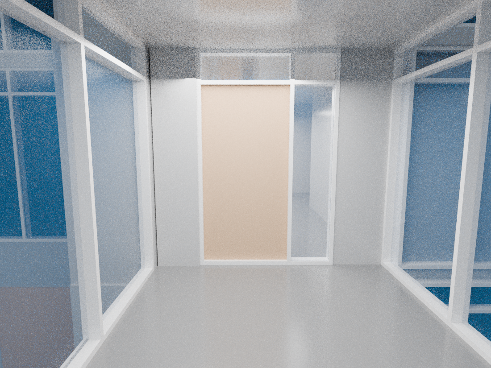
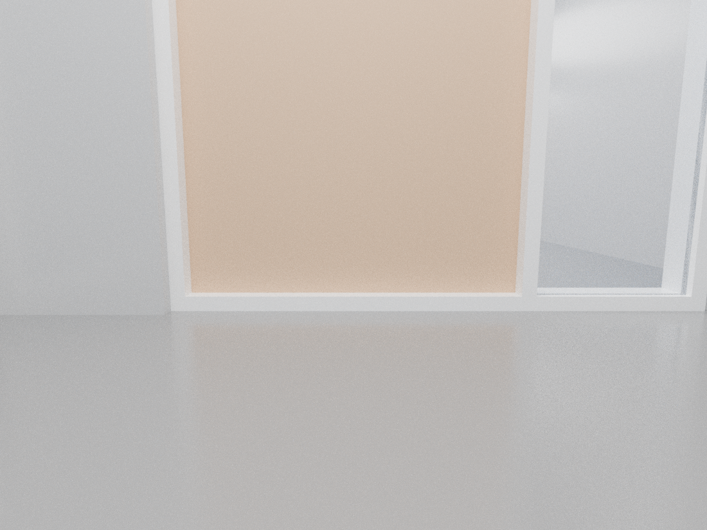
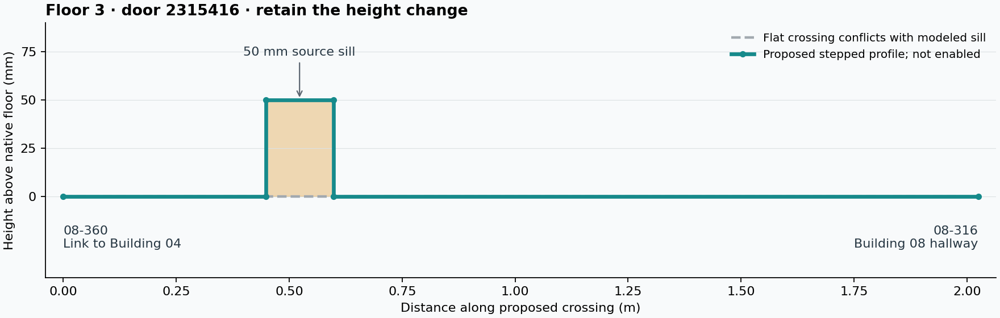

# Reusable 3D inspection and four-floor doorway threshold review

October 18, 2026. **The inspection workflow is reusable and tested. The Building
04–08 route is not yet repaired or published.** This work produces source-bound
owner/profile proposals and a matching-pattern inventory, not enabled links.

## Defined workflow for future agents

Start with the sibling Reviter [source-model inspection procedure](../../../../../reviter/docs/source-model-inspection/README.md)
and [skill](../../../../../reviter/.agents/skills/source-model-inspection/SKILL.md).
Both repositories' `AGENTS.md` require that workflow for native first-person
inspection. It supplies:

- A complete-scene exporter checking the actual original RVT/cache hashes,
  losslessly restoring serialized arrays and refusing empty/broken scenes.
- A reusable original-foot camera recipe and Blender renderer checking scene,
  recipe and triangle/mesh hashes/counts, retaining original geometry/materials.
- Selected-view rendering, preview/inspection budgets, partial/error receipts,
  camera positions and per-image hashes. Reuse the derived scene between views.
- A four-floor source survey and exact rational **envelope-profile proposal**.
  Rendering, sampling and source bounds cannot independently qualify a route.

The full UNBC scene has **1,763,196 vertices / 898,257 triangles / 30 meshes**.
The generic exporter reproduced the previous 53,155,452-byte GLB exactly, SHA-256
`ef718b75f2d87c2ad139a3b8a21a69d9d26007d54003d832dc37ea129f835d36`.
It is reproducible and is not duplicated in each evidence increment.

The camera recipe here uses 1100×825 and 64 samples. These are **source-model
renders**, not visitor/browser screenshots or on-site measurements. Prior four
views and the original source measurements remain in the
[specific Floor 3 investigation](../floor3-building04-building08/README.md).





## What the connection needs

The intended chain is `04-302 → 08-360 → 08-316 → 08-302`. Door **2315416**
between 08-360 and 08-316 remains unmatched in both saved datasets. The two
separate issues are:

1. **Original doorway ownership/approaches.** Source identities stop short of
   the thin native door. Five lateral rays on each side now propose the first
   original owner without jumping over another room. Exact full-two-foot
   endpoint strips fit their original identities; the full approach strip has
   native slab support and no positive overlap with a third room. Both owners
   belong to the same independently registered source drawing section. These
   are checked proposals, not applied boundary or owner patches.
2. **A modeled 50 mm threshold.** Native mullion **2315423**, own curtain host
   **2315413**, reaches from 24.278215223097114 to 24.442257217847768 ft.
   The door leaf starts at that same upper height. The source render and exact
   material replay agree that a flat portal cannot simply erase this member.

The concrete candidate is a **stepped doorway threshold**, retaining original
floor heights, two vertical transitions and the finite original member span.
`five-door-proposals.json` contains original IDs/boxes, both owner points, full
strip results, exact rational intersections and the proposed 3D profile. The
profile preserves the sill; it does not invent a sloped ramp or qualify a
wheelchair connection.



The eight-corner native bound is an envelope, not a proved walking cap/body.
Before enabling the link, the compiler still needs original body/cap/riser
correspondence, continuous full-width approach and body/headroom clearance,
current own-host/door aperture membership and preserved access policy. The
existing ankle/torso sections alone cannot prove that entire 3D demand. The
closed display leaf and host aggregate must be handled by their exact persisted
door/host membership; foreign material, holes and the real bottom member remain.

Implement that source-bound threshold admission in the compiler, apply the
verified original owner pair, then calculate **04-302 ↔ 08-302** through the
normal calculator, preserving step-free refusal unless independently supported.
Batch the stable result with the two lost-arrival repairs before a complete
master rebuild/export and desktop/mobile viewer acceptance. Do not expand the
ordinary 1.5-foot door-recovery radius globally, raise the ankle cut, clear all
mullions, reuse full-stair authority or waive the arrival-preservation guard.

## Other locations with this pattern

The complete four-floor source inventory contains **1,892 doors**. Matching
requires a persisted own-host native curtain mullion, its original eight-corner
bound, base at the exact native floor, top at the leaf base, and positive exact
current-model material inside the original door footprint. All matches have
the modeled 50 mm rise. The 150 mm discovery cap grants no traversal allowance.

| Defined campus floor | Matching doors | Without paired original owners |
| --- | ---: | ---: |
| Floor 1 | 2 | 2 |
| Floor 2 | 21 | 13 |
| Floor 3 | 12 | 5 |
| Floor 4 | 7 | 2 |
| Total | **42** | **22** |

These are **42 matching doors, not 42 confirmed broken routes**. Twenty have
paired source ownership; 19 have saved enabled door edges. Saved edges do not
prove the current physical/public/step-free route. One match has two source
members. The inventory also retains unresolved sides and narrow openings;
they are not silently bridged or enlarged. This is not an exhaustive survey
of every other entrance, ramp, stair or possible disconnection.

Five currently unpaired doors have proposed owners with full-width endpoint
containment, slab support, no intervening third room, the same registered
section and a finite two-foot envelope crossing:

| Floor | Native door | Proposed original owners |
| --- | ---: | --- |
| 3 | **2315416** | **08-360 ↔ 08-316**, Building 04–08 link |
| 2 | **2311764** | **08-260 ↔ 08-216**, corresponding lower link |
| 3 | 1505914 | 08-302 ↔ 08-310 |
| 3 | 2042015 | 08-340 ↔ 08-302 |
| 4 | 2465283 | 08-437 ↔ 08-402 |

The other 17 unpaired matches still lack a complete side proposal or meet the
source-width refusal. Preserve all of them for individual evidence review.
The same 42/22 inventory and five proposals occur in the complete failed-build
prepared snapshot. That comparison neither promotes it to an accepted master
nor resolves its missing 05-S204 / 03-S104 arrivals or 28 held full stairs.

## Targeted validation and reproduction

**Fourteen focused tests pass**, covering lossless scene restoration, sparse/
lossy/invalid mesh refusal, first-owner discovery, intervening private identities,
holes/overlaps/other floors, original membership/material/height requirements,
exact tangency/gap refusal and finite-width/reversed stepped proposals.
Scoped TypeScript and ESLint pass. Both complete source replays retain every
original byte and do not generate graph edges. See `targeted-tests.log`, the two
full survey JSONs and the bidirectional **proposal** replay receipt.

The final source survey stages took **16.4 seconds** for the published-source
dataset and **20.5 seconds** for the prepared diagnostic. Input loading is
additional. This is a local pattern/proposal check, not
full-campus physical validation or actual calculator route acceptance. No
runtime/UI change was made, so a visitor build/cold calculator run was not
repeated for these authoring tools.

From Reviter, run the commands in the shared workflow, then:

```sh
node --experimental-strip-types --import ./scripts/register-test-typescript.mjs \
  --test tests/source-inspection-scene.test.ts \
  tests/native-door-side-proposals.test.ts tests/native-door-sill-candidates.test.ts \
  tests/native-door-threshold-proposal.test.ts
npx tsc --noEmit -p docs/source-model-inspection/tsconfig.scoped.json
node --experimental-strip-types --import ./scripts/register-test-typescript.mjs \
  scripts/indoor/replay-door-threshold-proposals.ts SURVEY.json NEW-REPLAY.json
```

The survey accepts a complete JSON dataset or complete V8 `.bin` diagnostic
snapshot. It normalizes only the display prefix `Campus Floor`; original
native level IDs and elevations remain separate. Original RVT SHA-256 is
`8c294549ee667ed7aba38f1f4f3a53514dae7544af97f0157ee8187dd8702178`;
native cache SHA-256 is
`d3f445e6b1cee72f023cf4af0cbb3179ddcc259a2b05c8fc63928641586b9876`.
Full dataset/state/tool checksums are in the survey receipts and `SHA256SUMS`.

**Live Site remains version 13.** No new accepted master, actual route,
stair approval or publication is claimed by this review.

The [private 3.82 MB source/evidence increment](https://drive.google.com/file/d/1ni0O01s-kcMlINDu8yhSaK_GuSqvUzEF/view)
contains OpenIndoorMaps `d8aea42` and Reviter `cd13067`. Fresh Git restoration
verified all **3,921 tracked files**, and complete Drive download/readback
matched the archive SHA-256 and every entry. See `portable-backup.json`.
This receipt-only follow-up is outside those bundled commits. Original large
native inputs remain separate verified dependencies; the increment's manifest
and restore instructions link their private continuation folder.
