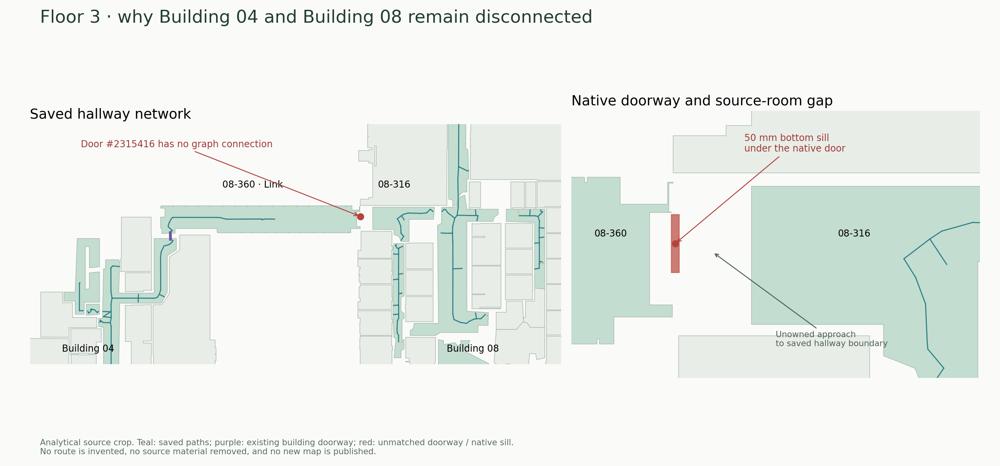
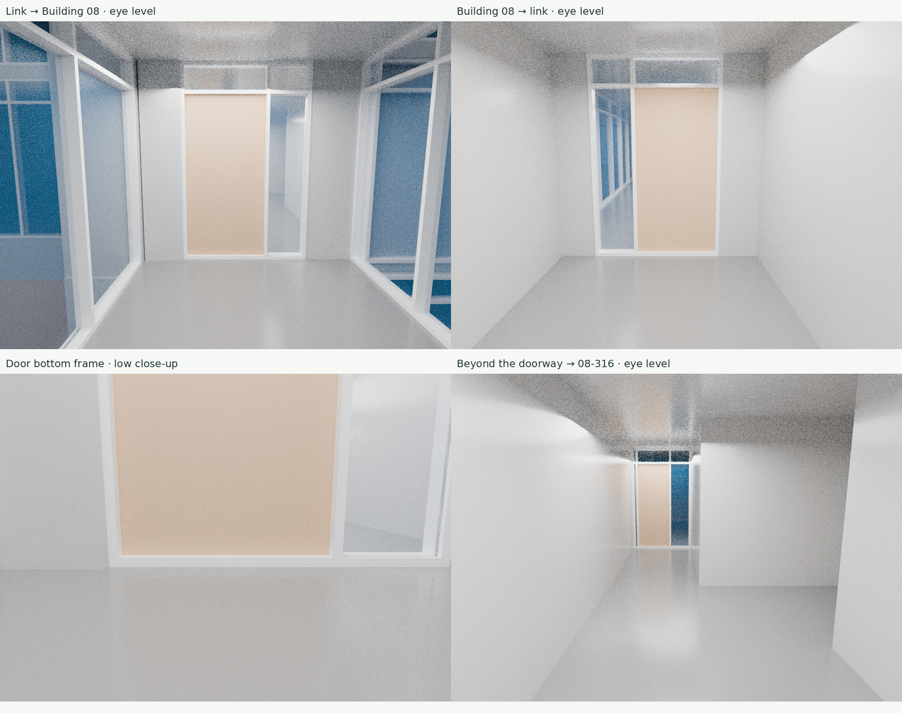

# Floor 3 · Building 04–08 connection

October 18, 2026. **The connection is still broken.** The previous systemic
candidate repaired common display/transit handling but did not repair this
missing source doorway. Neither the published visitor nor the failed fresh
native rebuild contains a complete same-floor connection here.

## Exact break

The saved chain is:

`04-302 → native door 2112703 → 08-360 (Link) → missing door 2315416 → 08-316 → 08-302`.

Door **2315416** exists in the original model at native level **400176**,
elevation **24.278215223097114 ft**. It is `unmatched` with **zero room keys**,
no portal nodes and no routing edge. The saved 08-360 arrival only connects
back to Building 04. Its apparent midpoint dead end is an arrival stop, not
the actual physical end of the link.

The source room outlines stop short of the native threshold: at its centre
ray, 08-360 is approximately **1.64 ft** away and 08-316 **4.85 ft** away.
Both identities use the same independently registered `08 Tea Lab LVL 3`
drawing section. The ordinary doorway-recovery search is bounded at 1.5 ft;
neither doorway side has been recovered. Increasing that distance alone is
insufficient because of the separate physical veto below.



## Physical source finding

The original model contains a **50 × 150 mm bottom mullion**, element
**2315423**, in curtain-wall host **2315413**. Its bottom is at the native
floor and its top is at **24.442257217847768 ft**: **50 mm above the floor**.
The independently recovered door leaf also starts at that exact top elevation.
This is explicit source geometry; the host and its child contribute the same
obstruction, rather than two unrelated walls.

An exact replay of a proposed two-foot-wide strip across the missing doorway
finds complete native slab support but positive material overlap with both
the curtain-host aggregate and its original mullion, including material outside
the original thin door-leaf footprint. The existing flat-walking admission
therefore refuses it. Removing the door leaf alone does not remove this sill.
`exact-door-probe.json` records this negative material result. It is not complete
headroom, ownership, accessibility or route certification.

This does **not** prove a 50 mm sill exists in the real building. The user asked
for first-person source-model inspection; the source views below are separate
from an on-site observation. A stepping-over-threshold route needs an explicit
supported surface/approach/clearance treatment. A flush real entrance needs a
model-bound source correction with evidence. Neither can be implemented by
erasing the mullion or declaring an ordinary flat/step-free edge.

## First-person source-model inspection

The current recovered complete 3D scene was rendered from three standing
eye-level cameras, **5.5 ft above the native floor**, and one low threshold
close-up. All 1,763,196 vertices and 898,257 triangles were retained. Inspection
lights and cameras were added; mesh geometry and source materials were not
edited. The checkpoint's serialized mesh arrays were restored with an explicit
lossless value check before GLB export. Scene/cache checksums, original camera
coordinates and renderer details are in `scene-export.json` and
`first-person-receipt.json`.



The views show an enclosed link reaching the framed doorway, the reverse view
from the Building 08 side, the bottom frame, and the hallway beyond it. They
support the intended doorway connection, not an invented crossing of a floor
void. The rendered closed leaf does not independently prohibit navigation.
The separate source sill and missing original doorway ownership still require
the repairs described above.

These are CPU-rendered first-person perspectives of recovered source geometry,
not interactive browser screenshots, a walked collision test or an on-site
measurement. Recovered scene meshes can contain tagged display proxies. Render
sampling noise does not establish a geometric defect, and the images alone do
not qualify a route. The exact source measurements/material replay remain the
evidence for the 50 mm finding.

The four panels are link-side eye level, Building 08-side eye level, low
threshold close-up, and eye level beyond the doorway. The contact sheet retains
the original pixels; separate duplicate PNGs are omitted from this evidence
folder. Original individual renders remain in the task scratch output.

## Connectivity and regression checks

The new reusable `audit-saved-pathway-connectivity.ts` reads one complete source
without building the physical campus graph. It preserves node IDs, enabled
states, direction and explicitly selected native levels. A failed result means
there is no selected-floor path even in the broad enabled source graph. A
successful result is only a topology witness, never public/physical/step-free
approval; it can include ordinary rooms and unconfirmed access.

| Source-graph request | Result |
| --- | --- |
| 04-302 → 08-302 and reverse | Disconnected |
| 08-360 → 08-316 and reverse | Disconnected |
| 04-302 → 08-360 | Existing source path |
| 08-316 → 08-302 | Existing source path |

The same missing doorway persists in the complete prepared snapshot of the
failed native rebuild. Its rejection and two lost arrivals remain unchanged;
that prepared output is not an accepted master.

Four focused regression tests pass, covering the gateway cul-de-sac, coincident
XY/held links, one-way edges and forbidden detours through another floor.
Scoped TypeScript and tool ESLint pass. No runtime/UI or source geometry changed,
so a full viewer build and another cold normal-calculator run were not repeated.

The earlier **21 missing approaches** counted existing doorway/vertical graph
stops. It did not count ownerless unmatched doors such as 2315416. It must not be
read as the total number of missing connections or proof that every building
pair was connected. Use both the stop inventory and explicit gateway-to-main-
hallway connectivity checks during final acceptance.

## Continue the local repair

1. Compare the first-person scene views with the source door, original mullion,
   registered corridor outlines and actual approach. Preserve the 50 mm native
   geometry until a supported source correction or stepping treatment exists.
2. Repair **both** original doorway ownership/approaches and the sill traversal.
   Keep original native IDs/elevations, full foreign material, true apertures,
   access and direction. Do not silently widen ordinary doorway recovery or
   qualify step-free passage from the label “Corridor”.
3. Replay this doorway and adjoining native cells at this exact elevation,
   then calculate 04-302 ↔ 08-302 and ramp/stair/profile dependencies. An enabled
   source-graph witness alone does not approve the repaired route.
4. Batch the stable repair with the two lost-arrival fixes before complete
   regeneration, source preservation, export and desktop/mobile acceptance.

## Reproduce

```sh
node --import tsx --test tests/unit/saved-pathway-reachability.test.ts
node --max-old-space-size=2048 --import tsx \
  scripts/indoor/audit-saved-pathway-connectivity.ts COMPLETE-SOURCE.json \
  docs/continuation/unbc-20261018/floor3-building04-building08/cases.json NEW-OUTPUT.json
python scripts/indoor/render-door-gap-inspection.py \
  docs/continuation/unbc-20261018/floor3-building04-building08/inspection.json NEW-FIGURE.png
```

From the sibling Reviter repository, replay the exact proposed strip:

```sh
node --experimental-strip-types --import ./scripts/register-test-typescript.mjs \
  scripts/indoor/inspect-native-door-strip.ts COMPLETE-SOURCE.json \
  ../openindoormaps/docs/continuation/unbc-20261018/floor3-building04-building08/exact-door-probe.json \
  NEW-EXACT-OUTPUT.json
```

`render-first-person.py` recreates the source-scene views in Blender from a
directory containing the verified `current-native-scene.glb` and `scene-export.json`.
Its `--` argument selects that directory. The full GLB and generated Blender
scene are not duplicated here; use the verified native-model cache and Reviter
`makeGlb`, losslessly restoring serialized numeric mesh positions/indices into
Float32Array/Uint32Array, as recorded in the export receipt.

The source indoor JSON SHA-256 is
`87194bb96ce4564699f5fb431ef00917fae93181f5730fe3e5f7056c1ca6ca1b`;
original RVT SHA-256 is
`8c294549ee667ed7aba38f1f4f3a53514dae7544af97f0157ee8187dd8702178`.
No candidate master, publication, physical authority or source-material removal
is produced by this investigation. Evidence files are covered by `SHA256SUMS`.

[Verified private 7.45 MB continuation increment](https://drive.google.com/file/d/1aTpRz5bGZQf6uwy7kJytgg-tw9CrsM8u/view)
contains the exact committed source changes and evidence, with all 3,885 tracked
files verified after fresh bundle restore and complete Drive readback. Original
native data remain in the preceding separate verified archives. See
`portable-backup.json`; later receipt-only commits are not inside this increment.
