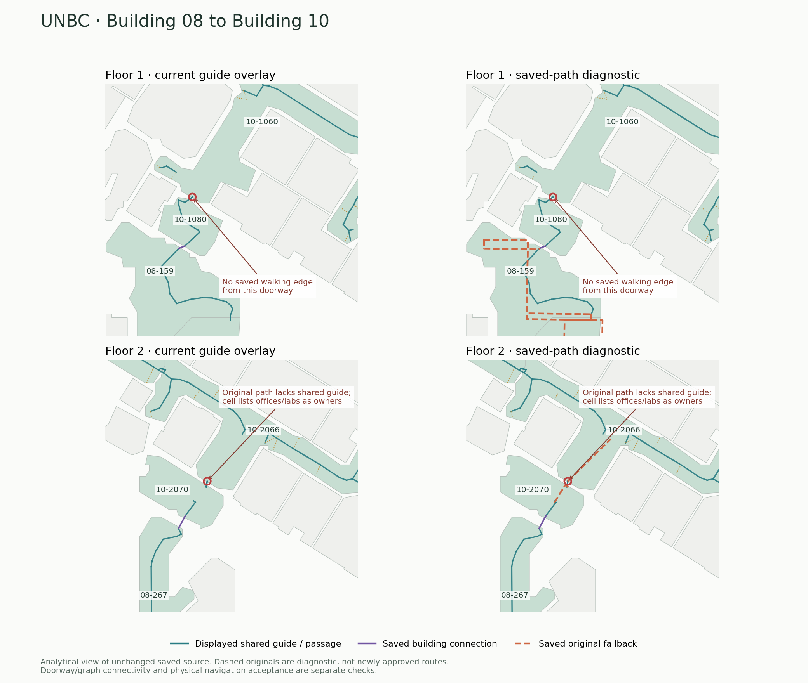
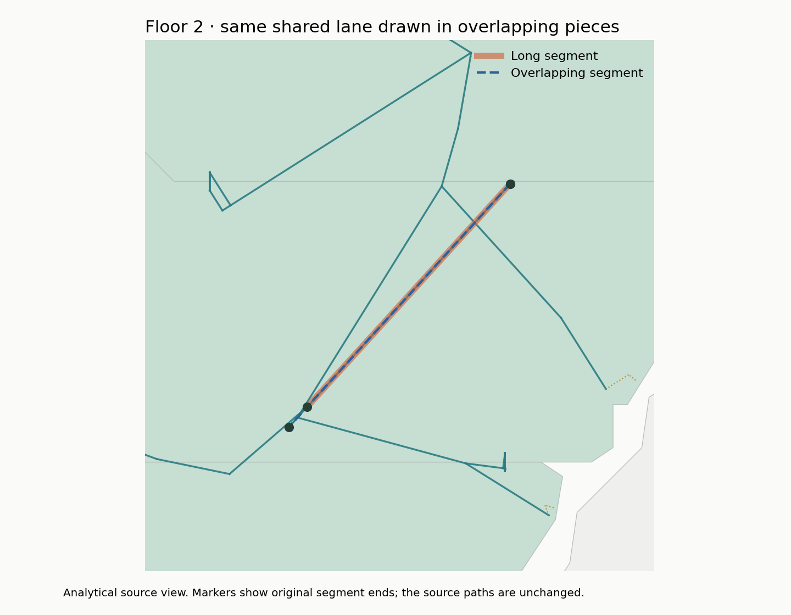

# Building 08–10 pathway gaps and overlapping guides

This is the initial diagnosis. The later [systemic four-floor candidate](../systemic-pathways/README.md)
adds shared fallback/vertical-approach display, exact ordinary-room transit
checks, complete directed stop inventory and frozen calculator results. The
original measurements below are preserved; their owner/overlap counts do not
describe the later candidate.

October 18, 2026. This is a focused inspection of the **published visitor data**,
not the running, unaccepted native rebuild. No routing, source geometry, access
rules, guide coordinates or published assets were changed.

The visitor indoor JSON SHA-256 is
`87194bb96ce4564699f5fb431ef00917fae93181f5730fe3e5f7056c1ca6ca1b`,
matching the version-13 publication. All 2,617 saved guides still pass the
current production geometry/policy binding. The diagnostic reads the actual
`hallwayPathView` and `pathConnections` functions without preparing floors or
building a whole-campus physical routing graph.

## Building connection findings

| Floor | Existing connection | Actual issue |
| --- | --- | --- |
| Floor 1 | 08-159 → door 1501580 → 10-1080 vestibule → door 1501582 → 10-1060 | The main-hall side `door:1487816:1501582:0` has **zero enabled walking edges**. The entrance exists, but its hallway approach is missing from the saved graph. Drawing a line across that gap would invent a connection. |
| Floor 2 | 08-267 → door 1499620 → 10-2070 vestibule → door 1499619 → 10-2066 | The vestibule approach and the main-hall walking branch have no shared guide. The main-hall branch is an enabled original edge, but lists six ordinary rooms as owners. Those create room-transit requirements under the existing policy, even though the endpoints belong to the hallway. |

The six ordinary owners on the Floor 2 main-hall branch are 10-2006 (Office),
10-2084 (Coffee), 10-2068 (Office), 10-2054 (Research Lab), 10-2056 (Office) and
10-2072 (Office). Its original identity is
`native-cell:14.435696:664:walk:arrival:rm-694-d30ff45a3d81|door:694:1499619:1`.
`route-policy.ts` derives its ordinary-room requirements from all declared
edge owners, with the existing geometry-bound through-navigation exceptions.
The diagnostic uses those same exceptions when reporting the six owners.
It does not certify that these room labels or their boundaries are wrong.

The earlier five-floor analytical overview drew shared guide trunks alone. It
omitted door/opening crossings, ramps and original solver fallbacks. That view
therefore exaggerated disconnection. The current viewer additionally draws
saved passage/building/vertical connections, but its shared-guide layer still
omits the unsupported-guide walking branches above. A visible guide gap and a
missing graph connection are different findings; both occur in this area.



These are analytical source views, **not browser screenshots or accepted route
calculations**. Orange dashed originals show diagnostic data, including the
Floor 2 branch with ordinary-room requirements; they are not a proposed bypass
of those requirements. Conservative passage-only saved-topology witnesses in
`source-check.json` fail in both directions. They check every cell owner and
must not be relabelled as normal-calculator physical refusals. The concrete
Floor 1 finding is the zero-degree hallway walking terminal; alternative
campus detours were not tested here.

## Overlap findings

The production view deduplicates identical reversed endpoint pairs within a
native cell. A long segment and a partly overlapping segment with different
endpoints survive. Averaged-axis arithmetic also leaves tiny coordinate
differences, so two visually coincident segments need not be byte-identical.

| Floor | Visually coincident partial-overlap pairs |
| --- | ---: |
| Basement | 0 |
| Floor 1 | 14 |
| Floor 2 | 3 |
| Floor 3 | 1 |
| Floor 4 | 12 |
| Total | **30** |

These pairs have positive shared projected length and lie within **1e-9 ft**
of the same line, within the same cell and physical elevation. None is exactly
collinear when the original IEEE coordinates are evaluated as exact rational
numbers. This is a diagnostic of visually repeated linework, not permission
to snap coordinates or merge neighboring halls. The counts are pairs, not
unique duplicated length, all crossings, or route failures. Independent
alternative chains and terminal branches can also intersect visually.



## Smallest next repair checks

1. Replay the original Floor 1 terminal at physical elevation
   **3.2808398950131235 ft**, cell `native-cell:3.280840:421`, retaining its full
   floor, openings, door 1501582, foreign material and access context. Diagnose
   why the saved main-hall branch was not emitted. Add a branch only after
   actual approach/clearance checks; preserve the original door coordinates.
2. Inspect Floor 2 cells `native-cell:14.435696:668` (vestibule) and
   `native-cell:14.435696:664` (main hall). Check actual source partition and
   traversed-room ownership before regenerating the entry and its shared
   guide. Do not simply remove six owners or enable other-room transit.
3. Render the shared network from stable shared-chain identities/intervals
   once, keeping route-specific terminal branches separate. Splitting and
   deduplicating display intervals must preserve source elevations, junctions,
   parallel halls, holes and original graph identities. Proximity alone cannot
   create a junction. Test this layer independently from native recompilation.
4. Check the repaired entrance chain in both directions with the normal
   hallway-default policy, then check the affected display on desktop/mobile.
   No complete campus import or navigation sweep is needed for each iteration.

The ongoing native rebuild is independent and remains unaccepted. Its output
may change these old visitor findings; rebind/recheck against its actual bytes
before carrying any diagnosis or proposal into that candidate.

## Reproduce and checks

```sh
node --max-old-space-size=3072 --import tsx \
  scripts/indoor/audit-hallway-display-links.ts COMPLETE-SOURCE.json EMPTY-OUTPUT
python scripts/indoor/render-hallway-display-links.py \
  EMPTY-OUTPUT/display-links.json FIGURE-OUTPUT
```

The diagnostic's source assertions checked the current binding, missing Floor
1 walking branch, unbound Floor 2 branch, six ordinary owner requirements and
30 overlap candidates. Scoped TypeScript and tool ESLint pass. Both figures
were visually inspected. There was no runtime/viewer change, browser capture,
fresh physical navigation calculation, master export or Site publication.
Receipts are `source-check.json`, `overlap-check.json` and `SHA256SUMS`.
