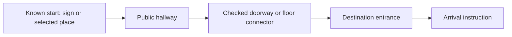

# Ship readiness and a viable first release

October 18, 2026. This work starts from the exact paired version-14 sources:
OpenIndoorMaps `5391ea3cbf9878e418a17fa1f99ed5b1a27ff5e5`, Reviter
`9fea6ce05b5355351040905b3e83ed4e01793df9`. The three-part publication backup
was downloaded, joined and checked against SHA-256
`309177723a9c4f69ab7f2d56b65d53f1896f982242314ebf00f326fe352f65e2`.
Its accepted 45,519,753-byte visitor was reconstructed and matched
`09d35032a47d4cde544207c5a83f28c061750dfdaf2b32e07f042362c164658a`.

**General campus release: blocked.** The existing map and the application
improvements are useful pilot work. They do not resolve the held stairs,
unmatched physical thresholds, lost arrivals in the failed native rebuild or
campus-wide accessible coverage. A release needs a defined coverage promise
and evidence for every journey in that promise. Do not describe a passing
sample route or source-body diagnostic as complete campus acceptance.

The original authoring model/master, verified native cache and seven staged
review/checkpoint archives were also recovered from Drive. All 109 declared stage
members passed checksum checks. This made the source investigations reproducible;
it did not produce a newer accepted master. See
[native recovery](native-base-restoration.json),
[threshold/connector findings](routing.md) and the
[exact arrival-loss diagnosis](arrival-loss/README.md).

## The concept in one sentence

Open a link or scan a sign, choose where you are going, and follow verified
indoor directions from a known starting place.

The first product should be a web visitor map for a small reviewed area. Use
entrance and reception QR signs to identify starting places; keep manual start
selection available. A QR encodes a place identity, not live positioning.
Show Walking and Step-free as explicit choices. Display one instruction and
the relevant floor at a time, with a route overview available. If a connection
is unavailable, explain that and let the visitor change places or profile.
Do not let an unreachable destination look like a calculation still in progress.

The first release scope should be a named set of public entrances, useful
destinations and supported profiles. A Library lift journey and verified
same-floor walks are plausible candidates from existing evidence, but the venue
still needs to choose the useful advertised coverage and confirm its actual
entrance/access conditions. No new scope whitelist is inferred or hard-coded
from a few successful samples.

## How the pathway should work

The visible centreline helps a person read the route. The underlying approved
graph must retain original door owners, served floor stops, direction, access,
real floor holes, obstructions and step-free eligibility. A smooth line cannot
join disconnected buildings. A 50 mm sill cannot become a verified flat edge.
Directions should normally end at the hallway side of a destination entrance;
inside-room arrival remains an explicit preference supported by the calculator.

The [Mappedin investigation](mappedin-lessons.md) records the exact supplied
hospital journey, live cloud-browser evidence, official documentation and
remaining limits. Its lesson is a curated graph and a clear visitor flow. Its
appearance supplies no evidence for a UNBC doorway or access rule.

## Application improvements implemented here

- Selected places in the progressive visitor offer **Start here** and
  **Directions to here**, plus **Swap places**. Restricted, non-walkable and
  disconnected places are explained and excluded from endpoint choices.
- Both visitor entry points accept stable string `from` / `to` identities and
  the `accessible=1` profile choice. Changes update the address bar while
  preserving the map package, manifest and view. The full visitor also accepts
  `profile=accessible`. Unknown identities are explained rather than resolved
  ambiguously by a display name. A link selects endpoints; normal physical and
  policy checks still decide whether a route exists.
- Visitor failure text describes unavailable or restricted/step-free journeys
  without exposing source-authoring instructions.
- The published visitor worker releases duplicate raw archive entries after
  checksum validation. Source/authoring readers retain their original files;
  prepared display blobs survive and are transferred. Exact accepted-map
  dataset, hydrated metadata and manifest comparisons are in
  [loading evidence](loading/README.md). This removes 231,895,082 bytes from
  retained/transferred raw inventory; it does not make total browser RAM small.
- Compiler calls rejected by the deterministic Math guard use the existing
  deterministic implementation. The guard remains active. Evidence in
  [routing readiness](routing.md) establishes that these modules do not change
  the current application's prepared-display/routing engine identity.

## Final verification and delivery limits

The final production build uses `SITE_DEMOS=indoor npm run build:pages`.
This optional dedicated visitor profile omits unrelated venue-demo code; the
default and hospital profiles remain available. It reduces the staged application
from 37,117,999 to 22,567,376 bytes, making room for the actual physical-floor
presentation. The candidate remains local and has not changed the private live Site.

A release-gate defect was fixed: the old checker accepted its manifest's four
combined floors while missing three subsets selected by the actual page.
The exact Main, Basement and fractional-plane views have now been prepared.
All seven scopes and eleven actual default page choices pass the stricter gate.
All previously served floor carriers remain byte-identical. The accepted visitor,
physical dataset, routing carrier and current engine identity remain unchanged;
only the progressive presentation revision changes. See
[plane regeneration](loading/plane-regeneration/README.md).

The final global TypeScript check passes. All 79 selected unit tests and all five
production browser tests pass, including desktop/mobile link restoration,
progressive selection/swap/profile recovery and manual entry/load retry.
The exact root directions carrier passes its independent decode/binding check;
the seven-scope published-project check also passes. Logs and machine-readable
receipts are in [final-checks](final-checks/).

Actual accepted-campus desktop evidence shows 283 rendered Main-floor room
features and the 62.6 m route from 05-136 to 05-173. It also exposes a material
performance blocker: the grey overview appears around 37 seconds, Main-floor
features around 200 seconds and the first route around 308 seconds in this
cold cloud-browser run. The result retains warnings for 60 areas with unknown
public access and 17 connections with unconfirmed step-free access; the observed
Walking result does not certify those properties. These are observed timings,
not a supported-phone promise. See [loading evidence](loading/README.md) for final browser outcomes.
A functioning route does not pass a visitor launch performance gate.

## Simplify delivery as well as the interface

The full visitor still carries the campus dataset and its physical routing
context. Even with duplicate buffers removed, its previous first cached route
took about 37 seconds in Node and its uncached preparation took minutes.
Those measurements must not become a mobile performance promise.

The next delivery milestone is a compact, versioned visitor export for the
chosen pilot: place directory, approved graph, readable instructions and
demand-loaded floor presentation. Keep source RVT interpretation, authoring
review and full compilation in the publishing workflow. A future compact
graph format must carry sufficient source/policy bindings and invalidate on
changes; it cannot remove physical checks merely to load faster. Reuse the
existing checked cache until that format has complete parity tests.

For the smallest viable pilot, an explicit list of reviewed entrance-to-destination
journeys can be calculated at publication time and served as checked instructions,
floor changes and polylines with exact source/profile bindings. Reversal needs
its own checked result. The visitor must advertise that finite coverage and refuse
unlisted requests. This is a smaller first milestone than building a new arbitrary
route engine. Do not infer that coverage from the current sampled test journeys.

Before calling the pilot shippable, measure a cold start and first route with
a floor visible on actual supported phones, including failure/retry, reversed
routes, floor transitions and offline reload. Record browser, device, time to
usable map, first-route time and peak memory. Desktop mobile emulation is
helpful interaction proof, not a physical-phone memory test.

## Remaining release gates

See [routing readiness](routing.md) for exact identities and executable checks.
The general release requires original-body threshold support, complete
foreign-material/standing clearance and ownership, two preserved lost arrivals,
a successful coherent native rebuild, required stair/step-free coverage and
every advertised journey in both directions. The failed rebuilt snapshot is
diagnostic only.

A loading/UX release can reuse the unchanged accepted visitor, provided its
current engine/cache/manifest gates, production build, desktop/mobile routes,
offline inventory and paired source restoration pass. A publication must also
preserve the existing Site audience, check normal live URLs and refresh the
exact paired development download and verified Drive backup. Local tests alone
do not establish a new live publication.
