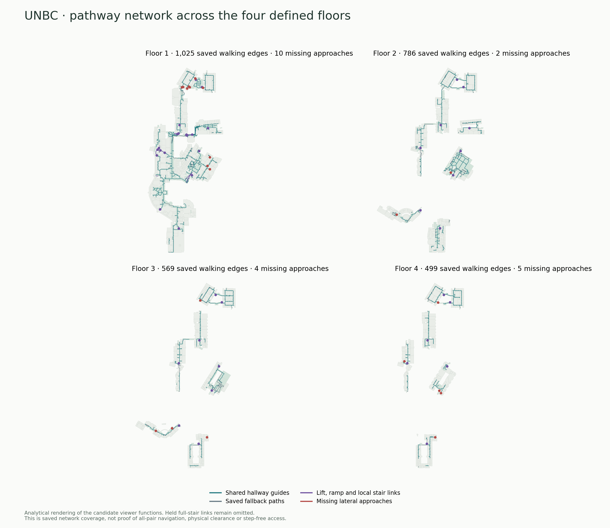

# Systemic pathways across the four campus floors

[Later Floor 3 Building 04–08 inspection](../floor3-building04-building08/README.md)
finds an additional missing connection at ownerless native door 2315416 and a
50 mm source sill. The 21 approach gaps below count existing graph stops, not
all unmatched doorways or disconnected building pairs. The new scoped gateway
reachability check prevents interpreting that inventory as complete connectivity.

October 18, 2026. This is a tested **local candidate**, not a new publication or
accepted authoring master. Private Site version 13 and its 45.52 MB visitor ZIP
remain unchanged. The implementation is shared across buildings, doorway
approaches, stairs, local steps, ramps and lifts on the four defined campus
floors. Native split levels and elevations remain separate within each floor.

## Shared repairs

- The path overlay includes enabled original walking branches without a bound
  shared guide, and saved approaches to vertical stops. Shared guides are teal,
  saved fallbacks grey, real room-door approaches dotted, and existing vertical
  connections purple. Passage/vestibule thresholds stay solid. Missing branches
  are not invented to make the picture look connected.
- A common directed approach inventory checks both sides of every doorway and
  stair/ramp/lift stop. The far side of a door cannot supply its missing
  near-side approach. One-way, held, staff and different-elevation connections
  remain distinct. Missing lateral approaches appear as optional red markers.
- Ordinary-room transit preferences now check the complete exact two-foot
  walking strip against original room identities, rather than requiring every
  ordinary room associated with a large native cell. Owners remain stored;
  staff, non-walkable, physical, access, direction and threshold vetoes still
  use original evidence. Door/endpoint ownership remains required.
  Straightening cannot introduce new ordinary-room transit.
- Shared display intervals are deduplicated within the same source cell and
  elevation. Independent paths require exact collinearity; an ULP-sized
  arithmetic exception needs original connected path/edge provenance. This
  changes rendered linework only, never source coordinates or graph joins.
- Reviter tries a bounded, exact-supported visibility proposal before its fine
  grid fallback for original terminals. Endpoints, holes and foreign obstacles
  remain fixed. The same helper serves doorway, stair and ramp approaches;
  it does not provide missing full-stair clearance/headroom evidence.

## Complete four-floor inventory

| Campus floor | Included native levels | Original walking edges shown | Missing lateral approaches | Ordinary-room requirement stops |
| --- | --- | ---: | ---: | ---: |
| Floor 1 | 1450417, 311, 1487816, 1425915 | 1,025 | 10 | 10 |
| Floor 2 | 694 | 786 | 2 | 21 |
| Floor 3 | 400176, 1487353 | 569 | 4 | 21 |
| Floor 4 | 402367 | 499 | 5 | 22 |
| Total | Original split levels retained | **2,879** | **21** | **74** |

The same directed inventory has 1,762 active scoped stops. Comparing its old
whole-cell ownership requirement with the new exact-body requirement reduces
ordinary-room flags from **1,362 to 74**: 1,288 false association flags cleared,
not 1,288 independently calculated routes. Held full stairs contribute 56 scoped
stops but **28 unique links**. The vertical source inventory contains 43 enabled
lift graph edges, four ramps and one local-step link; graph-edge counts are not
physical lift counts. All 28 held full-stair links remain disabled.

These are analytical renderings of the candidate production viewer functions,
not browser screenshots, all-pair navigation approval or step-free certification.
Individual views: [Floor 1](floor-1-pathways.png), [Floor 2](floor-2-pathways.png),
[Floor 3](floor-3-pathways.png), [Floor 4](floor-4-pathways.png).

The overlap diagnostic still finds nine roundoff-collinear overlap pairs:
7/1/0/1 on Floors 1/2/3/4. Original alternatives and newly exposed fallbacks
remain; not every visible crossing is a duplicate or routable junction. The
earlier 30-pair diagnostic omitted fallbacks and is not identical in scope.

## Actual normal-calculator checks

One frozen complete-source run calculated 13 requests with hallway endpoints
and ordinary-room transit disabled. Ten returned routes and three returned
refusals; all audit assertions passed and the source was unchanged. Only the
step-free refusal had a predeclared expected-unavailable assertion. The two
Building 08–10 refusals remain unresolved.

| Request | Result | Seconds |
| --- | --- | ---: |
| Floor 1: 09-218 → 09-260 | Route | 252.390, cold validation included |
| Floor 2: 06-214 → 06-244 | Route | 3.129 |
| Floor 3: 10-3564 → 10-3588 | Route | 0.762 |
| Floor 4: 04-402 → 04-423 | Route; one turn-around instruction remains | 1.276 |
| 08-264 ↔ 10-2006, Floor 2 | Both hallway-only requests unavailable | 0.057 / 0.042 |
| Library lift: 05-143 ↔ 05-242 | Routes in both directions | 2.000 / 1.995 |
| Existing local steps: 09-201 ↔ 07-180 | Routes in both directions; one turn-around upward remains | 5.331 / 6.637 |
| Ramp: 07-180 ↔ 08-S101 | Routes in both directions | 0.633 / 0.393 |
| Same ramp journey, step-free profile | Refused: approach/access evidence unconfirmed | 0.028 |

This verifies one existing ramp and the local-step link, not all four ramps or
any of the 28 held full stairs. Cold validation is still slow.
See [full calculator report](normal-calculator-report.json) and actual route
geometry in `actual-routes.json.gz`.

The first attempt was rejected because a concurrent build changed a transitive
generated display fingerprint. Its rejection is retained and not counted as a
pass. The successful retry used physically frozen source files. Its routing
implementation is `93707dfcb25168b668740d3f35deb152b4431487cfa31af4cc72f50b24ec31ea`.
Later changes affected only display interval deduplication, its unit tests and
the generated display binding. Routing policy and centering stayed identical.
`frozen-vs-current.json` records those three differences. Final display inventory,
targeted tests and Pages build cover that later display cleanup.

## Source rebuild and next repairs

The independent native rebuild completed at 2026-10-18 04:34:19 UTC with all nine
physical-plane checkpoints saved. It **failed** the original-arrival preservation
guard for **05-S204** (`rm-694-0bed6b73a3bd`) and **03-S104**
(`rm-694-504b25e5319a`). No candidate ZIP or newer accepted master was produced.
Original model/source bytes and the live site were unchanged.

A targeted replay of the new visibility fallback through the minority-owner
arrival query produced no supported attachment for either missing arrival.
That query is not an exhaustive own-cell repair attempt: 03-S104 also has owned
native cells. Keep the preservation guard and original nodes.

All nine checkpoints and the final failed state, including the complete prepared
mathematical snapshot, were uploaded privately and whole-file readback verified.
Final state backup: [UNBC.stage-07-final-build-state.tar.zst](https://drive.google.com/file/d/1arxvf4rGTmKwO7P4JwUk49sQW-ZBnSJU/view),
22,014,812 bytes, SHA-256
`6835403e8832092bf6fbbc1300e045ea9a805782b9b7450f739d9595d43b03a4`.
The [private continuation folder](https://drive.google.com/drive/folders/13ZLJpZEs-70wVXQiCUzhYera0aVqVpVL)
holds the preceding verified source/review/checkpoint increments.
These preserve a failed build, not a successful master.

Continue with targeted local checks:

1. Restore the two lost arrivals from complete original floor/owner/door contexts
   before attempting another accepted master.
2. Repair the 21 missing lateral stops from `stop-inventory.json` using original
   physical cells. Check both sides/directions and related access profiles.
   The unaccepted prepared rebuild has two walking branches at Building 10
   door 1501582 where the published source has none; that finding still needs
   coherent source acceptance and an actual route calculation.
3. Qualify the 28 original full-stair links against flight, landing, clearance,
   aperture, foreign-material and access evidence. Keep excluded exterior,
   seating and unqualified stairs held. Check both served native planes.
4. Replay the two remaining turn-around cases and nine display overlap candidates
   independently. Avoid repeating cold whole-map navigation for each edit.
5. Batch stable repairs for coherent source/export/navigation acceptance.
   Actual desktop/mobile browser proof is still required before publication;
   browser-control tools were unavailable for this candidate. Pair any future
   visitor with both exact committed source trees and verified restore.

## Verification and portable evidence

48 related OpenIndoorMaps tests and 39 related Reviter tests pass. Scoped
TypeScript checks and focused lint pass; the Pages build passes. These targeted
checks do not claim pre-existing full-repository CI debt is fixed.
Receipts and commands are in `checks.json`; raw test logs are retained here.

Complete visitor indoor JSON SHA-256:
`87194bb96ce4564699f5fb431ef00917fae93181f5730fe3e5f7056c1ca6ca1b`.
Visitor ZIP SHA-256:
`09d35032a47d4cde544207c5a83f28c061750dfdaf2b32e07f042362c164658a`.
Original RVT SHA-256:
`8c294549ee667ed7aba38f1f4f3a53514dae7544af97f0157ee8187dd8702178`.
`network.json.gz` contains the complete selected-floor saved-source display
inventory. It is analytical evidence and grants no import/physical authority.
All committed evidence files are covered by `SHA256SUMS`.

The [4.08 MB continuation increment](https://drive.google.com/file/d/1xIX7LiGg9qy50y2jhxKk0Ba8_7wYr3fd/view)
contains Git bundles, tracked-file checksums, restore instructions and a verified
fresh restore receipt for OpenIndoorMaps `17d2464` and Reviter `e311f16`.
All 3,858 tracked files matched after fetching only each prerequisite base and
then its bundle. The final archive entries and complete private Drive download
also matched SHA-256. See `portable-backup.json`. This is code and evidence;
the original model/review/checkpoint archives remain separate in the same Drive
folder. Subsequent receipt-only commits are outside this increment.
