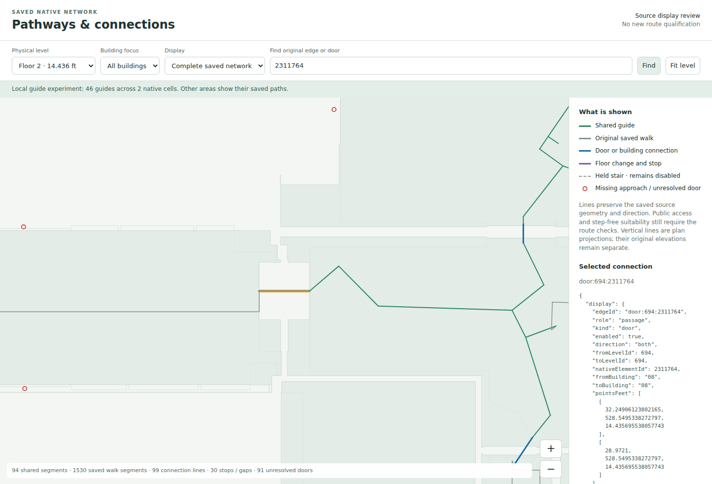
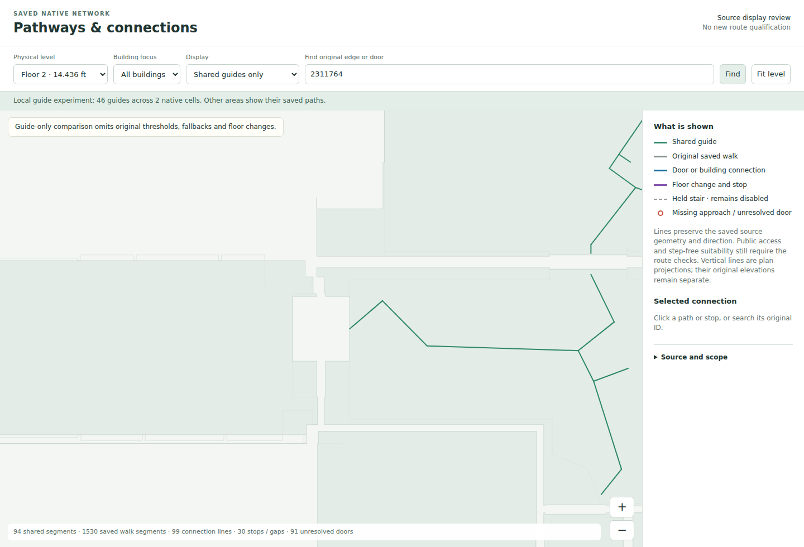
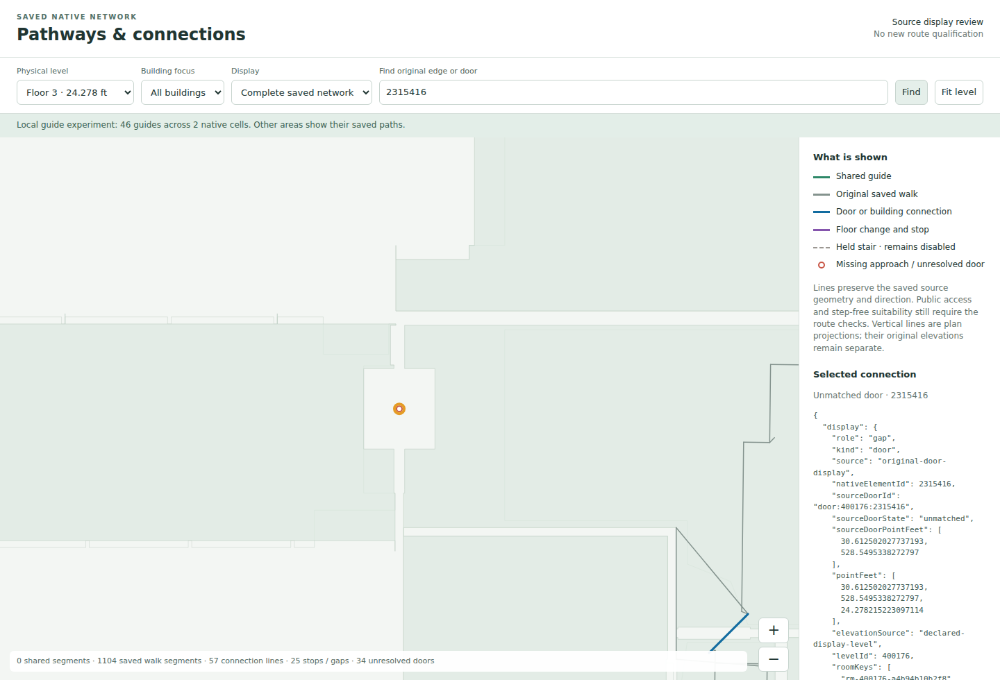
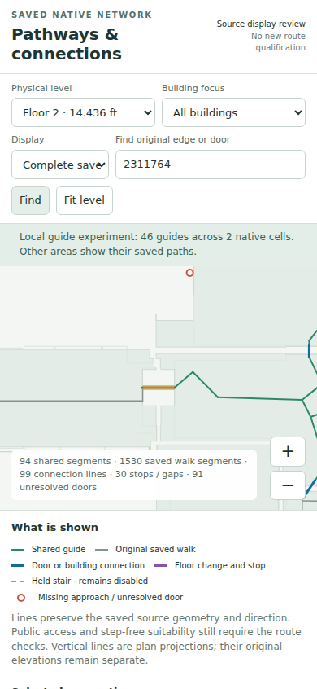
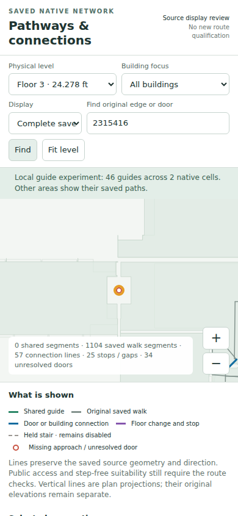

# Fresh UNBC native pathway preview — 30 October 2026

The rebuilt exporter and the real desktop/mobile preview checks passed. The export finished at **22:05:38 UTC** and browser checks finished at **22:05:56 UTC**. This evidence was generated from the recovered complete dataset and the freshly compiled 46-guide catalog; it is separate from the recovered October 23 reference preview.

## What the preview contains

- **12 declared native levels**, including the four with no saved native cells; eight levels have native cells.
- **1,188 unique native cells**, **1,865 room records**, and original saved walking paths, doorway crossings, floor changes, held stairs and gap diagnostics.
- **727 inner rings counted once per source cell**, with all original rings retained. This is a representation count, not a count of distinct physical hole elements. Cells appearing in more than one level scope are counted separately in per-level occurrence totals.
- **46 shared guides in two complete native cells**, `native-cell:14.435696:616` and `native-cell:14.435696:617`. Floor 2 displays these as 94 guide segments. Other areas retain their original saved pathways. This does not reproduce the earlier 2,701-guide campus candidate.
- Original model XYZ, graph-node identity, source-edge metadata and unmatched native doorway markers for inspection. No geometry or access permissions were edited.

The existing production floor worker already combined hallway pathways and connection edges. The shared helper keeps this exporter consistent with that production composition; it does not repair an alleged universal omission of connectors.

## What the images establish

**Floor 2 — doorway 2311764.** The complete view retains original source edge `door:694:2311764`, connecting its original two nodes at the original elevation. The guide-only comparison hides original connection and fallback layers, making a visible gap without changing the source graph.





**Floor 3 — doorway 2315416.** This source doorway remains unmatched, with only candidate room `08-360`. It is shown as a diagnostic at its original XY and declared native level. No second owner, approach or routing edge was invented.



The mobile layout keeps the map visible and puts its independently scrollable legend/details panel below it. The native ID inspection is exercised in both viewport sizes.





## Verification and scope

The exporter accepted the catalog only after the current resolver, complete source geometry and policy binding, source model identity, and every original guide endpoint/plane check matched. It rechecked the input bytes, complete source JSON value and implementation before finishing. The recovered raw dataset matched directly; no fallback extraction or second normal import was needed.

**24 real level/viewport checks passed**: all 12 native levels at desktop 1440×980 and mobile 390×844. Actual DOM counts match exported rooms, native cells and network features. Original per-cell ring counts and the even-odd hole rendering agree. Both requested native IDs were inspected, guide-only mode was compared, and there were zero page errors or horizontal overflows. Eight PNGs and their hashes are retained in `browser-checks.json`.

The export took 22.012 seconds under the supervisor. Linux child maximum RSS was 2,305,232 KiB; sampled shared-cgroup peak was 4,168,630,272 bytes. These are different measurements. The supervised browser check took 4.003 seconds. Both exited 0 with no new OOM events.

The separate normal-import and actual production-worker run also passed its ten selected cases: **four available journeys and six expected refusals**, with the required original doorway edge checked in guide-on and guide-off routes. All ten cases use **hallway arrival**. Twenty other known requests still require evidence, and the campus connection inventory remains incomplete. The preview itself performs no route acceptance and certifies no step-free journey. See the connection acceptance evidence alongside this preview documentation for those exact case results.

## Inspect locally

Extract `UNBC-native-pathways-preview-20261030.zip`, open a terminal in the extracted directory, and run:

```sh
python3 -m http.server 8767 --bind 127.0.0.1
```

Open `http://127.0.0.1:8767/`. Choose a physical level or building focus, compare **Complete saved network** with **Shared guides only**, and search `2311764` or `2315416`. Use the zoom controls or drag the map. The files are a local inspection preview; nothing was published.

## Evidence files

- `EXPORT-MANIFEST.json`: exact source bytes, whole-source guide binding, implementation dependency hashes, UI assets and each native level export.
- `FRESH-PREVIEW.json`: current scope, source/guide hashes, counts, image receipts and separate route-run reference.
- `browser-checks.json`: all 24 checks and eight screenshot hashes.
- `export.execution.json` and `browser.execution.json`: actual command, timings, exit and memory measurements; corresponding logs are retained.
- `CODE-CHECKS.json`: the earlier focused 23-test, strict TypeScript and lint checks for the rebuilt implementation.
- `chromium-install-receipt.json`: exact tested Chromium 147.0.7727.15 recovered from its official release URL.
- `screenshots/`: eight current desktop/mobile captures, including full-level overviews.
- `PREVIEW-ARCHIVE-RECEIPT.json`: final preview ZIP size, SHA-256, member count and CRC result. The receipt is provided beside the ZIP to avoid a circular self-hash.
