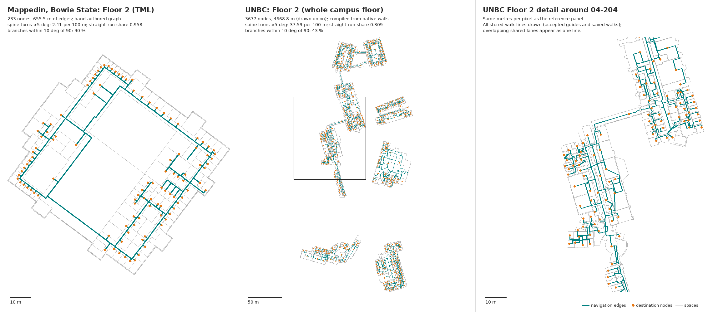

# UNBC walking network against reference navigation graphs — November 2, 2026

This compares the final candidate `32c395e1…` walking network with commercial
reference navigation graphs. It is analysis only. No routing data or code was
changed. All numbers are in [METRICS.json](METRICS.json). They were produced by
[`tools/reference-comparison/measure.py`](../../../../tools/reference-comparison/measure.py),
and the figure by
[`draw_figure.py`](../../../../tools/reference-comparison/draw_figure.py). Both
scripts use one shared model ([`navgraph.py`](../../../../tools/reference-comparison/navgraph.py))
for every dataset.

The reference captures are not committed. Neither is anything extracted from
them. The scripts parse the captures as JSON and never execute them.

**References.** These are Mappedin MVF v2 bundles for Bowie State University
(38 maps, including an outdoor campus map), Toronto Eaton Centre (5 maps) and
a demo mall (2 maps). There is also the Situm City Mall building path graph
(3 floors) and two Pointr Harrods route responses. The figures from the earlier
outside analysis are confirmed:

| Reference      | Graph checked                                                    |
| -------------- | ---------------------------------------------------------------- |
| Bowie          | 4,395 nodes; 105 connections (60 stairs, 20 elevators, 25 doors) |
| Eaton          | 1,228 nodes; 50 connections                                      |
| Demo mall      | 741 nodes; 11 connections                                        |
| Situm          | 138 nodes; 169 links, of which 12 are inter-floor                |
| Pointr route 1 | 103 route points; 8 directions; uses an elevator                 |
| Pointr route 2 | 64 route points; 5 directions                                    |

**Ours.** The four visitor floors in
`docs/continuation/unbc-20261031/campus/map/floors/` are measured from
`net`/`netNodes` plus the door/opening `crossings`. Each edge was rebuilt from
its full-precision feet geometry: the accepted guide from
`PREPARED-ROUTING.json`, otherwise the saved walk from `graph-full.json`. The
geometry was placed in the same display frame. The decimetre display
coordinates were not used, because their rounding adds noise of up to about 5°
on 1 m segments. On Floor 2 that rounding raised spine turns from 37.6 to 44.2
per 100 m.

**Scale and provenance.** UNBC is a multi-building campus. Its network is
compiled from native model walls, and every guide has to pass an exact
clearance check. It has an arrival point inside every room, so many of its
branches include a walk inside the room. The references are hand-authored or
generated by unknown means. Bowie is also multi-building, but it is split into
one map per building floor. Situm is sparse and corridor-only. Pointr
publishes no graph, so its two routes are compared only for directions and
route shape.

## Two views of each graph

- **As stored**: the graph exactly as the dataset holds it. Polyline interior
  vertices count as degree-2 nodes.
- **Drawn union**: vertices are merged within a 0.1 m lattice cell, and each
  segment is split at any vertex within 0.15 m of it. Duplicate segments are
  removed. No junction is added where two segments cross; those crossings are
  counted instead.

The views are identical for the references (to within 0.1 m). They differ for
UNBC because every walk edge stores its own polyline, so shared lanes are drawn
many times over. Topology, spine and straightness figures use the drawn union.
Zigzags use the as-stored view, because the union collapses out-and-back
spikes into stubs. The exact definitions are in `METRICS.json`
(`definitions`).



## Graph size

| Dataset (floors)    | Nodes / edges, as stored | Length, as stored | Nodes / edges, drawn union | Length, drawn union | Nodes per 100 m (union) |
| ------------------- | ------------------------ | ----------------- | -------------------------- | ------------------- | ----------------------- |
| Bowie (38)          | 4,393 / 4,493            | 21,187 m          | same                       | same                | 20.7                    |
| Bowie Floor 2 (TML) | 233 / 236                | 656 m             | same                       | same                | 35.5                    |
| Eaton (5)           | 1,220 / 1,374            | 8,753 m           | same                       | same                | 13.9                    |
| Demo mall (2)       | 740 / 772                | 5,890 m           | same                       | same                | 12.6                    |
| Situm (3)           | 138 / 157 (+12 vertical) | 2,933 m           | same                       | same                | 4.7                     |
| **UNBC (4)**        | 22,463 / 24,359          | 26,623 m          | 13,336 / 14,340            | 17,387 m            | **76.7**                |
| UNBC Floor 2        | 6,191 / 6,735            | 7,255 m           | 3,677 / 3,977              | 4,669 m             | 78.8                    |

Node counts exclude nodes with no edge on their own floor. For example, Bowie
has 4,395 nodes in total, 2 of which have only vertical links. On UNBC, 35 % of
the stored walk length repeats shared-lane geometry that is already drawn by
another edge.

## Topology (drawn union)

| Dataset           | Junctions (deg ≥ 3) per 100 m | Destination dead ends | Bare dead ends (stubs < 0.5 m) | Loops (cyclomatic number) | Loops per 100 m | Components (largest share) | Crossings without a junction |
| ----------------- | ----------------------------- | --------------------- | ------------------------------ | ------------------------- | --------------- | -------------------------- | ---------------------------- |
| Bowie             | 8.75                          | 1,840                 | 27 (0)                         | 143                       | 0.67            | 43 on 38 maps              | 0                            |
| Bowie Floor 2 TML | 16.3                          | 106                   | 1 (0)                          | 4                         | 0.61            | 1                          | 0                            |
| Eaton             | 6.37                          | 417                   | 9 (2)                          | 166                       | 1.90            | 12 on 5 maps               | 2                            |
| Demo mall         | 5.50                          | 281                   | 4 (0)                          | 36                        | 0.61            | 4 on 2 maps                | 0                            |
| Situm             | 1.98                          | 7 \*                  | 19 (0)                         | 22                        | 0.75            | 3 on 3 floors              | 0                            |
| **UNBC**          | **18.6**                      | 1,060                 | **519 (489)**                  | **1,042**                 | **5.99**        | 38 on 4 floors             | **163**                      |
| UNBC Floor 2      | 19.6                          | 282                   | 140 (130)                      | 306                       | 6.55            | 6 (48 %)                   | 61                           |

Degree histograms are in `METRICS.json`. As stored, UNBC has 1,938 loops and
25 bare dead ends. Most bare dead ends in the union are 0.1–0.5 m spikes left
behind when out-and-back hooks collapse.

\* Situm binds a destination at run time to the nearest point on the graph.
Its "destination" nodes here are the nodes within 3 m of a POI, which is only
an approximation.

## Spines and branches (drawn union; median, with p90 where shown)

| Dataset       | Spine chain length | Spine stroke length (p50 / p90) | Branch length | Branch angle to spine | Branches within 10° (5°) of 90° | Branch spacing along spine |
| ------------- | ------------------ | ------------------------------- | ------------- | --------------------- | ------------------------------- | -------------------------- |
| Bowie         | 3.4 m              | 13.5 / 80.7 m                   | 1.9 m         | 89.6°                 | 84 % (82 %)                     | 3.2 m                      |
| Bowie Floor 2 | 2.5 m              | 14.1 / 66.5 m                   | 1.5 m         | 89.6°                 | 90 % (90 %)                     | 2.6 m                      |
| Eaton         | 5.3 m              | 11.6 / 52.5 m                   | 5.5 m         | 89.3°                 | 80 % (78 %)                     | 6.6 m                      |
| Demo mall     | 5.8 m              | 29.5 / 94.7 m                   | 10.2 m        | 88.8°                 | 85 % (79 %)                     | 5.8 m                      |
| Situm         | 21.7 m             | 45.5 / 143.5 m                  | 6.1 m         | 85.2°                 | 65 % (54 %), n = 26             | 33 m                       |
| **UNBC**      | **1.9 m**          | **3.6 / 15.3 m**                | 2.8 m         | **75.1°**             | **42 % (29 %)**                 | 2.7 m                      |
| UNBC Floor 2  | 1.8 m              | 3.6 / 14.4 m                    | 2.8 m         | 76.1°                 | 43 % (28 %)                     | 3.1 m                      |

A stroke joins spine chains through junctions, always taking the straightest
continuation within 30°. Door density is about the same on UNBC and the
Mappedin floors: branch spacing is 2.7 m on UNBC against 2.6–3.2 m at Bowie.
What differs is that UNBC's corridors break into short, unaligned pieces, and
its branches meet them at oblique angles.

## Straightness

| Dataset       | Spine turns > 5° per 100 m | Share of spine in straight runs (≥ 5 m, < 3°) | Sideways jogs per 100 m | Zigzags (> 120°, leg ≤ 2 m), as stored |
| ------------- | -------------------------- | --------------------------------------------- | ----------------------- | -------------------------------------- |
| Bowie         | 2.51                       | 0.955                                         | 0.10                    | 0                                      |
| Bowie Floor 2 | 2.11                       | 0.958                                         | 0.47                    | 0                                      |
| Eaton         | 2.56                       | 0.932                                         | 0.04                    | 0                                      |
| Demo mall     | 3.64                       | 0.971                                         | 0.17                    | 1                                      |
| Situm         | 1.86                       | 0.995                                         | 0                       | 0                                      |
| **UNBC**      | **36.0**                   | **0.365**                                     | **3.84**                | **2,348 (8.8 per 100 m)**              |
| UNBC Floor 2  | 37.6                       | 0.309                                         | 3.96                    | 627 (8.6 per 100 m)                    |

A jog is two consecutive turns over 5° of opposite sign, no more than 3 m
apart, whose net change is under 5°. In other words, it is a sideways offset.
A rounded corner, whose turns all go the same way, is not a jog.

The Pointr route polylines have 17–39 turns over 5° per 100 m. Those turns come
from corner rounding (same-sign turns on 0.2–0.6 m segments): the jogs are only
0–2.5 per 100 m and there are no zigzags.

## Doors, transitions and flags

| Aspect                       | Mappedin                                                                                                                                                                                                                                                                                                                                                      | Situm                                                                                      | Pointr                                                                                                               | UNBC                                                                                                                                                                                               |
| ---------------------------- | ------------------------------------------------------------------------------------------------------------------------------------------------------------------------------------------------------------------------------------------------------------------------------------------------------------------------------------------------------------- | ------------------------------------------------------------------------------------------ | -------------------------------------------------------------------------------------------------------------------- | -------------------------------------------------------------------------------------------------------------------------------------------------------------------------------------------------- |
| Room doors                   | Not modelled. Each space lists `destinationNodes`; Bowie has 1,978 for 2,927 spaces. The 25 Bowie "door" connections are two-node links between maps, i.e. building entrances (neighbour weight 2000–2001).                                                                                                                                                   | None. Destinations bind to the nearest graph point at run time.                            | Not exposed.                                                                                                         | 1,572 door edges and 202 opening edges, each with anchors on both sides (`door:…:0/1`), plus 1,850 arrival nodes, one inside each room.                                                            |
| Stairs, lifts and escalators | Separate connection objects that list their nodes: Bowie 60 stairs and 20 elevators; Eaton 25 escalators, 19 elevators, 5 stairs and 1 ramp. The cross-map neighbour weight carries a cost: Bowie stairs 1001–1003 and elevators 5001–5004; Eaton escalators 1001, elevators 5001–5003 and some stairs 100001. Optional `extra.active` and `waitTime` fields. | Ordinary links between floors (12), with a fixed floor-change distance of 7 in the client. | Each transition has `transitionInfo` with `isAccessible`, `isComfortable` and `travelTime` (120 s for the elevator). | Graph edges with a kind: elevator 43, stairs 28 (held, accessible `no`), ramp 4, local steps 1. The cost is length only, ×4 through other rooms (`projectLinkCost`). No wait-time or active field. |
| Accessibility                | Binary. `accessible` is present on every connection: stairs and escalators false; elevators, doors and ramp true. Nodes carry an accessible bit: all 4,395 set at Bowie, 480 of 1,228 clear at Eaton. No missing values in these captures.                                                                                                                    | Binary per link: 158 true, 11 false. The editor creates new links as `accessible: true`.   | Route modes `normal`, `easy` and `accessible`.                                                                       | Three states. Walk edges: 5,431 unknown, 57 yes. Doors: 1,572 unknown. Unknown is the default, and step-free requests refuse unless every part is confirmed.                                       |
| Public access and filters    | `includeNonPublic` is false by default. Eaton has 8 entrance filter flags in the node bitmask.                                                                                                                                                                                                                                                                | Include/exclude tags with the current time (`#sec_control` and others).                    | Not exposed.                                                                                                         | Room access: 4 public, 8 staff, 1,853 unknown. Public profile, with transit through other rooms as an opt-in.                                                                                      |
| One-way                      | Directed neighbour lists: Eaton 50 and demo mall 12 one-way edges, all at escalators.                                                                                                                                                                                                                                                                         | Each link has an `origin` field (all 169 are "both"); the client draws directional links.  | Not exposed.                                                                                                         | Policy is evaluated per direction (`routing-graph.ts`), but the data has no one-way attribute. UNBC has no escalators.                                                                             |

## Directions

| Route                                     | Distance | Instructions | Per 100 m | Excluding depart/arrive |
| ----------------------------------------- | -------- | ------------ | --------- | ----------------------- |
| Pointr route 1 (elevator, 2 levels)       | 137.2 m  | 8            | 5.8       | 7                       |
| Pointr route 2                            | 116.2 m  | 5            | 4.3       | 4                       |
| UNBC 04-204 → 08-267                      | 121 m    | 12           | 9.9       | 10                      |
| UNBC 04-255 → 08-272 (other-room transit) | 186 m    | 19           | 10.2      | 17                      |
| UNBC 08-264 → 10-2006                     | 84 m     | 15           | 17.9      | 13                      |
| UNBC 06-376 → 06-364 (transit)            | 47 m     | 9            | 19.1      | 7                       |
| UNBC 06-388 → 06-364                      | 34 m     | 6            | 17.6      | 4                       |
| UNBC 06-366 → 06-364                      | 21 m     | 7            | 33.3      | 5                       |

The UNBC step counts come from the browser proof files in
`../final-candidate/browser/`, desktop and mobile, which agree.

What produces an instruction:

- **Pointr**: Turn left/right or turn slightly left/right; an upward or
  downward transition; and the destination. There is no departure step. The
  captured turns were 64–94°.
- **Mappedin** (from the client SDK constants): Departure, Turn, Take/Exit
  connection and Arrival. Bearings are classed as straight within ±18°, slight
  at 18–45°, turn at 45–145°, and back beyond that. The path is smoothed by line
  of sight first, with a default buffer radius of 1.8 m.
- **Situm**: Initial, go ahead, turn, slight turn, change floor or level, pass
  through, look at, and destination reached. POI categories carry
  `indication_type`/`indication_radius`, which are landmark hints.
- **UNBC** (`app/indoor-project/navigation-steps.ts`): depart; a turn over 25°
  ("Bear" below 60°, "Turn around" above 150°); a floor change; entering a
  curve; a change of building; and arrive. Legs shorter than 0.5 m do not set
  the heading.

**Reconstruction.** The route was rebuilt from its stored edges, with exact
out-and-back pairs removed. Our step rules were then applied again
(`directionsReconstruction`). This is not a browser result.

- 04-204 → 08-267 gives 13 steps, against 12 in the browser. 36 of its 97
  stored segments cancel out as out-and-back pairs. Of the 11 middle events, 5 are
  "Bear" turns of 28–50°, 5 are turns of 61–101° and 1 is a building change.
  5 of the 11 follow a leg shorter than 2 m.
- 06-366 → 06-364 gives 7 steps, the same as the browser. All 5 middle events
  are "Bear" turns of 30–55°.
- The other two routes do not reproduce. The arrival trimming and composition
  are not emulated, so those results are listed only in `METRICS.json`.

## What a client loads before routing

| System    | Graph a client loads                                                                                                                     | Where routing runs                                                                                                                                                                                                                     |
| --------- | ---------------------------------------------------------------------------------------------------------------------------------------- | -------------------------------------------------------------------------------------------------------------------------------------------------------------------------------------------------------------------------------------- |
| Bowie     | Whole-venue bundle: 1.54 MB zip (13.3 MB unpacked). Of that, `node.geojson` is 2.83 MB (167 KB gzip -9).                                 | Client, in the SDK. No dedicated routing worker was found in the SDK bundle; the 6 worker constructions there serve map rendering. This was not checked at run time.                                                                   |
| Eaton     | 0.66 MB zip (4.9 MB); `node.geojson` 834 KB (67 KB gzip)                                                                                 | Same as Bowie.                                                                                                                                                                                                                         |
| Demo mall | 0.27 MB zip (2.0 MB); `node.geojson` 490 KB (32 KB gzip)                                                                                 | Same as Bowie.                                                                                                                                                                                                                         |
| Situm     | Building JSON with paths, 181 KB, plus a 209 KB routes-library script                                                                    | **A persistent worker** (`persistent: true`). The graph is built once per building and reused for directions, navigation, distances and "where am I".                                                                                  |
| Pointr    | None                                                                                                                                     | Server. Each journey is one request, with responses of 28 KB and 17 KB.                                                                                                                                                                |
| **UNBC**  | Directions carrier: 35.2 MB logical / **8.2 MB** gzip (1,188 cells). The progressive routing asset is 196.5 MB logical / 25.2 MB brotli. | A dedicated worker that is **not** persistent on the whole-campus map. It gets no background warm-up, and an idle worker is released before a floor transition or review (`use-project-route.ts`). The next request prepares it again. |

## What the references do that we don't (ranked)

Effort assumes the usual candidate cycle: a compile, about 2,000 s of
acceptance, about 5,000 s of progressive export, then cache, plans and browser
gates.

1. **One straight centerline per corridor.** Spine turns are 36 per 100 m on
   UNBC against 1.9–3.6. The straight-run share is 0.37 against 0.93–1.00, and
   jogs are 3.8 per 100 m against 0.5 or fewer. Corridor strokes reach 15 m at
   p90, against 52–143 m. _We do part of this already:_ `corridor-straight-axis.ts`
   (ad367a5) fits one axis, but only to elongated single-interval components
   with at most 0.75 ft deviation. The chain fit and trunk refit (d1aa50f) and
   the crossing rejection (e826098) cover the rest. Junctions, bends and
   multi-interval halls fall back to the general network. _Effort:_ high.
   _Risk:_ medium. Every refit guide must pass the exact 2 ft clearance check
   again, and distances in the acceptance cases will change.
2. **Fewer, coarser instructions.** UNBC gives 9.9–33 instructions per 100 m
   against 4.3–5.8 for Pointr. Mappedin smooths by line of sight before
   classifying turns. In the reconstructed corridor route, 5 of the 11 middle
   steps are 28–50° "Bear" turns and 5 follow legs shorter than 2 m. _Partly
   done:_ legs under 0.5 m are ignored, curve ranges are suppressed, and the
   hallway centre is trimmed (ad367a5). _Effort:_ low to medium; the change is
   to `navigation-steps.ts`, which is 177 lines. Turns within 2 m whose net
   change is under 25° could be merged. A building-change step could be
   dropped unless the door or name changes. Smoothing could be done only
   inside the already verified cells. _Risk:_ low for merging text. Geometric
   smoothing needs a containment check again and must not change the routes.
3. **No hooks or zigzags in the stored geometry.** UNBC has 2,348 zigzags
   (8.8 per 100 m) against 0–1. On the corridor route, 36 of 97 stored segments
   cancel out as out-and-back pairs. _Partly done:_ exact out-and-back inside a core is
   removed when the route is composed (`composeCorridorCenterlineRoute`), and
   crossed approaches are rejected (e826098). _Effort:_ medium; collapse hooks
   at compile time and check the result again. _Risk:_ low to medium.
4. **Door branches that meet the corridor at a right angle.** On UNBC 42 % of
   branches are within 10° of 90°, against 80–90 % on the Mappedin floors. The
   median angle is 75° against about 89°. _Partly done:_ door-normal shaped
   approaches (d1aa50f) and the topology-safe fallback (e826098). _Effort:_
   medium. _Risk:_ medium, because approaches near door jambs fail clearance
   and fall back to the legacy approach.
5. **One shared node graph.** UNBC stores each edge as its own polyline, so
   35 % of its walk length is repeated. It has 163 crossings without a
   junction against 0–2, 6.0 loops per 100 m against 0.6–1.9, and 77 nodes
   per 100 m against 5–36. In the references a route is simply a path through
   the nodes, with no composition step. _Partly done:_ shared lanes share
   vertices and `hallwayJoins` (resolver native-walking-guides-4). _Effort:_
   high, because it changes the routing data model, the caches and the
   receipts. _Risk:_ high. It is also the main lever for item 6.
6. **A small client graph and a persistent worker.** The reference graphs are
   0.03–0.17 MB gzip, Situm builds its graph once in a persistent worker, and
   Pointr loads nothing. UNBC loads an 8.2 MB carrier (35 MB logical), and its
   worker is released between floors. _Partly done:_ the directions carrier,
   the progressive manifest and lazy plans (317b8c9). _Effort:_ high. Keeping
   the worker alive is easy, but the large heap is the reason it is released.
   _Risk:_ medium (memory use on mobile).
7. **Cost and state per connection.** Mappedin weights elevators higher than
   stairs (5001+ against 1001+). It also has `active` and `waitTime` fields,
   and the query can pass `excludedConnections` and `connectionIdWeightMap`.
   Pointr reports `travelTime` and `isComfortable`. UNBC costs by length only,
   though excluding a stair is already supported (`excludedNativeStairIds`).
   _Effort:_ low to medium. _Risk:_ low, but route choice changes, so
   acceptance must be run again.
8. **Landmarks in instructions.** Situm has look-at and pass-through
   indications and per-category landmark radii. The October 17 Mappedin review
   saw named landmarks in its instructions. UNBC names rooms only on depart and
   arrive. _Effort:_ medium. _Risk:_ low.
9. **One-way edges.** Mappedin has directed escalator edges and Situm a link
   `origin` field. UNBC has no escalators, so the priority is low. _Effort:_
   low.
10. **Rounded route corners in the display.** Pointr routes have fillets made
    of 0.2–0.6 m segments, and Mappedin has `smoothingTension` and
    `smoothingCornerRadius`. This is display only. _Effort:_ low. _Risk:_ it
    must not suggest that the geometry was simplified.

## What we do that they don't

- **Exact native containment.** Every accepted guide and door approach passes
  an exact continuous 2 ft strip check against the native model walls and
  holes (`corridor-centerline.ts`, plus the straight-hallways report). The
  reference graphs carry no clearance evidence.
- **Explicit unknown accessibility and access.** Accessibility has three
  states and defaults to unknown, so step-free routing refuses rather than
  guessing. Mappedin and Situm store binary values, and Situm defaults new
  links to accessible.
- **Real doors.** Each door is a two-sided portal edge with its native element
  identity: 1,572 doors and 202 openings. Every room has an arrival point
  inside it, and inside, doorway and hallway endpoint modes are explicit.
  Mappedin's room doors are only implied by destination nodes.
- **Explained refusals.** The user is told why there is no route, for example
  "No hallway-only route is available…". Transit through other rooms is an
  opt-in.
- **Reproducibility.** Results are bound to the source model hash, the engine
  hash and receipts. The normal calculator and the production worker are
  checked for parity on every policy case.
- **Campus scale.** Four floors that span several buildings, 17.4 km of drawn
  network, all compiled from native geometry. The whole map is also available
  offline.

## Reproduce

Put each capture in its own new, empty directory under
`/home/user/unbc-work/refs/x/`. Then run, with the paths filled in:

```sh
python3 -I tools/reference-comparison/measure.py \
  --bowie BOWIE_MVF --eaton EATON_MVF --demomall DEMO_MVF \
  --situm SITUM_BUILDING_JSON --situm-routes-js SITUM_ROUTESLIB_JS \
  --pointr-routes ROUTE1.json ROUTE2.json \
  --floors docs/continuation/unbc-20261031/campus/map/floors \
  --graph CAND_FINAL/graph-full.json --frame CAND_FINAL/frame-1a127847.json \
  --guides docs/continuation/unbc-20261102/final-candidate/PREPARED-ROUTING.json \
  --manifest PROGRESSIVE/manifest.json --carrier HYDRATION/3d27eaa5….json.gz \
  --proof docs/continuation/unbc-20261102/final-candidate/browser/desktop-proof.json \
  --acceptance docs/continuation/unbc-20261102/final-candidate/acceptance/NORMAL-ROUTES.json \
  --policy-matrix docs/continuation/unbc-20261102/final-candidate/policy/POLICY-MATRIX.json.gz \
  --sizes BOWIE_ZIP EATON_ZIP DEMO_ZIP \
  --out docs/continuation/unbc-20261102/reference-comparison/METRICS.json
python3 -I tools/reference-comparison/draw_figure.py --mvf BOWIE_MVF \
  --mvf-floor "Floor 2 (TML)" --mvf-label "Mappedin, Bowie State" \
  --ours docs/continuation/unbc-20261031/campus/map/floors/floor-2.json \
  --detail-room 04-204 --metrics docs/continuation/unbc-20261102/reference-comparison/METRICS.json \
  --out docs/continuation/unbc-20261102/reference-comparison/floor2-vs-bowie.png
```

The measurement takes about 4 s. It needs only the Python standard library;
the figure also needs Pillow.
