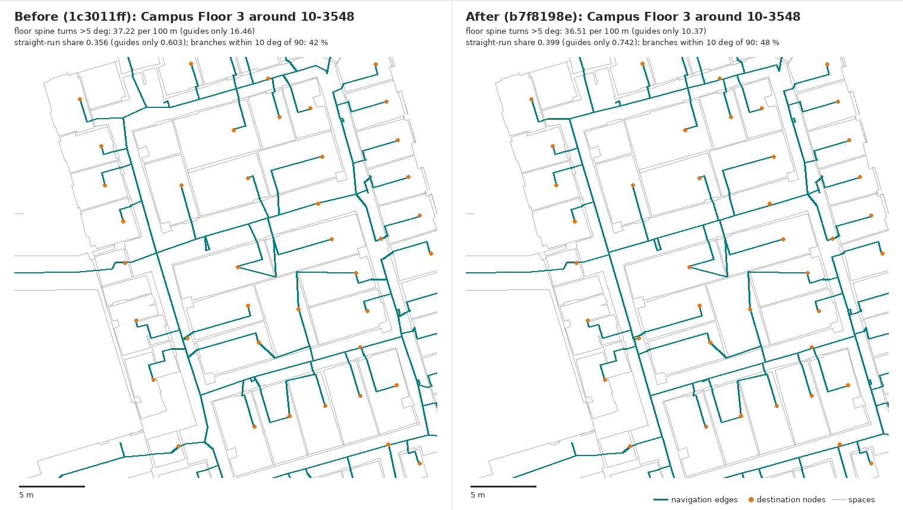

# Straight corridor runs and right-angle door branches — November 3, 2026

> **Not merged into the candidate.** The code is preserved as
> [corridor-runs-code.patch](corridor-runs-code.patch) (branch commit `2e12130`,
> apply with `git am`) and its campus catalog as
> [PREPARED-ROUTING.json](PREPARED-ROUTING.json) (`b7f8198e…`). Merging it
> changes the display engine, route runtime and plan runtime bindings, so the
> candidate, caches, receipts and proofs would all need requalification. It
> also adds one new crossing (cell 852). It is held until it is combined with
> the next pathway change and that crossing is resolved.

This works on gaps 1 and 4 from the
[reference comparison](../../unbc-20261102/reference-comparison/README.md):
one straight centre line per corridor run between real junctions, and door
branches that meet the corridor at a right angle. The compiler change is
commit `2e12130`. This folder holds the campus compile and the measurements.

**Status: drawing diagnostics only.** I did not run route acceptance,
progressive export or hydration. 1,967 of the 2,728 guides changed, so route
distances and directions will change. The catalog has to be requalified before
it can replace `1c3011ff`.

## What changed in the compiler

The new module is `app/indoor-project/corridor-run-fit.ts`. It runs after join
sliding in `buildCorridorCenterline`, but only for shaped networks. Legacy
networks are unchanged.

1. **Runs.** The checked shared network is split into runs. A run continues
   through a vertex if the straightest pair of lanes there deflects by less
   than 30°. The following do not split or end a run:

   - destination branches (dead-end lanes of 12 ft or less that only receive
     door branches);
   - terminal joins on the run.

   A genuine corner, or a junction with no straight continuation, ends a run.

2. **Fit.** Runs are fitted longest first. Each run gets one straight line
   through its cross-section midpoints. Sections are sampled every 2 ft
   against the cell rings, and widened sections (openings, recesses) are
   dropped.
   - If a midpoint is more than 1 ft off the line, the run is split at its
     largest deviation, up to 8 pieces. Each split becomes a bend at the
     intersection of the two lines, or a short jog if the lines are parallel.
   - Two kinds of vertex stay fixed: one an earlier run already placed, and a
     run end where another run passes straight through (a T stem).
   - Loops, island sides and other alternatives are never merged. They stay
     separate lanes.
3. **Door branches.** Junctions on the run are projected onto the fit, and no
   vertex moves more than 3 ft. Every door branch of the run is proposed again
   against the fitted run with the existing approach proposals (door-normal,
   straight, projected elbow). A branch that meets the run within 10° of a
   right angle is preferred. The join slides along the run.
   - If no proposal passes, the branch keeps its exact checked approach and
     join, plus one short lane piece to the run. If its old branch already
     crossed the run, it is cut at that crossing.
   - An approach still has at most one elbow, as the checkpoint rule requires.
4. **Acceptance per run.** A run is replaced only if all of these hold:

   - every new run piece passes the same exact 2 ft support;
   - every changed neighbouring lane piece passes it;
   - every moved door branch passes the terminal's own-half support;
   - the complete network gains no topology contact. A contact is identified
     by its e826098 approach-conflict key plus its exact rational location
     (new `corridorChainTopologyContacts`). So existing contacts may stay, but
     none may be added or moved;
   - no required original edge's shared-lane route grows by more than 15 %
     plus 3 ft.

   Otherwise that run keeps its current checked geometry, and the next run is
   still tried.

5. **Cell guard** (`prepare-corridor-routing.ts`). If a cell needs legacy
   fallback guides, which come from another network, the compiler checks
   whether they cross its straight-run guides. If they cross them more than
   they cross guides compiled without straight runs, the cell is compiled
   without runs. Only cell 729 was affected (`straightRunsWithdrawn`).

These are unchanged: the final per-edge `edgeSupported` check, the guide
distance limit, the fixed original terminals and endpoints, ownership, access,
policy, the legacy fallback and the createCorridorCenterline topology
acceptance. The new compiler parameter `straightRuns` is on by default and is
bound in every checkpoint. `--without-straight-runs` reproduces the previous
compiler as a separately bound experiment. Each network records its outcome in
`statistics().straightRuns`. The documentation is in
`scripts/indoor/corridor-candidates.md`.

### Tests

These run on Node 24.19.0. `tsc -p tsconfig.indoor-project.json` passes.

| CI group (`indoor-checks.yml`)              | Tests | Pass |
| ------------------------------------------- | ----: | ---: |
| Routing and worker lifecycle                |   145 |  145 |
| Shared pathways and candidate checkpoints\* |    87 |   87 |
| Progressive delivery and published routes   |    99 |   99 |

\* This group includes the new `tests/unit/corridor-run-fit.test.ts`, which
is now also listed in the workflow.

New tests use `tests/unit/corridor-run-fixture.ts`. The fixture is a 120 ft
hall with door recesses on both walls, side corridors going up and down, a
genuine corner and a lobby with an island:

- **Straight hall.** The hall is one straight line within 0.35 ft of the
  centre, and all 13 hall doors meet it within 10° of a right angle.
- **Corner.** It keeps exactly one bend, near (116, 4).
- **Every route.** All 171 terminal pairs keep exact 2 ft support, original
  endpoints, approaches with at most one elbow, and reverse symmetry. They
  have fewer core bends than without runs, and the result does not depend on
  terminal order.
- **Island loop.** Both lanes around the island survive. Each lobby door
  uses its own side, and a blocked side reroutes through the other.
- **Branch that cannot be proposed again.** It keeps its exact checked
  branch, and the hall is still straightened.
- **Hall whose straight proposal fails support.** It keeps its exact checked
  geometry and door branches, and the side corridors are still fitted.
- **Off switches.** Runs are off for legacy networks and when disabled.
- **Topology contacts.** `corridorChainTopologyContacts` reports contact
  locations exactly.

Existing tests:

- The straight-hallway control and the crossed-approach fixtures pass
  unchanged.
- The join-sliding test now sets `straightRuns: false`, so it still tests
  sliding on its own.

### Engine bindings (regenerated with the writer scripts)

| Binding                                 | SHA-256                                                            |
| --------------------------------------- | ------------------------------------------------------------------ |
| `PREPARED_DISPLAY_ENGINE_SHA256`        | `18b7fc26361b61c12786df95b3bd30d7d154b388a004fecbbce972600b4bd7df` |
| `PUBLISHED_ROUTE_RUNTIME_SHA256`        | `a160c7b8fbba6b46b5009857c3461e5b78413da69f7bb2144d28d2374944974f` |
| `PUBLISHED_VISITOR_PLAN_RUNTIME_SHA256` | `79b06f9f77e1c3ba061bd48c401d9c956198a26fe45822ead7276418dbb6dedc` |
| Compiler binding (checkpoints)          | `28d08f55ed32e0239dcb2bb43efb247f8f0f9d3f6fd8023c1b8893f0cf72aa1c` |

## Campus compile

The campus compile used the same input as `1c3011ff`: `master-0388.zip`
`6e7971f8…` and source model `8c294549…`. It ran under `flock heavy2.lock`
and `run-supervised.py` with `TZ=UTC`, using the resumable script
`/home/user/unbc-work/corridor-runs/run-compile.sh`. It ran from `24b0ebc`, which
has the same sources as `2e12130`; the amend only added the test to the CI
workflow. It took 1,734 s, with a
maximum child RSS of 3.76 GB ([COMPILE-EXECUTION.json](COMPILE-EXECUTION.json)).

The new catalog is `/home/user/unbc-work/corridor-runs/compile/prepared-routing.json`,
sha256 `b7f8198e50326e36b889511e94fb26d31209f41cdb45bca658eb886bb4798010`.

Attempt 1 (sha `9663eae3…`) was discarded. Its run acceptance compared conflict
keys only, so in cell 729 a terminal could gain a new contact under a key it
already had. The topology identity was then made exact, and the compile was
run again. The discarded output is kept in
`/home/user/unbc-work/corridor-runs/compile-attempt1-superseded/`.

| Measure                                        | `1c3011ff` |      This compile |
| ---------------------------------------------- | ---------: | ----------------: |
| Accepted guides                                |      2,728 |             2,728 |
| Lost / gained                                  |          — |             0 / 0 |
| Refused edges                                  |        156 |   156 (unchanged) |
| Legacy-fallback guides                         |          6 |                 6 |
| Guides changed                                 |          — | 1,967 in 59 cells |
| Network topology results (shaped / restricted) |    108 / 1 |           108 / 1 |

Runs: 638 strokes. 154 were shorter than 6 ft and 484 were candidates.

- **368 runs fitted.** Pieces per run: 1 → 271, 2 → 51, 3 → 18, 4 → 19,
  5 → 6, 6 → 3. In 90 of them
  no junction, station, spur or door branch changed; only the lane geometry
  was replaced.
- **116 runs kept their checked geometry:**

  | Reason                             | Runs |
  | ---------------------------------- | ---: |
  | No straight fit within 8 pieces    |   49 |
  | New topology contact               |   20 |
  | Detour guard                       |   17 |
  | Vertex shift over 3 ft             |   13 |
  | Unsupported run piece              |   11 |
  | Door branch could not be re-placed |    4 |
  | Run is not simple                  |    2 |

- **Door branches.** 1,178 were proposed again in accepted runs. 871
  terminal-only stations and 28 destination spurs were removed, 320 junctions
  moved and 42 dead run ends were trimmed. The `perpendicularBranches`
  (1,184) and `keptBranches` (40) statistics count every placement attempt,
  including attempts in runs that were later kept. They are therefore upper
  bounds for the accepted networks. The measured angles are below.

The [compare-corridor-candidates](COMPILE-COMPARISON.json) results for the
2,728 matched guides:

| Diagnostic          | Before |  After |
| ------------------- | -----: | -----: |
| Core bends over 5°  |  2,304 |  1,906 |
| Guide bends over 5° |  7,843 |  7,453 |
| Zigzag reversals    |    225 |    166 |
| Approach elbows     |    342 |    259 |
| Core vertices       |  8,798 |  8,621 |
| Core length (ft)    | 30,360 | 30,221 |
| Core dead ends      |    545 |    533 |

## Reference-comparison metrics, before and after

All figures come from `tools/reference-comparison/measure_ours.py`, which uses
the same model and definitions as the November 2 `measure.py`. It reads the
four visitor floor files, `graph-full.json` and the display frame. For each
catalog it replaces only the accepted-guide lines (net categories 0/2), so all
saved walks are identical in both columns. Full numbers, including per-floor
values, are in [METRICS.json](METRICS.json).

The **whole network** is the November 2 headline: accepted guides plus the
saved walks inside rooms and the door crossings. **Guides only** is the set of
lines this compiler draws. The saved walks (about 11.5 km of the 17.4 km drawn
network) are not touched by this compiler.

| Metric (drawn union unless noted) | Whole: before |    Whole: after | Guides only: before | Guides only: after | References  |
| --------------------------------- | ------------: | --------------: | ------------------: | -----------------: | ----------- |
| Spine turns > 5° per 100 m        |          36.0 |        **34.8** |                19.1 |           **13.0** | 1.9–3.6     |
| Straight-run share (≥ 5 m, < 3°)  |         0.365 |       **0.407** |               0.514 |          **0.634** | 0.93–0.995  |
| Spine stroke length p50 / p90 (m) |    3.6 / 15.3 |      3.6 / 15.5 |          3.7 / 16.4 |         3.7 / 17.2 | 13.5 / 81\* |
| Branches within 10° (5°) of 90°   |   42 % (29 %) | **47 % (36 %)** |         54 % (41 %) |    **65 % (60 %)** | 80–90 %     |
| Median branch angle               |         75.1° |           77.3° |               81.5° |          **89.9°** | ≈ 89°       |
| Sideways jogs per 100 m           |          3.84 |            4.00 |                1.45 |               1.05 | ≤ 0.5       |
| Zigzags, as stored                |         2,348 |           2,296 |                 772 |                719 | 0–1         |
| Zigzags, drawn union              |            80 |              78 |                  19 |                 23 | —           |
| Crossings without a junction      |           163 |             160 |                   4 |                  5 | 0–2         |
| Bare dead-end stubs < 0.5 m       |           489 |             485 |                  19 |                 14 | 0–2         |
| Nodes (drawn union)               |        13,336 |          13,182 |               4,706 |              4,551 | —           |

\* Bowie.

Per floor, whole network: spine turns per 100 m, straight-run share and
branches within 10°.

| Floor          | Turns before | Turns after | Share before | Share after | Branches before | Branches after |
| -------------- | -----------: | ----------: | -----------: | ----------: | --------------: | -------------: |
| Campus Floor 1 |         32.3 |        30.7 |        0.405 |       0.441 |            44 % |           49 % |
| Floor 2        |         37.6 |        35.9 |        0.309 |       0.362 |            43 % |           46 % |
| Campus Floor 3 |         37.2 |        36.5 |        0.356 |       0.399 |            42 % |           48 % |
| Floor 4        |         40.0 |        39.5 |        0.371 |       0.407 |            42 % |           46 % |

The same comparison for guides only:

| Floor          | Turns before | Turns after | Share before | Share after |
| -------------- | -----------: | ----------: | -----------: | ----------: |
| Campus Floor 1 |         21.9 |        15.4 |        0.464 |       0.564 |
| Floor 2        |         18.7 |        12.4 |        0.471 |       0.617 |
| Campus Floor 3 |         16.5 |        10.4 |        0.603 |       0.742 |
| Floor 4        |         15.8 |        10.6 |        0.604 |       0.715 |

**How to read this.** The corridor lines themselves improve clearly: turns
drop by 32 %, the straight-run share rises from 0.51 to 0.63, and the median
door-branch angle reaches 90°. The whole-network headline moves much less.
Most of its spine turns, all but a few of its 163 crossings and almost all of
its 489 stubs come from the saved walks inside rooms and the door crossings.
On guides alone there were only 4 crossings and 19 stubs before this change.
Closing the remaining gap to the references needs the other ranked items,
mainly gap 3 (hooks in the stored geometry) and gap 5 (one shared node graph).
The corridor compiler cannot close it alone.

## Figures

The figures use the reference-comparison style: navigation edges in teal,
destination nodes in orange, spaces in grey. They are drawn at 32 m wide with
full-precision geometry, before on the left and after on the right, using
`tools/reference-comparison/draw_before_after.py`. The subtitles are each
floor's whole-network and guides-only values.

- [Floor 2](floor-2-before-after.png): around 04-204, 08-216 and 10-2042.
- [Campus Floor 1](campus-floor-1-before-after.png): around 05-140E.
- [Campus Floor 3](campus-floor-3-before-after.png): around 10-3548.
- [Floor 4](floor-4-before-after.png): around 10-4546.

The rooms other than 04-204 and 08-216 are the ones near the most changed
guides on each floor.



## Risks and limits

- **Requalification needed.** 1,967 guides changed. Acceptance distances,
  instructions and caches will change. The detour guard limits a required
  edge's lane route to 115 % plus 3 ft of its previous length. The guide
  distance limit is unchanged.
- **One new crossing (cell 852).** Guides-only crossings went from 4 to 5. The
  new one is in cell 852 (Campus Floor 3). There, a legacy-fallback guide
  (door 2262772 to 2262984) runs almost parallel to a run-fitted lane that
  serves the same door. The two come from different networks, so the
  per-network topology check cannot see the pair. The cell guard compares raw
  crossings, and there the cell without runs had at least as many crossings
  as the cell with runs, so the runs were kept. Per network, the contact check means
  no network gains a contact.
- **Zigzags on guides.** Drawn-union zigzags on guides rose from 19 to 23,
  while stored zigzags fell from 772 to 719. Where the union merges
  coincident lanes and branch ends, short re-placed branches next to an
  unchanged lane can form a turn over 120° with a leg under 2 m. They were
  not inspected one by one.
- **Not fitted:** lobbies and wide junction areas (Voronoi junction clusters)
  and runs that need more than 8 pieces. 116 candidate runs, plus 154 runs
  shorter than 6 ft, keep their checked geometry.
- **Statistics.** `perpendicularBranches` and `keptBranches` count attempts,
  not only accepted placements.
- **Cell 729.** Runs were withdrawn there (legacy-fallback guard), so it
  matches the previous compiler.
- **Not run:** route acceptance, the policy matrix, progressive export,
  hydration, directions caches and browser proof.

## Reproduce

```sh
# Compile (about 30 min, 3.8 GB): /home/user/unbc-work/corridor-runs/run-compile.sh
python3 scripts/indoor/compare-corridor-candidates.py \
  /home/user/unbc-work/topology/compile /home/user/unbc-work/corridor-runs/compile \
  docs/continuation/unbc-20261103/corridor-runs/COMPILE-COMPARISON.json
python3 -I tools/reference-comparison/measure_ours.py \
  --floors docs/continuation/unbc-20261031/campus/map/floors \
  --graph /home/user/unbc-work/cand-final/graph-full.json \
  --frame /home/user/unbc-work/cand-final/frame-1a127847.json \
  --catalog before=docs/continuation/unbc-20261102/final-candidate/PREPARED-ROUTING.json \
  --catalog after=/home/user/unbc-work/corridor-runs/compile/prepared-routing.json \
  --out MEASURE.json
python3 -I tools/reference-comparison/draw_before_after.py \
  --floor docs/continuation/unbc-20261031/campus/map/floors/floor-2.json \
  --graph /home/user/unbc-work/cand-final/graph-full.json \
  --frame /home/user/unbc-work/cand-final/frame-1a127847.json \
  --before docs/continuation/unbc-20261102/final-candidate/PREPARED-ROUTING.json \
  --after /home/user/unbc-work/corridor-runs/compile/prepared-routing.json \
  --labels "Before (1c3011ff)" "After (b7f8198e)" --metrics MEASURE.json \
  --room 04-204 --room 08-216 --room 10-2042 \
  --out docs/continuation/unbc-20261103/corridor-runs/floor-2-before-after.png
```
