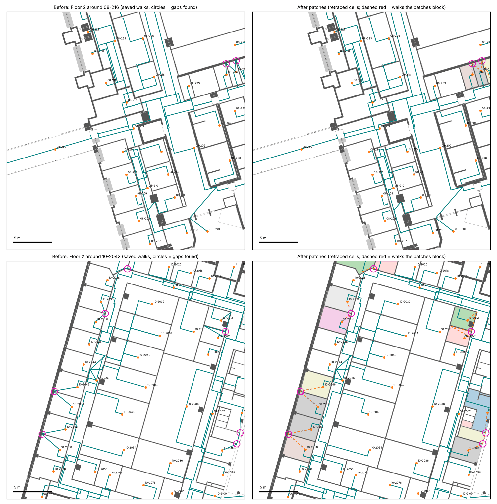
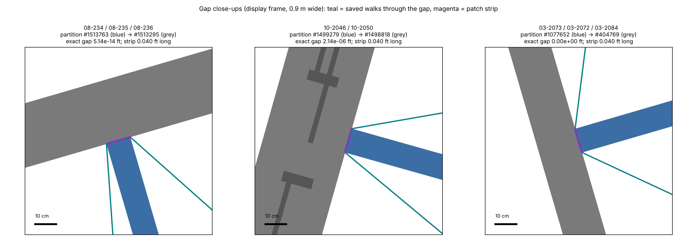

# Accidental wall gaps that walking paths squeeze through — November 3, 2026

**Status: reviewed patch file, proposed (not applied to the canonical master).**
The project owner asked for these source corrections:

> go through all the gaps that are causing the extra connection in a lot of
> rooms where it is going through a very small gap that was an accident when
> we were designing it, so just fix it for us and patch the gap on how it
> should have been done

Every patch row records that authorization ("project owner requested: patch
accidental modelling gaps (2026-11-03)") and its own evidence. The patches are
in the existing `nativeBoundaryPatches` wire format. Nothing in
`master-0388.zip` (`6e7971f8…`), the candidate (`32c395e1…`), RVT, GLB or GIS
was changed. Walks change only after a Reviter regeneration
(`boundaryPatchState.regenerated=false` disables directions until then); see
[Regeneration](#regeneration).

| File | What it is |
| ---- | ---------- |
| [OWNER-GAP-PATCHES.native-boundary-patches.json](OWNER-GAP-PATCHES.native-boundary-patches.json) | 132 patches as an `openindoormaps-native-boundary-patches` file (`native-boundary-patch-file.ts`), bound to model `8c294549…` and rooms `5060e6f9…`. All rows `proposed`. sha256 `c92b9e21…` |
| [CONTACT-REPAIR-SUPERSESSIONS.json](CONTACT-REPAIR-SUPERSESSIONS.json) | For 67 of the patches: the applied, selection-only native selection-contact repair on the same joint (68 in all) that the patch replaces |
| [GAP-PATCHES.json](GAP-PATCHES.json) | Authorization, every gap found (283) with class, outcome, rooms, walk edges and bodies; per-patch evidence; dropped and refused patches; the retrace preview |
| [floor-2-owner-examples-before-after.png](floor-2-owner-examples-before-after.png) | The owner's two screenshots, before and after, in the map display frame |
| [gap-closeups.png](gap-closeups.png) | Three gaps at 0.9 m width with their patch strips |
| [tools/](tools/) | Every script used, in run order below |

## What the gaps actually are

None of the patched ones is a visible gap. A partition is drawn in Revit as
joined to the wall it meets, but its exported end face misses that wall by
5e-14 to 4.4e-6 ft. In other cases it touches or overlaps the wall exactly in
the source, while the routing material is one float step off. The routing
compiler works in exact arithmetic, so even a 5e-14 ft sliver is a real
opening to it, and the saved walk inside the cell runs along the wall face,
over the end of the partition, into the next room.

| Exact distance from the partition's end corners to the wall it should meet | Patches |
| ---- | ---: |
| 0: touching or overlapping in the source, still crossed in the routing cells | 66 |
| Under 1e-12 ft | 57 |
| 2.1e-6 to 4.4e-6 ft (the oblique Building 10 facade joins) | 9 |

The only measurable gap found, 0.33 ft between 04-105 and 04-106 on Floor 1,
was refused by the floor guard (below).

This is also why earlier scans missed them. The existing detectors
(`scan-native-connections.ts`, the aligned-cap gap detector, the manual
"Draw wall gap patch" tool) all start at 0.02 ft. The October docs state that
the compiler nodes contacts within 1e-7 ft, but the routing cells show that
these joints still leak.

## The owner's examples



Left: today's saved walks (teal) and the gaps found (magenta circles). Right:
the routing cells cut by the patches, one colour per resulting piece, and the
walks the patches block (dashed red). New walks are not drawn because they
only exist after regeneration. Figures use the map's display frame
(`frame-1a127847.json`, the same transform as the November 3 corridor
figures).

- **The "M" near 08-216** (top right of the first row) is 08-234, 08-235 and
  08-236 (storage cells in one routing cell, `native-cell:14.435696:677`).
  Partitions #1513763 and #1513764 stop 5.0e-14 / 5.1e-14 ft short of the
  north wall #1513295. The walk from each room runs up the partition, along
  the wall face over its end and down into the next room. Patches
  `owner-gap:694:1513763-1513295:…` and `…1513764-1513295:…` split the cell
  into the three rooms, and each keeps its own door to 08-233's corridor.
- **The facade near 10-2042** (second row, left edge) is 10-2046 / 10-2050
  and 10-2052 / 10-2058. Partitions #1499279 and #1499281 meet the facade wall
  #1498818 obliquely. One end corner touches it (−5e-14 ft) and the other is
  2.136e-6 ft off. The walk goes from each room to that corner on the
  outer wall and back into the neighbour. The same join, at the same
  coordinates, repeats on Floors 3 and 4 (patches on #2255365, #2282596 and
  others). On Floor 2 the patches also close 10-2030/10-2036, 10-2004/10-2012
  and 10-2096/10-2098 in this view.



## Inventory

Two independent methods were used.

1. **Walk clearance** ([walk-squeezes.py](tools/walk-squeezes.py)). Every
   enabled walk in the map build's `graph-full.json` (5,486 walks) was sampled
   every 0.1 ft. At each sample the shortest chord through it was measured, in
   directions within 60° of the walk normal, between two different native
   bodies (walls, columns, applied patch walls). A **squeeze** is a stretch
   under 2.0 ft with wider samples on both sides; a recess at a walk end is not
   one. Samples inside a measured door footprint (+0.25 ft) or within 1 ft of a
   doorless opening edge are skipped. This found 446 squeezes, which group
   into 283 gaps ([group-gaps.py](tools/group-gaps.py)).
2. **The existing scanner** (`scan-native-connections.ts`). It could not
   start: the CLI did not load the exact overlay engine
   (`The checked native overlay engine is not initialized`). This commit fixes
   that with three lines. Run per level
   ([scan-all-levels.ts](tools/scan-all-levels.ts)), it took 45 s on Floor 0
   (0 findings at 3 ft) and threw a polygon-clipping sweep-line error on Floor
   0.5. On Floor 1 it ran for over 15 minutes at 3 ft without finishing a
   level. It is queued again in the regeneration chain (1 ft, then 3 ft,
   capped at 90 minutes); results land in
   `/home/user/unbc-work/gap-patches/scan/`. By design it cannot see gaps below
   0.02 ft, so it cannot see the gaps above.

Each gap was classified by [design-patches.py](tools/design-patches.py):

- **(a) accidental joint.** One body's own end cap (a short end edge) faces
  the other body. Carried along its own axis, it reaches a precise original
  face within 1 ft. Approximate envelopes are never a target.
- **(b) facade/curtain gap.** The partition stops at an approximate
  curtain/facade envelope, and no precise original face lies on its axis
  within 6 ft.
- **(c) real opening.** The partition's axis runs more than 2 ft to the next
  face.
- **(d) unclear.** One of: a wall-to-column joint (a column contact needs a
  continuation proof); no facing end cap (corner joints, irregular bodies,
  1–2 ft passages); or the walk passes *beside* the joint without crossing the
  designed strip (35 cases).

Rooms are the rooms at the walk ends (arrival nodes) of the affected walks.

| Floor (native level) | (a) gaps / walks / rooms | (b) | (c) | (d) |
| -------------------- | -----------------------: | --: | --: | --: |
| Floor 0.5 (1450417)  | 0 | 0 | 0 | 2 / 3 / 0 |
| Floor 1 (311)        | 9 / 9 / 14 | 0 | 1 / 2 / 1 | 14 / 13 / 10 |
| Floor 1.25 (1487816) | 3 / 2 / 3 | 4 / 5 / 3 | 0 | 9 / 10 / 10 |
| Floor 2 (694)        | 64 / 50 / 57 | 3 / 3 / 3 | 1 / 1 / 1 | 32 / 26 / 22 |
| Floor 3 (400176)     | 37 / 34 / 41 | 4 / 4 / 6 | 0 | 18 / 16 / 9 |
| Floor 3.5 (1487353)  | 5 / 5 / 2 | 1 / 1 / 0 | 0 | 2 / 2 / 2 |
| Floor 4 (402367)     | 51 / 42 / 48 | 11 / 8 / 15 | 0 | 12 / 12 / 10 |
| **All**              | **169 / 142 / 165** | **23 / 21 / 27** | **2 / 3 / 2** | **89 / 82 / 63** |

Floors 0, 1.5, 2.5, 4.5 and 5 have no squeezes.

Native cells that join named rooms only through such gaps: 74 routing cells
split under the final patch set, into 216 pieces holding 276 rooms
(Floor 2: 27 cells, 109 rooms; Floor 3: 19 / 60; Floor 4: 17 / 76; Floor 1:
6 / 16; Floor 3.5: 3 / 10; Floor 1.25: 2 / 5). Per-cell pieces, rooms and
portal counts are in `GAP-PATCHES.json → cellPreview.pieces`.

## Patches

[design-patches.py](tools/design-patches.py) →
[build-candidates.py](tools/build-candidates.py) →
[exact-gaps.py](tools/exact-gaps.py). For each (a) gap:

- **Geometry: "how it should have been modelled".** The partition's own end
  cap is carried along its own axis to the first face of the wall it should
  meet. Each cap corner keeps its own run, so an oblique facade gives a
  trapezoid. The strip starts 0.02 ft back inside the partition and ends
  0.02 ft inside the target, the same contact overlap as the manual
  "Draw wall gap patch" tool. Its thickness is the partition's own cap width
  (0.16–1.64 ft here). It is a four-corner `NativeBoundaryPatch` with exactly
  two `wallEvidence` rows: the complete current source and target footprints.
- `widthFeet` records the full strip run (gap + 0.04 ft, so 0.040 ft for every
  kept patch). The measured gaps are all below 0.02 ft, and `widthFeet` must
  be positive. The exact measured gap and both
  corner distances, computed in rational arithmetic on the stored IEEE
  coordinates, are in `GAP-PATCHES.json → patches[]`.
- A candidate needs the walk that revealed it to cross the strip interior. No
  door footprint may touch it.

**Validation** ([validate-preview.ts](tools/validate-preview.ts), master
`6e7971f8…`, all with the project's own code):

1. `validateNativeBoundaryPatches` on the whole set: 133/133 pass.
2. Per patch, `reviewedBoundaryWalls` with the patch applied (exact current
   wall evidence and positive-area contact with both supports, including
   `nativeMaterialPlanWalls`): 133/133 pass.
3. Per level, the guards of `deriveExactBoundaryPatchGroupPreview`: native
   floor support (`nativeBoundaryPatchFloorSupport`), protected floor
   openings, measured doors, columns, fixtures and contact with both supports.
   A failing patch was isolated by bisecting the prefix. The trace was stopped
   after the guards with an invalid selection-contact sentinel, so no level
   was retraced for this. **132 pass. 1 is refused:**
   `owner-gap:311:965713-968686:…` (04-105 / 04-106, a real 0.33 ft gap).
   0.013 sq ft of its strip lies off the native floor, so it needs a source
   continuation with the 0.0002 ft contact allowance and evidence. It was not
   forced.
4. **Applied selection-contact repairs on the same joints.** The first full
   retrace (Floor 1) threw `Native selection contact repair: positive gap
   intersects a foreign wall or column`. Earlier reviews had recorded many of
   these same joints as `nativeSelectionContactRepairs` (`floor2-review-contact:…`,
   `f34-contact:…`, `review-f1-proposed:…`, `mixed-native-contact:…`). Those
   repairs are selection-only by design and never changed walking routes,
   which is why the walks still leak there. Their replay guard runs in every
   native trace and at the end of Reviter regeneration, and it treats the new
   wall face as foreign material. [check-contact-conflicts.ts](tools/check-contact-conflicts.ts)
   finds **67 patches** that sit on **68** such repairs. Among them are both
   legs of the owner's "M" (`floor2-review-contact:1513763-1513295:full-cap:47733`
   and `…1513764-1513295:full-cap:47739`). The physical patch is the
   correction those provisional, `revisitRequired` contacts were waiting for.
   So each of them is **superseded**: set to `restored`, with a note naming the
   patch and the owner's authorization, in both the room review and the
   dataset ([apply-gap-patches.ts](tools/apply-gap-patches.ts),
   [CONTACT-REPAIR-SUPERSESSIONS.json](CONTACT-REPAIR-SUPERSESSIONS.json)).
   All 68 exist and are applied in the regeneration input `d5a829e8` too. This
   is a change to another reviewed record, so it is listed separately. To
   decline it, drop those 67 rows and keep the other 65 patches.
5. **Full selection retrace** (`deriveExactBoundaryPatchGroupPreview` with all
   patches of a level and the supersessions, against a baseline
   `deriveNativeAreas`). This runs as the first step of the regeneration chain
   and is still running at this commit. Each Floor 1 trace took 738 s. Results go to
   `/home/user/unbc-work/gap-patches/validate2/level-*.json`, and
   [compare-traces.py](tools/compare-traces.py) summarizes them. The chain
   stops before applying anything if a level fails.
   **Floor 1 passed** with its 6 patches and the supersessions in 727 s. It
   kept the same 1,356 regions before and after, with 0 rooms separated and
   no new door-less region. The selection tracer already keeps these rooms
   apart, because it applies the contact repairs and contact noding. Only the
   routing cells leak. So this trace proves that the patches pass every
   trace-time guard and leave selection unchanged. The routing effect is the
   cell preview below.

**Isolation check** ([cell-preview.py](tools/cell-preview.py),
[drop-isolating.py](tools/drop-isolating.py)). Each routing cell of the map
build was cut by its patches. Room arrivals and the portal nodes of enabled
door/opening/vertical edges were assigned to the pieces. A patch that left
any room in a piece without a portal was dropped. **10 patches were dropped.**
Each of these rooms has no door, opening or vertical portal of its own, so
the gap is today its only connection:

| Dropped patch | Room it would isolate |
| ------------- | -------------------- |
| `owner-gap:1487353:1779379-1779378:…` | 06-308 |
| `owner-gap:311:742615-742756:…` | 07-754 (with 07-756) |
| `owner-gap:311:742423-742854:…` | 07-758 (with 07-760) |
| `owner-gap:400176:1921127-1921620:…`, `…1922511-1922410:…` | 05-S301 Stair (only disabled stairs) |
| `owner-gap:402367:501992-501989:…` | 04-422 |
| `owner-gap:694:1327891-1327882:…`, `…1327883-1327881:…`, `…2370115-1327252:…` | 06-268, 06-266, 06-276A, 06-258 |
| `owner-gap:694:1522396-1522397:…` | 09-384 |

These rooms need a door, an opening review or an access decision, not a wall.
With the final 132 patches, **no room loses all connection.** Every piece
holding a room keeps at least one portal.

Patches per floor: Floor 2: 47, Floor 4: 41, Floor 3: 32, Floor 1: 6,
Floor 3.5: 4, Floor 1.25: 2. Together they close 158 of the 169 class (a)
gaps; one patch can close several walk crossings at one joint. All are cap-to-face continuations. No aligned-cap
bridge survived the walk-crossing test.

**Not patched:**

- **(b), 23 gaps.** Partitions stop at approximate curtain/facade envelopes
  with no precise original face on their axis. Most are on Building 03's west
  facade (x ≈ −13 ft, Floors 3 and 4: 03-3056 to 03-3076, 03-2072/03-2073,
  03-2094/03-2096). Others are 08-155/08-156 (Floor 1.25), 04-437/04-438 and
  04-341, and two at Building 10's east facade (10-2534, 10-4534). The docs
  forbid treating an approximate envelope as a wall. These need curtain-joint
  evidence (precise glass/frame members and assembly-end contacts), as in the
  October 6 Floor 4 facade patches.
- **(c), 2 gaps.** 07-110 (Floor 1) and 06-240 (Floor 2) run 3–4 ft to the
  next face. These are openings.
- **(d), 89 gaps.** These are wall-to-column joints (13), corner joints with no
  facing cap, 1–2 ft passages, and the 35 walks that pass beside a joint. Each
  is listed with its bodies, rooms and walks in `GAP-PATCHES.json → gaps[]`.

The one Floor 4 patch `owner-gap:402367:2283111-2282580:…` (10-4030/10-4032)
sits inside a layered Building 10 facade, where the walk threads through seams
between abutting wall layers (the stub's end corners are inside the facade). It passes every guard and isolates nothing, but
that facade needs a separate look after regeneration.

## Regeneration

**What it needs.** `regenerate-from-native-cache.ts` rebuilds walks from a
full authoring master and an exact-model decoded cache, plus the reviews of
the October 21 recompile
([run.sh](../../unbc-20261021/recompile/run.sh),
[inputs.json](../../unbc-20261021/recompile/inputs.json)). Applied
`nativeBoundaryPatches` in the input rooms are consumed by Reviter's
`prepareIndoorDataset` (`reviewedBoundaryWalls` per level) before the
circulation compile.

| Input | Where it is now | Verified |
| ----- | --------------- | -------- |
| Source master `d5a829e8…` (attempt-006 input; master-0388 is a compiled descendant, not an input) | Downloaded from the owner's Drive into `/home/user/unbc-work/gap-patches/regen-inputs/master.zip` | sha256 ✓ |
| Native cache `bfc1f261…` (421 MB) | same folder | ✓ |
| `reviewed-drawing-references.json` `ee97659f…`, `checked-boundary-review-bundle.json` `f9f65fe2…`, `checked-door-boundary-review.json` `38c8623b…`, `positive-source-review.json` `d58d8bda…`, `03-source-door-standing-review.json` `f1b86cd4…`, `05-source-stair-base-standing-review.json` `27b07a05…` | same folder | ✓ |
| Prelanding snapshot `cb5d6d3e…` (the door review binds its absolute path) | Extracted to `/workspace/scratch/unbc-regeneration-20261017/reviews/prelanding-source-snapshot.bin` | ✓ |
| Door aperture review | [`DOOR-APERTURE-REVIEW.json`](../../unbc-20261021/link-doors/DOOR-APERTURE-REVIEW.json) in git | — |
| `review/companions.bin` in master-0388 | 890 authoring companions, but **none** of the inputs above | checked |

All 228 evidence wall footprints of the patches are byte-identical in
`d5a829e8` and `6e7971f8`, so the patch file applies to the regeneration
input unchanged. A native cache can also be rebuilt here from the master's RVT
with Reviter's `convertRvtBytes` (65–82 s, about 1.2 GB). It is not needed,
because the exact cache `bfc1f261…` is downloadable and the stair reviews
bind that cache's SHA.

**Local, level-scoped path.** Reviter's `prepareNativeCirculationPlaneDraft`
compiles one physical plane. `attachNativeCirculationCellRoutes` rebuilds
walks only when `circulationGeometry` matches the current geometry key, and
`mergeNativeCirculationPlaneDrafts` needs every plane. A one-floor rebuild
therefore still compiles all 9 planes and skips landings, stairs and the
final gates. That makes it a diagnostic, not a master. It was not run.

**Time and memory.** The October 21–22 Colab run (8 cores, 50 GB, 2 plane and
7 landing workers) took 11 h 14 min: about 8.5 h single-threaded, 2 h 07 min
for landings and 33 min for planes. `run.sh` sizes this host (4 cores, 15 GiB)
to 1 plane worker and 1 landing worker. The main process peaks at about
7 GB, plus 4 GB per worker. Estimate: about 8.5 h + about 15 h of landings +
about 1 h of planes, **about 25 h holding the heavy lock**. The October 21
README records that a cloud session's container was suspended within minutes
of going idle, so a run here can be lost when the session ends. Floor and
landing checkpoints resume a restart, but a rebuilt import snapshot
recomputes all landings.

**Status (November 4): restarted as a source review; see
[REGENERATION.md](REGENERATION.md).** The patched master from step 1 below is
not a valid regeneration input. The October 21 source stays the input, and
the checked patch rows join the reviewed source rooms. The original plan
follows for the record.

**Original plan.** `/home/user/unbc-work/gap-patches/regen/run-chain2.sh`
first runs the full selection retrace (validation step 5) and stops if any
level fails. It then calls `regen/run-chain.sh`, which holds the heavy lock
and does three things:

1. It applies the patch file and the supersessions to `d5a829e8` with
   [apply-gap-patches.ts](tools/apply-gap-patches.ts). The steps are
   `importNativeBoundaryPatchFile`, the contact-repair supersessions, the same
   guards, then `saveNativeBoundaryPatches(…, apply=true)` per row, then
   `exportIndoorProject`. Output goes to `regen/inputs/master.zip`.
2. It runs the existing scanner (90 minutes at most).
3. It runs the unchanged October 21 `run.sh` with `NATIVE_WORKERS=1
   LANDING_WORKERS=1 PARENT_HEAP_MIB=7168`. Checkpoints go to
   `regen/run/checkpoints`, supervised by `run-supervised.py` with `TZ=UTC`.
   Logs are in `regen/logs/` and `regen/run/compile-*.log`.

It is resumable: rerun the same command.

**Where it should run.** Run it on the owner's Colab (CPU High-RAM) with
[UNBC-recompile.ipynb](../../unbc-20261021/recompile/UNBC-recompile.ipynb).
Use the same inputs.json and replace `inputs/master.zip` with the patched
master that step 1 writes. Alternatively, run `apply-gap-patches.ts` there
first:

```sh
node --max-old-space-size=10240 --import tsx \
  docs/continuation/unbc-20261103/gap-patches/tools/apply-gap-patches.ts \
  inputs/master.zip \
  docs/continuation/unbc-20261103/gap-patches/OWNER-GAP-PATCHES.native-boundary-patches.json \
  inputs/master.patched.zip \
  docs/continuation/unbc-20261103/gap-patches/CONTACT-REPAIR-SUPERSESSIONS.json
mv inputs/master.patched.zip inputs/master.zip
bash docs/continuation/unbc-20261021/recompile/run.sh "$WORK"
```

**After it passes**, these steps remain:

1. Re-add the 06-388 reviewed link with `add-reviewed-circulation-link.ts`,
   as for `master-0388`.
2. Rebuild the corridor catalog, the shared-pathway candidate and the map
   floors.
3. Check every room in `GAP-PATCHES.json → cellPreview.pieces` for its door
   approach.
4. Rerun route acceptance, the policy matrix, caches and the browser proof.

The regenerated master records `boundaryPatchState.regenerated=true` only if
every applied face compiled.

## Reproduce

Paths are on this host. Every Node step that uses more than 2 GB runs under
`flock /home/user/unbc-work/heavy2.lock` and `run-supervised.py`.

```sh
G=/home/user/unbc-work/gap-patches T=docs/continuation/unbc-20261103/gap-patches/tools
# 1. master import (751 s) + geometry tables + existing scanner
$G/run-scan.sh 1,3            # node … $T/scan-all-levels.ts master-0388.zip $G/scan 1,3 40
# 2. independent inventory (python with shapely)
python -I $T/walk-squeezes.py $G/cache/geometry.json cand-final/graph-full.json squeezes.json 2.0
python -I $T/group-gaps.py    $G/cache/geometry.json cand-final/graph-full.json squeezes.json gaps.json
python -I $T/design-patches.py $G/cache/geometry.json gaps.json designs.json
python -I $T/build-candidates.py $G/cache/geometry.json cand-final/graph-full.json designs.json candidates2.json
python -I $T/drop-isolating.py cand-final-preview/data cand-final/graph-full.json candidates2.json keep2.txt dropped2.json
python -I $T/exact-gaps.py candidates-kept.json candidates-kept-x.json
# 3. validators: guards, contact-repair conflicts, then the retrace preview
$G/run-validate.sh $G/work/candidates-kept.json            # guards (traces were cut short by the conflict)
node … $T/check-contact-conflicts.ts master-0388.zip candidates-kept-x.json final-ids.txt contact-conflicts.json
python -I $T/cell-preview.py cand-final-preview/data cand-final/graph-full.json candidates-kept-x.json cellpreview-final.json final-ids.txt
python -I $T/summarize.py $G/work $G/validate $G/cache/geometry.json docs/continuation/unbc-20261103/gap-patches cand-final/graph-full.json
# 4. figures
python -I $T/draw-examples.py … floor-2.json … 08-216 10-2042
python -I $T/draw-details.py … owner-gap:694:1513763-… owner-gap:694:1499279-… owner-gap:400176:1077652-…
# 5. retrace with supersessions, then apply, scan and regenerate
$G/regen/run-chain2.sh $G/work/candidates-kept-x.json $G/regen/OWNER-GAP-PATCHES.native-boundary-patches.json $G/regen/CONTACT-REPAIR-SUPERSESSIONS.json
```

## Limits

- The inventory reads the map build's saved walks and native cells (from
  `6e7971f8`). It finds gaps that a walk uses today. A gap that no walk
  crosses is not listed.
- The retrace preview here cuts routing cells with the patch strips. The
  authoritative after-state is the regeneration. Until that runs, no new walk,
  route distance or door approach is claimed.
- The selection-trace comparison (validation step 5) is still running at
  this commit.
- These are construction-joint corrections that the owner authorized. The
  docs call a sub-nanometre joint a numerical-topology case, and
  `nativeSelectionContactRepairs` is selection-only, so it cannot change
  walks. A generic compiler rule that closes contacts below 1e-7 ft in the
  routing cells would fix all of these at once without patches. That would be
  a Reviter change; none was made.
