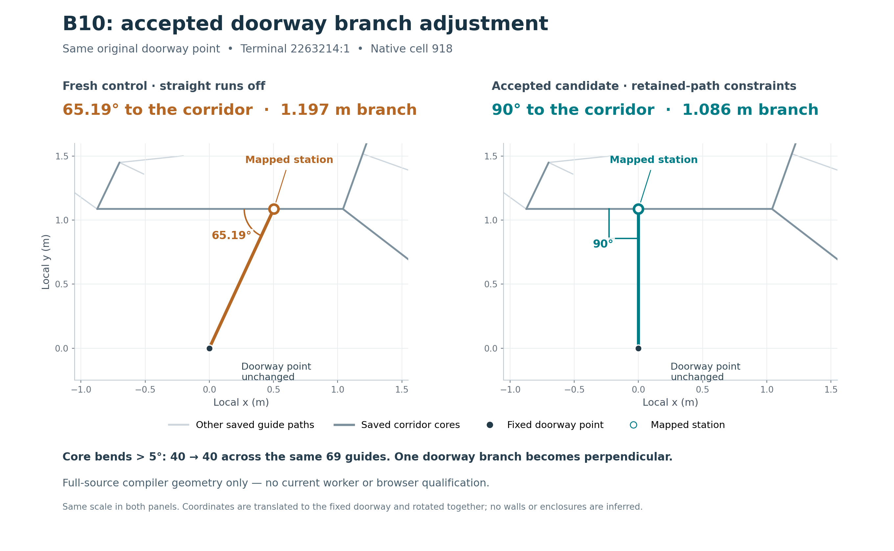

# PR 4 review follow-up

The contact guard, retained-path constraints, map cleanup and CI coverage have
been repaired. Complete-source Building 10 compilation now finishes with the
original master and physical context intact. This remains a **draft candidate**:
the known turn-back and the fresh runtime/publication gates remain separate work.

## Implementation

1. **Contact lineage.** Every disallowed contact binds both original path
   identities and its exact location. Splitting a run or replacing a doorway
   station preserves its lineage; a new connector receives a new identity. An
   unrelated pair's old contact cannot authorize a moved contact at that point.
   Positive tests retain real junctions, crossings and overlaps that are unchanged.
2. **Retained paths constrain each fit.** With `--straight-runs`, the complete
   unfitted control is built first. Its legacy, refined and other-part guides,
   including their terminal approaches, constrain each primary run. A local
   conflict can retain that run while another fit survives. The final complete-cell
   contact and missing-guide guard still runs after all recovery passes. The
   option remains off by default. These are constraints against the fixed complete
   control, not a joint solver that relocates primary and fallback stations together.
3. **Map cleanup.** `Basemap3dBuildingsLayer` uses the existing `mapReady` guard
   during setup and cleanup. The targeted effect harness reproduces the old
   destroyed-map crash and passes eight corrected lifecycle cases. A persistent
   Pages test covers same-document navigation, Back, Forward and reload at desktop
   and mobile viewport sizes; browser execution is recorded separately below.
4. **CI coverage and source pair.** Both selective workflows include the five
   previously omitted corridor/cache tests and the new input-loader tests. Their
   Reviter checkout is pinned to the handoff's exact `4a8fe6a` revision. Workflow
   triggers and deployment behavior are retained.
5. **Complete-input memory.** The candidate CLI verifies the actual archive and
   member hashes, then releases temporary ZIP, member and text references before
   the next large allocation. Its semantic hash still uses native
   `JSON.stringify` order and numeric behavior, with bounded UTF-8 hashing that
   keeps surrogate pairs intact. `--expose-gc` allows collection at those explicit
   boundaries. No source field, obstacle, hole, review or access decision is
   removed. The normal verifier also records memory at its existing import and
   worker stages; its normal importer, exporter and acceptance assertions remain.

## Complete-source Building 10 result

The [control](cell-918-control/report.json) and
[candidate](cell-918-retained/report.json) use the original 247,419,905-byte master
ZIP (`8e397ddf…`), whose complete indoor member is 302,032,680 bytes
(`28140a97…`). These are production complete-cell compiler runs, including fresh
native doorway support and all recovery/refinement passes. They are distinct from
the earlier conservative cached-face diagnostics.

| Measure                                    | Fresh default-off control | Opt-in candidate |
| ------------------------------------------ | ------------------------: | ---------------: |
| Original eligible edges                    |                        79 |               79 |
| Original terminals                         |                        53 |               53 |
| Compiled guides                            |                        69 |               69 |
| Original edges retaining fallback behavior |                        10 |               10 |
| Added or removed control guide IDs         |                         — |                0 |
| New final mixed-network contacts           |                         — |                0 |
| Whole-cell proposal withdrawn              |                         — |               No |
| Summed core bends greater than 5 degrees   |                        40 |               40 |
| Summed core vertices                       |                       193 |              193 |

The two runs have identical scope, guide inventory and ten refusal records. The
compiler reports two fitted runs, including one unchanged run. Seven guide values
change around **one doorway station**, not seven independent corridor repairs.
The complete comparison and inventories are in
[cell-918-geometry-comparison.json](cell-918-geometry-comparison.json).

### The measured improvement

The station for original terminal `door:400176:2263214:1` moves along its checked
corridor. Its original terminal coordinates remain unchanged. Four incident
guides use the adjusted doorway branch; three other guides pass through the
relocated station.

| Doorway-branch measure  |              Control |            Candidate |
| ----------------------- | -------------------: | -------------------: |
| Acute angle to corridor |      65.1918 degrees |           90 degrees |
| Approach length         | 3.92610 ft / 1.197 m | 3.56379 ft / 1.086 m |



This is a plot of compiler output. It is not a browser screenshot or acceptance
of a returned walking journey. The original six-image gallery remains historical
evidence with its original receipts.

The doorway branch is shorter, but moving its station makes some complete guide
paths longer. The original-network detour limits still apply. This does not
establish a reduction in end-to-end journey distance.

The stored master already differs from a fresh default-off rebuild: five stored
guides change and summed core bends decrease from 48 to 40. That eight-bend
rebuild change must not be attributed to the new opt-in retained-path constraint.
Bend totals sum guide paths, so a shared lane can appear more than once.

### The known turn-back

The recorded `10-3026 ↔ 10-3060` ordinary journeys use none of the seven changed
guides. Their 165.6266-degree turn-back concerns original terminal
`door:400176:2262854:0`, at a different location. The corresponding guides are
unchanged from the fresh control.

That doorway currently has two corridor stations about **13.605 cm apart**. The
primary station is a core endpoint (degree one); the legacy station lies on a
through-path (degree two). The existing station-recovery rule requires two
degree-one endpoints, so it cannot reconcile this case. The next geometry repair
needs same-original-terminal station reconciliation, complete-guide replay, and
explicit junction provenance in the final guard. Proximity alone is insufficient.

## Journey and publication scope

The [28-case input](b10-cell918-cases.json) contains seven recorded Building 10
destination pairs in both directions and both profiles: 14 expected public
routes and 14 recorded accessible `pathway-start` refusals. Each public case
requires its original source edge IDs and a shared guide. The
[inventory](b10-cell918-inventory.json) is complete only for this explicit sample;
it does not cover every cell terminal or campus journey. The
[case provenance](b10-cell918-case-provenance.json) preserves the exact archived
requests, geometry, diagnostics and identities. These files are verification
inputs, not fresh results.

The public assertions require membership of the recorded original edges, not
identical historical edge ordering or distances. Refusal assertions require a
current blocked pathway result; they do not require the precise historical
`pathway-start` subtype. A successful replay would additionally require exact
current normal-calculator versus production-worker equality. The sample contains
no positive accessible journey or vertical connection.

The actual [normal-package attempt](normal-package-worker-outcome.json) was killed
after 33.13 seconds, at 2,801,344 KiB peak RSS (about 2.67 GiB). Its last callback
entered the `companions` stage; that callback does not certify completion of the
stage. Normal import, checked export and the production worker did not finish,
and **zero route cases executed**. The retained `started.json` is the interrupted
attempt's original start record; the outcome file records its final state.

### Expanded next-run coverage

The initial 28-case selector required literal `10-` destination labels. It missed
archived Building 10 requests expressed as stable room keys, and covered none of
the seven changed guides. Searching those stable requests recovered a separate
[68-case supplement](b10-cell918-changed-guides/cases.json), with its original
[provenance](b10-cell918-changed-guides/provenance.json.gz). The large original
rows are stored with lossless gzip compression; the
[archive receipt](b10-cell918-changed-guides/provenance-archive.json) verifies
the exact original JSON bytes and their unchanged hash.

The [combined 96-case input](b10-cell918-combined-96/cases.json) and
[inventory](b10-cell918-combined-96/inventory.json) preserve all 24 pairs in both
directions and profiles: 48 expected public routes and 48 recorded accessible
refusals. Both actual input validators pass; see
[schema and inventory validation](b10-cell918-combined-96/schema-validation.json).
Use this combined set for the next normal import so that both regression and
changed-doorway coverage share one expensive qualification run.

The [coverage matrix](b10-cell918-changed-guides/changed-guide-coverage.json)
identifies exact original owners, doorway crossings and available archived trips.
The expanded sample includes the adjusted doorway branch and **two of the seven
changed guide records**. Five records still have no archived traversal and require
explicit destination selection and fresh outcome evidence. None of the 96 cases
has been executed under this candidate. Historical success expectations do not
establish a new accepted journey.

The live route-cache file must still be admitted by the changed preparation and
route consumers. A successful local HTTP response at `/openindoormaps/data/…`
proves delivery and exact carrier bytes, not freshness of the historical receipt.
The [runtime qualification procedure](../runtime-qualification.md) remains the
release checklist for floors, plans, routes, worker parity, final built assets,
hosted/offline behavior and the exact paired development package.

Phone and campus acceptance, positive step-free journeys, the held physical
connections and reviewer access are not established by this PR's compiler tests.
Existing source geometry, ordinary-walking assumptions and intentional refusals
remain preserved.

## Final local validation

| Check                                                                     | Outcome                                                                                          | Evidence                                                                                               |
| ------------------------------------------------------------------------- | ------------------------------------------------------------------------------------------------ | ------------------------------------------------------------------------------------------------------ |
| Focused routing, guards, cache transport, input reader and Reviter parity | 124 passed; zero failed, cancelled or skipped                                                    | [Output](final-focused-tests.txt), [execution](final-focused-tests-execution.json)                     |
| Full repository TypeScript check                                          | Passed in 44.71 seconds with a 2,048 MiB V8 old-generation limit                                 | [Execution](whole-repository-types-execution.json)                                                     |
| Lint for every changed TypeScript/TSX file in the PR                      | All 28 files pass; this is not a whole-repository lint result                                    | [Execution](changed-files-eslint-execution.json)                                                       |
| Standard Pages build, all default venues                                  | Incomplete: exit 137; retry after releasing redundant input copies also terminated               | [First attempt](pages-build-execution.json), [retry](pages-build-after-scratch-cleanup-execution.json) |
| Scoped indoor Pages build                                                 | Passed in 19.51 seconds using the existing `SITE_DEMOS=indoor` option                            | [Execution](indoor-pages-build-execution.json), [output](indoor-pages-build.txt)                       |
| Complete-source B10 control and opt-in candidate                          | Passed in 98.39 and 108.02 seconds; exact guide bytes reproduce the earlier complete-source runs | [Control](cell-918-control-execution.json), [candidate](cell-918-retained-execution.json)              |
| Normal package import, export and actual worker                           | Incomplete: SIGKILL during import, before any route case                                         | [Outcome](normal-package-worker-outcome.json), [log](b10-normal-worker.txt)                            |
| Desktop and mobile viewport browser flow                                  | Blocked before application load                                                                  | [Browser attempts](browser-check.json)                                                                 |
| Fresh floor, route and plan publication approvals                         | Not granted; none of the existing compiled pins match the current consumers                      | [Metadata comparison](consumer-admission-status.json)                                                  |

The [validation record](validation.json) collects these outcomes. The
[source-file record](qualified-source-files.json) binds the changed code,
tests, workflows and generated consumer constants by SHA-256. The paired sibling
remains Reviter `4a8fe6a8bd6b085e7725bb4ea18bb32d519e00a4`. The [figure receipt](accepted-station-comparison.receipt.json)
binds the exact guide/report inputs, plotting script and image.

The browser record and its before/after bindings describe the earlier attempt;
the final source-file record and validation record identify the completed source.
The persistent mobile test uses a phone-sized Desktop Chrome viewport, not touch
emulation or a physical phone. Its deterministic basemap fixture and uncaught-error
assertions do not qualify production basemap delivery or the full UNBC viewer.

## Reproduction

The [preparation scripts](preparation-scripts/) retain the exact generators hashed
in the case provenance. They expect the original scratch layout recorded in
those receipts; the ready-to-use case files above do not require rerunning the
selection. The [effect harness archive](lifecycle-effect-harness.zip) preserves
the eight-case lifecycle reproduction, its original failing component, the
corrected component and helper, and its original change receipt. After extraction,
run `node --test verify-map-cleanup.mjs` from that directory. The corrected source
copies match the final repository bytes; this harness does not replace a browser.

Use the exact source pair, restored master and Node/flags recorded in each
`binding.json`. From the OpenIndoorMaps checkout, create separate empty outputs:

```sh
node --max-old-space-size=1400 --expose-gc --import tsx \
  scripts/indoor/compile-corridor-candidates.ts MASTER.zip CONTROL_DIR \
  --cell native-cell:24.278215:918

node --max-old-space-size=1400 --expose-gc --import tsx \
  scripts/indoor/compile-corridor-candidates.ts MASTER.zip CANDIDATE_DIR \
  --cell native-cell:24.278215:918 --straight-runs

node --max-old-space-size=1400 --expose-gc --import tsx \
  scripts/indoor/verify-shared-corridor-candidate.ts MASTER.zip \
  CANDIDATE_DIR/prepared-routing.json \
  docs/continuation/unbc-20261119/review-followup/b10-cell918-combined-96/cases.json \
  NEW_ACCEPTANCE_DIR --connection-inventory \
  docs/continuation/unbc-20261119/review-followup/b10-cell918-combined-96/inventory.json
```

The compiler flags above reproduce the successful bounded runs recorded here.
The verifier attempt used the same heap with the original 28-case input and did
not complete normal import. The command now selects the expanded 96-case input
for the next run; it is not a claimed reproduction of a successful verifier run.
Use an adequately provisioned environment for normal import/export and worker
qualification. Preserve all checks and record the actual phase and exit status
of any incomplete attempt.
