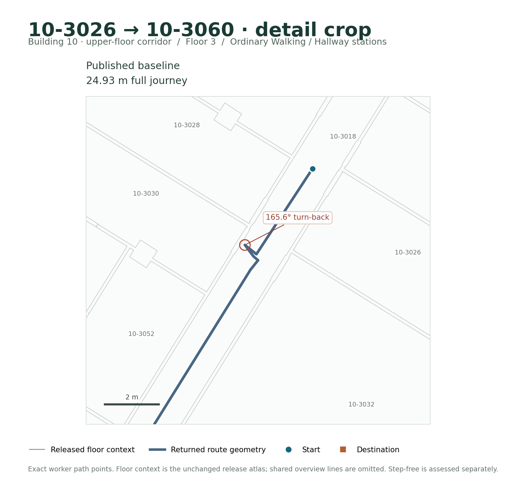
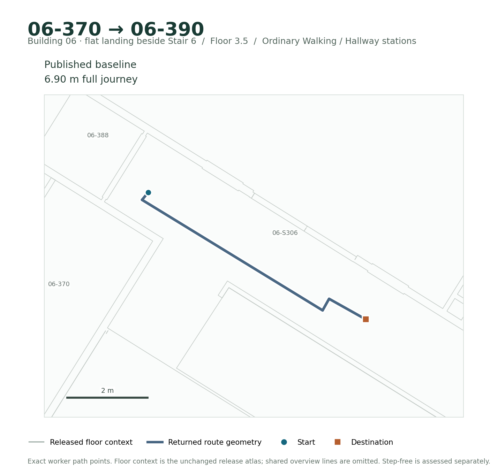
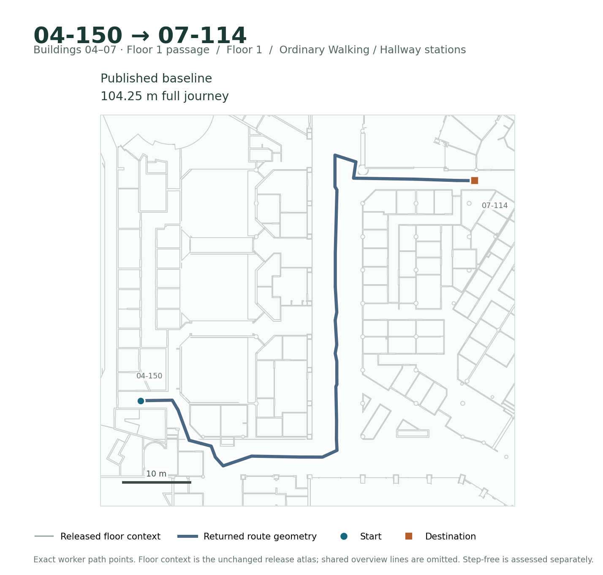
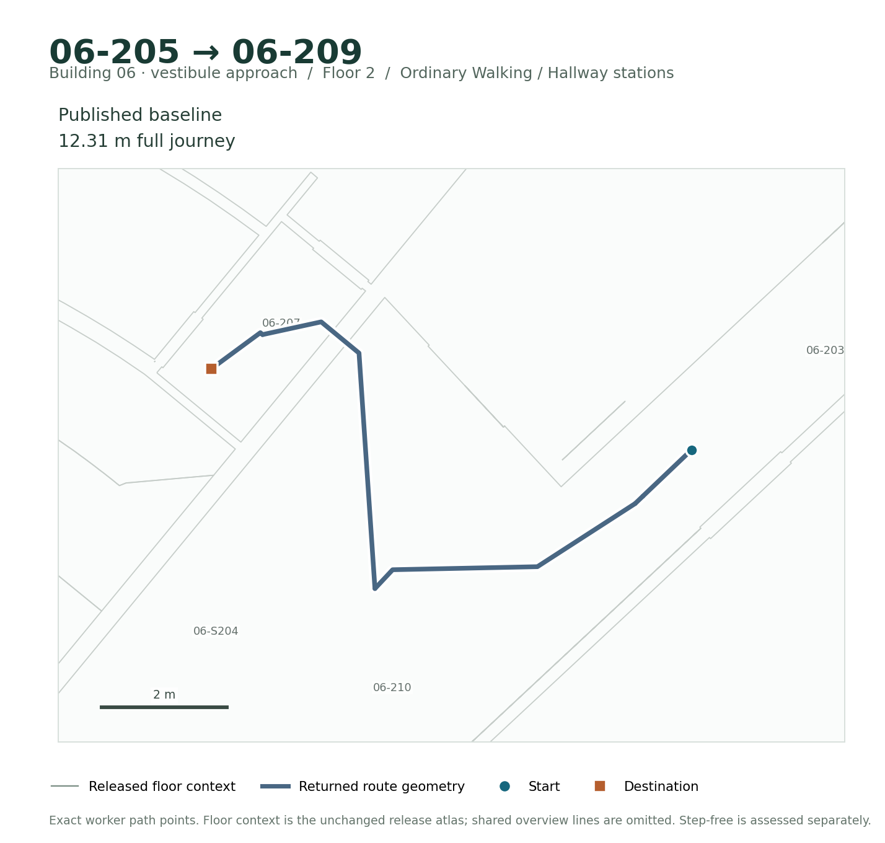
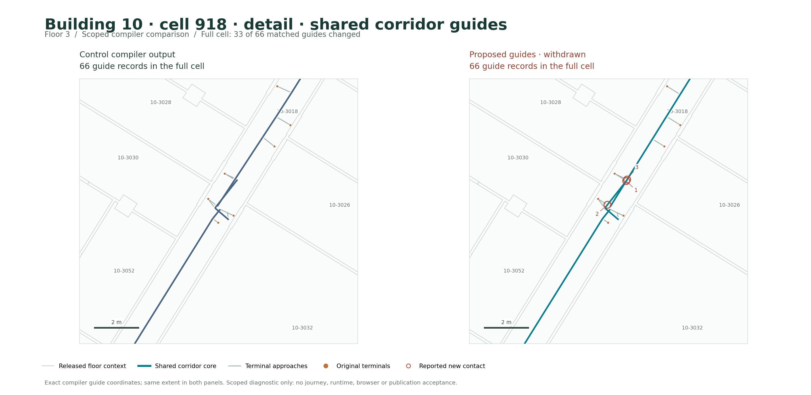
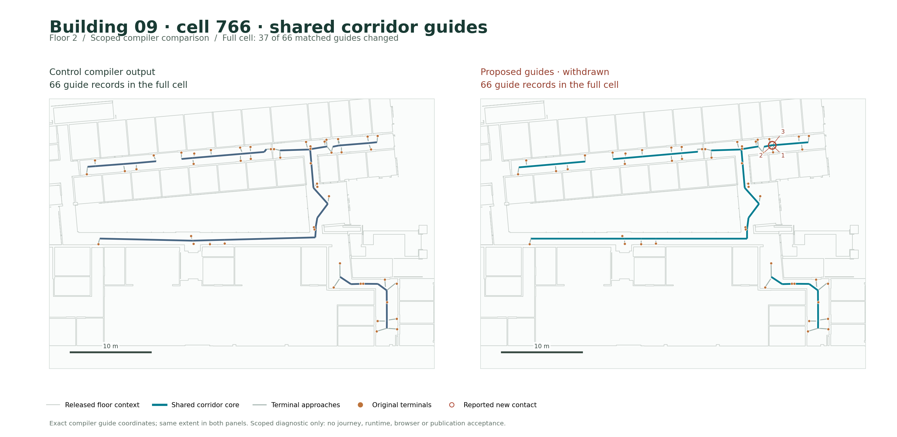

# UNBC recorded walking paths

These figures plot the exact worker path points preserved in the released
handoff against the matching atlas floor outlines. They show the **published
baseline** and retain its route shape, including awkward turns. No path has been
smoothed or fitted for presentation. The shared overview network is omitted.

The endpoint mode in all four records is `pathway`: the start circle and
destination square are **hallway stations** associated with the selected room
labels. The displayed distance is the full recorded journey, even in a crop.

| Recorded journey | Physical floor | Distance | What the figure shows |
| --- | --- | ---: | --- |
| 10-3026 → 10-3060 | Floor 3 (`400176`) | 24.93 m | Detail of the 165.6° turn-back in the upper corridor; destination falls outside this crop. |
| 06-370 → 06-390 | Floor 3.5 (`1487353`) | 6.90 m | Flat landing beside Stair 6; this is not a stair flight. |
| 04-150 → 07-114 | Floor 1 (`311`) | 104.25 m | A longer passage between Buildings 04 and 07. |
| 06-205 → 06-209 | Floor 2 (`694`) | 12.31 m | The recorded Building 06 vestibule approach. |

The floor names are the labels in the released atlas. The figures are scientific
plots, not newly captured browser screenshots. They do not establish native-model
enclosure, step-free accessibility, physical-device behavior, a candidate route
improvement, or a newly published visitor package.

## Images

### Building 10 corridor detail



### Flat landing beside Stair 6



### Buildings 04–07 passage



### Building 06 vestibule approach



## Reproduce

The [figure receipt](baseline-route-figures.json) records source, runtime,
dataset, renderer and image hashes, exact distances, displayed extents and turn
measurements. Restore the atlas and continuation kit from the
[release handoff](https://drive.google.com/drive/folders/1PdyETAWsVOPcPPC-RAOUSaJmqXEh-rWU),
then run from the repository root with Python and Matplotlib:

```sh
python tools/unbc-atlas/render-route-review.py \
  --atlas /path/to/baseline/campus-network.html \
  --before /path/to/unbc-continuation/evidence/current/browser-measurements.json.gz \
  --output /path/to/route-review-baseline
```

This generates six figures and a complete receipt. The four images above are the
selected review set. The renderer verifies that the measurements reference the
same source dataset as the atlas before drawing them.

## Scoped compiler diagnostics: both proposals withdrawn

The next two comparisons show actual local compiler outputs from the preserved
source data. The left panels are freshly computed control guides. The right
panels are the straight-run proposals, with new exact cross-network contacts
marked in red. **The guard withdrew both proposals and retained the control
guides unchanged.** These figures do not establish a new accepted journey or fix
the baseline route shown above.

| Diagnostic cell | Physical floor | Matched guides | Changed proposal guides | Core bends over 5°: control → proposal | New contacts | Guarded result |
| --- | --- | ---: | ---: | ---: | ---: | --- |
| Building 10, cell 918 | Floor 3 (`400176`) | 66 | 33 | 50 → 39 | 3 | Control retained |
| Building 09, cell 766 | Floor 2 (`694`) | 66 | 37 | 24 → 22 | 3 | Control retained |

Each cell proposal fitted five runs. Bend counts are sums over matched guide
paths; shared lanes can appear in several guides. They are not counts of unique
physical corridor bends. The Building 10 image is a fixed detail crop, while its
counts describe the complete cell. In Building 09, the three reported contacts
are different guide-pair contacts at one coordinate. Floor 2 is the native atlas
label for this physical level, even though the surrounding room labels begin
with `09-3`.

The diagnostic uses complete cached physical cell faces and conservatively
retained terminal demand. It does not run recovery passes, renew native doorway
admission, validate full journey policy, produce a visitor export, hydrate a new
runtime, or qualify a browser. The
[diagnostic receipt](../corridor-runs/diagnostic-receipt.json),
[verified export manifest](../corridor-runs/diagnostic-export-manifest.json),
and [diagnostic replay instructions](../corridor-runs/README.md) describe this
scope and preserve the underlying evidence.

### Building 10: withdrawn proposal near the recorded turn-back



[Building 10 figure receipt](building-10-withdrawn-proposal-detail.json)

### Building 09: withdrawn proposal across the corridor cell



[Building 09 figure receipt](building-09-withdrawn-proposal.json)

## Reproduce the diagnostic figures

The renderer validates both input files against the real producer receipt and
export manifest, including their byte hashes, source/context/cache/compiler
identities, roles, cell IDs and guide counts. It checks every guide endpoint
against the included unchanged original source edges, rejects duplicate IDs and
empty matched sets, and retains the exact producer-reported rational contact
locations in each figure receipt. Only their display coordinates are converted
for plotting. It does not alter or fit any guide points.

From the repository root, with Python and Matplotlib:

```sh
unbc_diagnostic_dir=docs/continuation/unbc-20261119/corridor-runs
unbc_figure_dir=docs/continuation/unbc-20261119/route-review

python tools/unbc-atlas/render-corridor-review.py \
  --atlas /path/to/baseline/campus-network.html \
  --before "$unbc_diagnostic_dir/native-cell_24.278215_918-control.json" \
  --after "$unbc_diagnostic_dir/native-cell_24.278215_918-proposed.json" \
  --after-role proposed \
  --producer-receipt "$unbc_diagnostic_dir/diagnostic-receipt.json" \
  --export-manifest "$unbc_diagnostic_dir/diagnostic-export-manifest.json" \
  --level 400176 --scope 'Building 10 · cell 918 · detail' --view b10-upper \
  --dataset-sha256 ecd8af21dd0d83740c5a3b5133298e52d88d71ce1c1db54c46e8642e853f66e3 \
  --output "$unbc_figure_dir/building-10-withdrawn-proposal-detail.png"

python tools/unbc-atlas/render-corridor-review.py \
  --atlas /path/to/baseline/campus-network.html \
  --before "$unbc_diagnostic_dir/native-cell_14.435696_766-control.json" \
  --after "$unbc_diagnostic_dir/native-cell_14.435696_766-proposed.json" \
  --after-role proposed \
  --producer-receipt "$unbc_diagnostic_dir/diagnostic-receipt.json" \
  --export-manifest "$unbc_diagnostic_dir/diagnostic-export-manifest.json" \
  --level 694 --scope 'Building 09 · cell 766' \
  --dataset-sha256 ecd8af21dd0d83740c5a3b5133298e52d88d71ce1c1db54c46e8642e853f66e3 \
  --output "$unbc_figure_dir/building-09-withdrawn-proposal.png"
```
