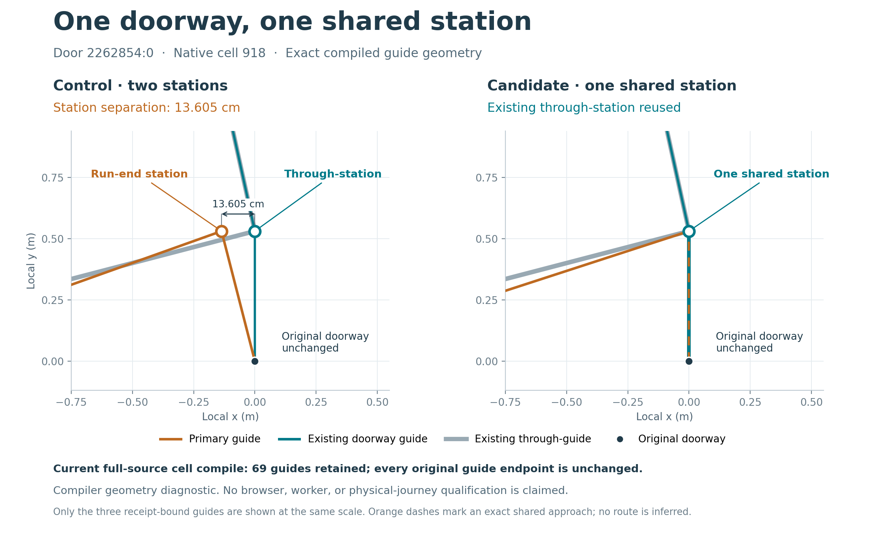

# UNBC doorway and package continuation — November 19, 2026

This checkpoint continues [draft PR #4](https://github.com/ahzs645/openindoormaps/pull/4). It repairs the duplicate station at one original Building 10 doorway and reduces avoidable package allocations. The complete physical-cell compiler, 174 focused tests, full repository TypeScript check, changed-file lint and scoped indoor Pages build pass. **Full normal package import, actual route-worker qualification and current publication assets remain incomplete. This is a recoverable development checkpoint, not an accepted release.**

The original master, model, geometry, room identities, access decisions and public carrier are preserved. Straight-run fitting remains off by default. The package does not promote the diagnostic catalogue or make unknown accessibility decisions positive.

## Exact source and input identity

The source is the Git commit containing this directory, following OpenIndoorMaps `86a8a9349a858c783c95c326be12cf66c3f56a87`, paired with unchanged Reviter `4a8fe6a8bd6b085e7725bb4ea18bb32d519e00a4`. The versioned Drive package records the final complete commit IDs and archive hashes. [Qualified source files](qualification/qualified-source-files.json) record the final source bytes without a circular reference to the commit containing that inventory.

| Input                                            |       Bytes | SHA-256                                                            |
| ------------------------------------------------ | ----------: | ------------------------------------------------------------------ |
| Original `UNBC.rotunda.reviter.zip`              | 247,419,905 | `8e397ddf461a5ec997269848091972a71a0e5231a5dd9c7a4d8407d285db4f52` |
| Complete `viewer/indoor.json` within that master | 302,032,680 | `28140a977977564e410af86585928533c43c2ea584f6a2530b2e4c3cb531b748` |

The [recovery guide](recovery/README.md) lists the original Drive parts, master-only restore command, source context, route projection and current accessibility evidence. Original historical browser results, source snapshots and rebuilt atlas remain baseline evidence; they are not fresh qualification of this continuation.

## 1. One original doorway now has one shared station

The prior geometry gave doorway `2262854:0` a primary endpoint and a retained through-station separated by 13.605 cm. The new generic recovery reuses the existing through-station only when both paths belong to the same original doorway, share the exact saved tail to the same other original terminal, and occupy the same checked cell and physical elevation.

The compiler replays all incident and receiving guides against physical and policy checks before accepting the junction. A private, live receipt limits authorized contacts to the exact original guide identities, station and approach. Serialized, copied, stale or forged receipt data cannot authorize a contact. The combined contact and missing-guide guard also runs when junction recovery is the only accepted modification.



This is a plot of the three exact fresh compiler guides in a common local coordinate frame. It is not a browser screenshot, a whole journey, or a physical campus validation. The figure's script, inputs and checksum receipt are saved beside it.

| Complete cell `native-cell:24.278215:918`    |   Control | Opt-in candidate |
| -------------------------------------------- | --------: | ---------------: |
| Eligible original edges / original terminals |   79 / 53 |          79 / 53 |
| Compiled guides                              |        69 |               69 |
| Original edges retaining fallback behavior   |        10 |               10 |
| Original first/last guide endpoints          | Preserved |        Preserved |
| Stations for doorway `2262854:0`             |         2 |                1 |
| Station separation                           | 13.605 cm |             0 cm |
| Core bends greater than 5 degrees            |        40 |               40 |
| Changed guides relative to control           |         — |                8 |
| Unapproved new contacts / missing guides     |         — |            0 / 0 |

Seven guide changes come from the previously checked doorway-branch adjustment. The new reconciliation changes one additional primary guide, `2262772:0 → 2262854:0`; the receiving through-guide remains byte-for-byte unchanged. All ten refusals remain unchanged. No original routing graph edge is added.

**There are three new raw geometric contacts within the three receipt-bound guides.** They are the explicitly replayed station/shared-approach contacts. “Zero unapproved contacts” is the accurate claim; “zero new contacts” is not. The [comparison](qualification/doorway-station-geometry-comparison.json) records the distinction and all eight changed guides.

The control catalogue SHA-256 is `283e947c94f516b8fa07e837c443b246d376e9be3d0f182040bfe5fdaafae2a2`; the candidate is `4aaa4b74810178432fd31ddd88bea07f0a7e07bc6043096b80d19341b8b49d98`. Both compiled the preserved full master with the same current compiler binding. This is complete-cell compiler evidence, not completion of the ordinary full package importer. **The recorded 165.6-degree turn-back on the actual `10-3026 ↔ 10-3060` journey still needs fresh calculator and production-worker replay.** A shared station alone does not establish that the full journey is fixed or shorter.

The reference's smooth shared spines remain a useful design direction. These results support common stations constrained by original connectivity; visual smoothness does not supply missing access, doorway, stair or lift evidence. This cell still has 40 core bends, so no campus-wide smoothing result is claimed.

## 2. Package memory work preserves normal checks

Archive companion hydration now keeps binary data in bytes instead of converting the complete member to base64 and back. Bounded chunk helpers avoid whole binary strings and iterable numeric arrays. Native SHA-256 receives the exact ordinary byte view without an unnecessary initial copy; shared buffers receive an explicit independent copy, including Node Buffer cases.

Prepared export compares parsed and derived plain JSON data without making two campus-sized strings. It preserves the required JSON semantics for ordering, omitted fields, sparse arrays, non-finite numbers and negative zero. Exotic objects, accessors, custom JSON behavior, cycles and other unsupported cases fall back to native serialization. This optimization is scoped to archive JSON, not arbitrary adversarial JavaScript Proxies.

Compressed and raw checksums, expansion limits, exact canonical recompression, file identities and metadata checks remain enforced. [Package correctness records](package-memory/execution.json) include a real small master/viewer prepared-export round trip. The [companion diagnostic archive](package-memory/companion-diagnostics.zip) preserves the three standalone profiles, instrumentation, summaries and unmerged task-yield proposal.

| Full preserved-master attempt                        | Result                            | Seconds |      Peak RSS |
| ---------------------------------------------------- | --------------------------------- | ------: | ------------: |
| Current production code                              | SIGKILL after entering companions |   53.53 | 3,020,844 KiB |
| Same code with diagnostic digest yield and forced GC | SIGKILL after entering geometry   |  102.16 | 3,021,476 KiB |

The diagnostic completed validation of all 890 companion files before entering geometry. At geometry entry it measured 3,001,499,648 bytes RSS. Stage messages indicate entry, not completion. Neither attempt completed normal import, export or journey replay. **Zero of the configured 96 cases ran through the current normal/worker qualification.**

The diagnostic preload changes scheduling and collection only, delegates the same native digest and does not relax package validation. It is not included in production source. A proposed production task yield remains archived and unmerged; yield-only memory behavior was not measured. These CLI profiles do not establish phone startup performance. The next full run needs a host with sufficient memory headroom or a separately qualified reduction in the geometry phase's allocations.

## 3. Verification and remaining limits

| Check                                                                  | Result and evidence                                                                                                                              |
| ---------------------------------------------------------------------- | ------------------------------------------------------------------------------------------------------------------------------------------------ |
| Focused routing, contact, recovery, transport, input and package tests | **174 passed**, no failures, cancellations or skips; [command](qualification/focused-suite-command.json), [log](qualification/focused-tests.log) |
| Whole repository TypeScript                                            | **Passed** after two test-only typing corrections; [record](qualification/whole-repository-types-corrected-tests.json)                           |
| ESLint for the 18 continuation-changed TS/TSX files                    | **Passed**, zero errors and one existing import warning; [record](qualification/changed-files-eslint.json). Not a whole-repository lint claim.   |
| Scoped indoor Pages build                                              | **Passed**, `SITE_DEMOS=indoor`, 19.63 seconds; [record](qualification/indoor-pages-build.json)                                                  |
| Default all-venue Pages build                                          | **Incomplete**, exit 137 at 3,019,848 KiB peak RSS; [record](qualification/final-all-venue-pages-build.json)                                     |
| Fresh complete-source physical-cell control / candidate                | **Passed**, 98.98 / 115.16 seconds; full binding and outputs in `qualification/`                                                                 |
| Normal package / actual production worker                              | **Blocked**; no completed import, candidate export or journey; [outcome](qualification/normal-package-worker-outcome.json)                       |
| Browser navigation and mobile view                                     | **Blocked before app load**, local preview connection refused; [record](browser-access.json)                                                     |
| Current floor, routing-cache and plan admission                        | **Outstanding**; fresh consumer identities require new validation                                                                                |
| Physical phone and campus acceptance                                   | **Outstanding**                                                                                                                                  |

The rejected GeoJSON build experiment is retained under `build-experiment/` for reproducibility. Its production changes were reverted before the final all-venue and scoped builds. It is not an enabled build workaround.

[Current preparation, route and plan bindings](qualification/bindings.json) are respectively `39e85d00…`, `5276c47e…` and `a35f8eee…`. Existing compiled publication receipts are stale under these consumers, even while fitting defaults to off. The original public carrier and historical receipts have not been renamed or relabelled as current. Follow [runtime qualification](../runtime-qualification.md) for independently generated current floors, hydration, plans and real publication checks.

## 4. Resume from the complete saved source

Download the real `continuation-manifest.json`, `restore-continuation.py` and all named source archive parts from the [versioned continuation folder](https://drive.google.com/drive/folders/11NKlb2hmHC2S7cwb-Nbcp8k1xDgX1rxq). The manifest is generated from the final committed source. The example manifest in `handoff-tools/` is deliberately invalid and must not be used for restoration.

With Python 3.12 or later, run the helper on a filesystem preserving Unix permissions:

```sh
python3 /absolute/path/downloads/restore-continuation.py restore \
  --manifest /absolute/path/downloads/continuation-manifest.json \
  --parts-dir /absolute/path/downloads \
  --destination /absolute/path/work/unbc-continuation
```

The destination must be absent or empty. The helper checks all parts, assembled archive hashes, Git PAX commit identities, paths, file hashes and permissions. It restores sibling `openindoormaps/` and `reviter/` source directories. Source archives contain complete tracked source, not Git history, installed dependencies or a newly accepted model/viewer. Original master/viewer inputs remain in the [original Drive folder](https://drive.google.com/drive/folders/1PdyETAWsVOPcPPC-RAOUSaJmqXEh-rWU); use the exact recovery guide.

Run `npm ci` in the OpenIndoorMaps directory using a supported Node version. These runs used Node `v24.22.3`. Use the full preserved master and a new output directory. From OpenIndoorMaps, set paths explicitly and compile:

```sh
UNBC_MASTER=/absolute/path/UNBC.rotunda.reviter.zip
UNBC_OUTPUT=/absolute/path/new-qualification
UNBC_EVIDENCE=docs/continuation/unbc-20261119/station-package-followup

node --max-old-space-size=1400 --expose-gc --import tsx \
  scripts/indoor/compile-corridor-candidates.ts "$UNBC_MASTER" \
  "$UNBC_OUTPUT/control" --cell native-cell:24.278215:918
node --max-old-space-size=1400 --expose-gc --import tsx \
  scripts/indoor/compile-corridor-candidates.ts "$UNBC_MASTER" \
  "$UNBC_OUTPUT/candidate" --cell native-cell:24.278215:918 --straight-runs
```

Then run normal qualification with sufficient physical memory. The following reproduces the attempted command; its 1,400 MiB V8 heap setting does not cap external/native allocations or promise success on another host:

```sh
node --max-old-space-size=1400 --expose-gc --import tsx \
  scripts/indoor/verify-shared-corridor-candidate.ts "$UNBC_MASTER" \
  "$UNBC_OUTPUT/candidate/prepared-routing.json" \
  "$UNBC_EVIDENCE/cases/cases.json" "$UNBC_OUTPUT/normal-worker" \
  --connection-inventory "$UNBC_EVIDENCE/cases/inventory.json"
```

The 96 preserved cases contain 48 expected ordinary public routes and 48 expected accessible refusals. They are prepared expectations, not 96 accepted routes or positive accessible examples. [Additional guide coverage proposals](recovery/changed-guide-proposals.json) remain unmeasured. Keep corridor departure-only pathway rules distinct from `inside` audits rather than inventing reverse pathway successes.

## 5. The seven-step finish order now

| Order                                    | Current position                                                                         | Evidence still needed                                                                                                                                                   |
| ---------------------------------------- | ---------------------------------------------------------------------------------------- | ----------------------------------------------------------------------------------------------------------------------------------------------------------------------- |
| 1. Cache delivery and navigation cleanup | Source fixes and focused regressions retained                                            | Current admitted assets delivered at the real deployment root; navigation/Back/Forward/reload in the actual built app                                                   |
| 2. First-use costs                       | Avoidable allocations reduced; normal import bottleneck localized through geometry entry | Full normal import and isolated cold/warm startup within the retained target, then physical phone confirmation                                                          |
| 3. Positive step-free journeys           | Source evidence reviewed; candidate ramps listed separately                              | Verified positive same-floor, ramp and lift journeys plus preserved intentional refusals; nine lift reviews still leave 43 enabled transfer edges accessibility-unknown |
| 4. Stair, landing and doorway holds      | One duplicate doorway station reconciled and compiler-checked                            | Actual `10-3026 ↔ 10-3060` replay, remaining guide coverage, and complete approach–connection–exit journeys for each relevant direction/profile                        |
| 5. Release and acceptance record         | Exact inputs, source hashes, diagnostics, commands and recoverable source prepared       | Complete normal package, worker and current floor/cache/plan admission, followed by final paired visitor/source development package                                     |
| 6. Phone and campus acceptance           | Not completed here                                                                       | Launch, search, routing, floor changes, reload, offline behavior and required physical journeys on intended devices and campus                                          |
| 7. Reviewer handoff                      | Versioned continuation folder and restore tooling prepared                               | Final accepted launch/package and intended teammate access; current Drive access is owner-only                                                                          |

The saved evidence distinguishes unknown source accessibility from a physical finding that a campus journey is impossible. Do not change lift or ramp flags merely to obtain a positive test. The [preserved lift review](recovery/preserved-lift-source-review.json) and [accessibility prospects](recovery/accessibility-prospects.json) show exactly which source decisions and complete journeys remain open.

The PR remains draft. A successful source restoration protects the work; it does not grant release acceptance. The final versioned Drive save record supplies publication, complete source restore and raw-download checksum evidence for the saved checkpoint.
